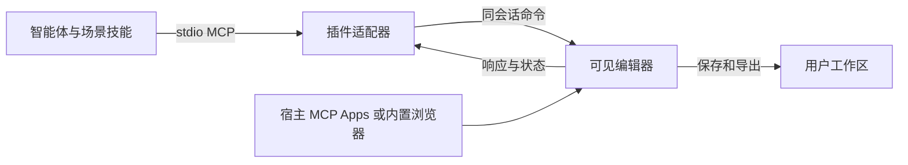

# Craft 同会话编辑器

13 个独立插件均通过 stdio MCP 提供工具和场景技能。10 个应用使用固定 fork 源码构建的增强 WASM，EffectCraft、FilmCraft、LightCraft 使用官方 Web API。Agent 命令进入用户正在查看的编辑器实例，保存和导出来自同一份状态。

源码仓库和提交由各包 ui/source.lock.json 固定，第三方代码及图标保留来源与许可。官方原始发行物保持只读，构建补丁应用于独立副本。增强运行时只接受兼容的自有发行更新；下载失败或不兼容时使用内置包。官方 Web API 应用使用对应官方发行更新。更新不切换活动会话。

目前按 [便携插件安装](craft-portable-installation.md) 使用。原有验证属于各自测试版本，不用于证明本轮新包已经原生安装。
