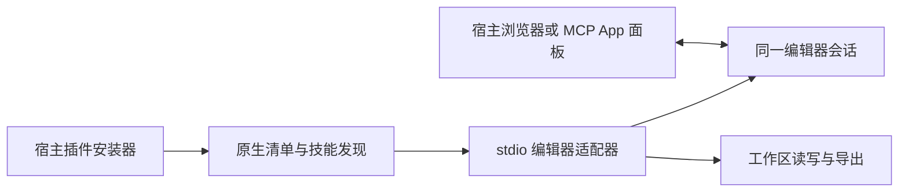

# Craft Use：三个宿主的本地候选安装

适用 13 个插件：CADCraft、DesignCraft、EffectCraft、PhotoCraft、FigCraft、FilmCraft、LightCraft、PdfCraft（包名 printcraft）、VectorCraft、DeckCraft、SoundCraft、GridCraft、WordCraft。

每个包保留 Agent Plugins 1.0.0 的根 `plugin.json`、`mcp.json` 和独立 `skills/`；原生清单只是适配层。所有清单使用主体版本号。官方图标、`xxCraft Use` 名称和编辑器运行包保持独立于宿主品牌。

需要 Node.js 24+。完整候选包含编辑器资源；直接克隆开发源码不等于已取得完整运行包。

| 宿主 | 原生入口 | 安装方法 |
| --- | --- | --- |
| Codex | `.codex-plugin/plugin.json`、专属相对路径 MCP 配置 | `codex plugin marketplace add "<市场目录>"`，然后 `codex plugin add photocraft@craft-use-local` |
| ZCode | `.zcode-plugin/plugin.json`、共享 `.mcp.json` | `zcode plugins marketplace add "<市场目录>"`，然后 `zcode plugins install photocraft@craft-use-local` |
| Kimi | `kimi.plugin.json` 内联 MCP，`cwd: "./"` | 会话内 `/plugins install <市场目录>/plugins/photocraft-plugin`；随后新建会话或重连 MCP |

将示例中的 photocraft 换成其他包名即可。市场与包内配置可搬迁，不含开发者本机路径。Kimi 的 `kimi.marketplace.json` 是 version 2 索引；客户端配置市场来源后可按其插件菜单安装。上述命令已对应当前本机宿主验证，桌面分发可能不把 CLI 加入 PATH。

`hosts/native-cli/mcp.json` 是 CADCraft、DeckCraft 的可选外部 CLI 配置，不默认启用；编辑器 MCP 已随包提供。这样首次安装无需先安装另一套 CLI。

调用 `open_browser_editor` 时明确提供任务 `workspace`。返回的地址由宿主内置浏览器打开；支持 MCP Apps 的宿主也可读取 `ui://…/panel.html`。stdio 负责工具通信，不自动提供桌面面板。真实安装、工具调用、页面可访问和桌面内嵌操作属于不同验收层级，参见本次验证报告。

Kimi 的原生二进制将 `node` 命令转换为自身的 Node 兼容入口。适配器启动编辑器子进程必须使用 `node`，不能把 `process.execPath` 当成 Node 可执行文件；该问题已通过 Kimi 原生连接与安装后包调用回归。

本地候选未发布到公共市场，未提交或推送。测试安装不替代用户正式安装。

2026-10-16 真实宿主补验：Codex 内置浏览器与 ZCode MCP App 侧栏已观察到 13 个编辑器的操作变化；Kimi 0.43.1 Web 会话只能返回编辑器 URL，未加载内嵌页面，仍为 attached:false。安装支持不等于内嵌支持。具体边界见 [真实宿主验收](craft-live-host-acceptance.md)。最新本地候选位于 `.local/Craft Recovered Final Market/`。
