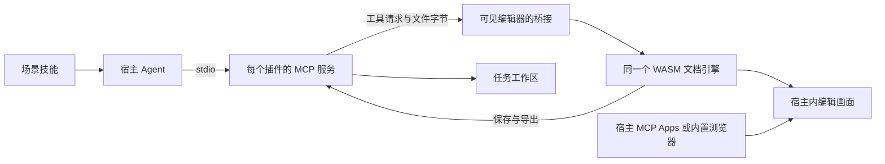

# Craft 源码增强接入

目标为 13 个独立插件；PdfCraft 保留 printcraft 的包 ID，PrintCraft 为别名。所有插件 MCP 使用 stdio。官方 Web 有命令 API 时直接接入；缺少接口时参考 ZCode 在锁定源码上增加 UI 线程桥接，构建我们自己的 WASM。

源码构建使用 `ui/source.lock.json` 的仓库和完整提交，适配代码在 `ui/runtime/`，构建入口为 `ui/build-source.py`。生成目录与原始源码检出分开；原检出及现有会话不被覆盖。`BUILD.json`、许可文本和工具目录跟随产物。

13 个源码 fork 已建立。10 款增强编辑器的构建锁均指向 full-aigc-plugins 自有 fork，并保留此前验证的提交；三款已有公开 Web API 的应用继续使用官方完整 Web 制品。6 个新增 fork 已确认包含对应固定提交。本轮不升级源码提交、不重编译或替换活动编辑器。现有运行时 BUILD.json 保留真实构建时的来源，不能把来源配置切换写成重新编译。

增强运行时更新查询对应 `full-aigc-plugins/*-plugin` Release。要求 `APP-editor-VERSION.zip`、`editor/` 根目录、GitHub 资产 SHA-256、完整 WASM/JS/服务/面板与兼容工具 schema。原版 Web ZIP 不会混入增强运行时。没有兼容发行时使用内置版本；不在活动工程中热替换。

MCP Apps 面板与内置浏览器是两种呈现路径。Codex Desktop 可用其内置浏览器；ZCode 使用 MCP Apps 适配。WorkBuddy 配置生成器只负责 stdio 注册，能否内部打开取决于实际客户端是否提供 MCP Apps 或内置页面能力。仅支持 MCP 协议并不自动获得 UI。

所有候选仍是本地未发布状态。静态清单、源码构建、stdio 浏览器回归和目标宿主安装验收分别记录；不能据此宣称所有宿主已安装可用。

## 当前交付（2026-10-16）

共 **13 个独立本地候选插件、本次配套 91 个候选技能（13 个编辑器入口 + 78 个领域场景），保留各包既有技能**。每个插件使用对应官方图标，显示名为 `xxCraft Use`。分发包内包含 stdio 服务、页面、完整运行时、技能、宿主配置与来源/许可证；运行需要 Node.js 24+，不需要从 ZCode 缓存取文件。

| 插件 | 引擎版本与集成 | 本次实际主线 |
| --- | --- | --- |
| CADCraft Use | 0.7.0 源码增强 | 绘图、DXF 保存重开、渲染 |
| DesignCraft Use | 0.8.0 fork 源码增强 | 文本框、工程保存重开、渲染 |
| EffectCraft Use | 官方 Web 0.10.0 | 合成文字、保存重开并核对内容 |
| PhotoCraft Use | 0.9.0 fork 源码增强 | 图层、工程保存重开、PNG 与图层导出 |
| FigCraft Use | 0.6.0 源码增强 | 画板/文字、工程保存重开、PNG、刷新重连 |
| FilmCraft Use | 官方 Web 0.8.0 | 序列文字、保存重开并核对内容 |
| LightCraft Use | 官方 Web 0.8.0 | 图库检查、备份 ZIP 写回 |
| PdfCraft Use（printcraft） | 0.8.0 fork 源码增强 | PDF 创建、保存重开、渲染、打印输出 |
| VectorCraft Use | 0.11.0 fork 源码增强 | 矩形、工程保存重开、截图 |
| DeckCraft Use | 0.7.0 源码增强 | 幻灯片编辑、PPTX 保存重开 |
| SoundCraft Use | 0.7.0 源码增强 | WAV 导入、混音导出、工程保存重开 |
| GridCraft Use | 0.7.0 源码增强 | 单元格编辑、撤销重做、XLSX 保存重开 |
| WordCraft Use | 0.7.0 源码增强 | 文字编辑、DOCX 保存重开、渲染 |

十款增强版已实际源码编译并通过 stdio + Chrome 主线。Effect/Film/Light 复用本任务之前已验证的同版本官方 Web 制品。LightCraft 的导入、恢复仍未验收，不能把图库备份称为完整项目往返。详情见 [当前源码与测试记录](craft-source-tests.json)。

本次修正了新版引擎的 Web 文件边界：CAD 的路径打开入口；Design 的读取与真正落盘；Deck 的路径读写；Sound 的浏览器文件类型检查和目录保留。十款的 `prepare-automation.py` 均从干净锁定源码重新应用，并与实际编译的 Rust/TOML 文件一致。`runtime/patches` 的历史补丁只在 `source.lock.json` 明确列出时应用，避免自动带入旧版本或品牌改动。

## 本机可审查产物

- 插件 ZIP 与 SHA-256：`.local/craft-editor-candidates-zcode/index.json`。
- 独立解压后的完整插件：`.local/craft-zcode-verified/<name>-plugin/`。
- 本机配置：`.local/craft-zcode-host-configs/codex.toml`、`workbuddy.json`。
- 配置只生成到交付目录，未改宿主全局设置。需要其他任务目录时用 `scripts/configure-craft-host.py` 或每个包的 `scripts/configure_editor_host.py` 重新生成。

各仓 `ui/editor.lock.json` 已锁定新的增强制品；开发目录中既有 `ui/dist` 保留以保护已打开会话。**使用本次新版时应从上述独立解压目录启动**。不要用保留的开发缓存判断新包版本，也不要热替换活动会话。

## 验证边界

Codex 内置浏览器已实际显示 PhotoCraft 和 FigCraft。FigCraft 已实际通过 stdio 创建中英文内容、保存工程并导出 PNG，修复了缺失字体导致文本宽度为 1、画布不显示的问题。MCP Apps 资源和 ZCode/Codex 清单已实现；ZCode、WorkBuddy 的安装及原生面板验收尚未执行。只有 stdio MCP 的客户端不会自动获得内部 UI，宿主必须提供 MCP Apps 或内置浏览器。

78 个场景技能是操作方法、决策与验收步骤，不等于内置了 78 种算法，也不代表所有最终作品质量已经验证。老照片修复技能已包含分区诊断、修复顺序、工具能力检查、人物特征保护和源工程交付；生成式补全、人脸重建等能力仍以实际工具为准。

当前 PhotoCraft 源码构建采用默认 features，未启用可选 HEIF/HEIC 解码器；七款字体依赖编辑器已嵌入锁定的 Inter、BIZ UDPGothic 和 LXGW WenKai，保留 OFL；FigCraft 中英文已实测显示和导出。更复杂的中文排版、字体、RAW、长音视频、OCR、脱敏和复杂版式需要相应真实素材验收。本轮没有提交、推送、发布、全局安装或运行远端 CI。

规格已同步至 `openspec/specs/craft-editor-scenes/spec.md`，变更已归档为 `2026-10-16-add-craft-editor-scenes`。13 个最终包合计约 450.9 MiB，独立解压包含 173 个技能文件（其中本次候选 91 个）。13 个包的 stdio 启动、MCP Apps 资源读取与页面服务全部通过；配置仅生成，未全局安装。

## 最终接入决定

按用户确认，采用 ZCode 同会话模式：stdio 接收命令，桥接驱动可见编辑器，保存与导出来自同一工程。必要的自动化补丁在独立构建副本应用，官方原始检出和发行包保持不变；自有源码 fork、桥接及许可归属明确。原生 CLI 可以独立使用，但不能把它的另一份会话冒充当前可见文档。源码 fork 不代表具备所有宿主 UI 能力，目标宿主仍分别验收。
