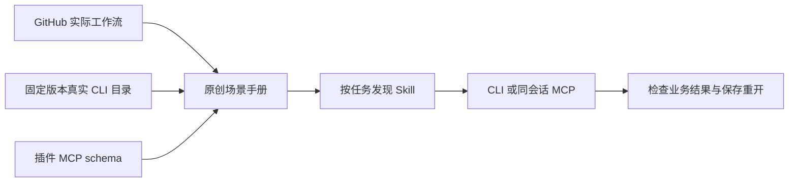

# 设计

每应用使用场景入口技能按任务选择具体手册，避免把数百条无关命令一次加载。手册给出业务目标、输入、处理顺序、实际 command ID、参数例子、MCP 包装方式、CLI 会话方式和检查方法。共享内容仅放在同一技能内部，技能可独立安装。

GitHub 来源记录 commit、路径、许可与借鉴点。命令目录记录运行版本；宿主编辑器与独立 CLI 可能版本不同，先查实际方法再套用参数。实际业务验证与文字/schema 检查分开。
