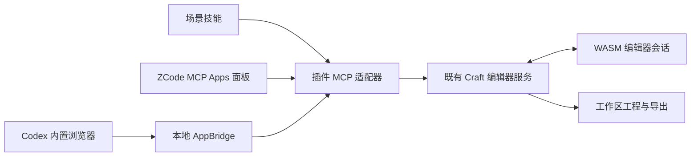

# 接入设计

MCP Apps 模式保留 ZCode 的 panel 资源和工具元数据。Codex 可使用自己的浏览器面板加载本地 AppBridge 页面；该页面与 Agent 连接同一个编辑器 MCP 服务，因此操作与画面共享状态。此模式单独称为“宿主浏览器接入”，不声称 Codex 原生 Apps 面板验收。

保留原生 CLI 的独立使用方式。场景开始时选择后端，不能把原生 CLI 修改的另一份会话误认为浏览器中的文档。打开界面和编辑成功分别检查。

开发依赖限项目目录。增强制品由锁定的 fork/上游源码生成，ZCode 仅提供桥接实现参考，适配代码保留许可与修改说明；不把开发者缓存路径写入可分发配置。包包含完整运行时和来源许可证。

新技能提供判断、步骤、参数选择、视觉或语义检查与交付要求；先查询实际工具能力，不能把 Photoshop Neural Filters 等功能名称直接映射为不存在的命令。

更新策略：宿主 MCP 保持 stdio；本地 HTTP 仅服务编辑器页面及桥接。首次打开从对应 full-aigc-plugins/*-plugin Release 读取十款兼容增强包，从 GitHub Releases 读取三款官方 Web 包；校验来源、摘要、压缩包路径和接口。缓存以包摘要隔离，不修改内置版本；失败直接回退内置。进程内版本固定，避免活动会话切换。默认元数据超时 5 秒、归档下载超时 45 秒；CRAFT_EDITOR_UPDATE=off 可离线启动。

## 2026-10-16 源码增强决定

用户确认参考 ZCode 模式，使用 full-aigc-plugins 源码 forks。原版 Web 缺少控制接口时，在提取的固定提交上应用自动化与文件桥接，构建独立增强发行包。插件的 stdio MCP 将操作交给可见 WASM 的 UI 线程。源码原检出、既有发行快照和未提交成果保留。FigCraft 新增该桥接；官方 0.6.0 原版页面缺少文件 Services，不作为功能等价替代。

更新源为对应 full-aigc-plugins/*-plugin Release 的完整 enhanced 包；未发布时回退内置并报告原因。支持 MCP 不自动代表支持 UI；MCP Apps 和宿主内置浏览器分别验收。

七款依赖外部字体数据库的源码构建使用 `fonts.lock.json` 锁定下载与摘要，嵌入 Inter、BIZ UDPGothic、LXGW WenKai 并保留 OFL。FigCraft 回归检查真实文字尺寸和实际中英文 PNG，避免只验证文档文字存在。
