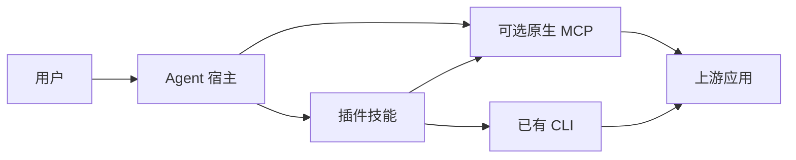

# Design: Craft 插件基础包

2026-10-16 用户补充 Windows 安装验证：目录仓 CI 使用真实 Windows runner，校验固定摘要的完整分发 ZIP，在中文与空格路径下通过原生 Codex 安装器和 app-server 调用插件 MCP。缺少运行资源即失败，不以源码包或模拟 MCP 返回代替。安装与 MCP 验证不等于 Windows 桌面内嵌或编辑同步验收。实现位于 `scripts/ci/`，不增加插件运行时职责。

Agent Plugins 1.0.0 的可移植包使用根 `plugin.json`，并从固定位置发现可选的 `skills/` 与 `mcp.json`。这十个产品选择至少一个领域技能作为用户入口；这属于本项目的产品决定，不是规范对所有插件的强制要求。命令和钩子只在目标客户端支持且确有用途时加入客户端扩展。

插件只包装入口、操作知识、必要配置和来源说明。上游 CLI/MCP 拥有真实命令、参数与文档操作，宿主拥有 Agent 的规划、权限、工具调用和 MCP 进程。插件不能凭技能文字保证 Agent 一定遵循路线；强制性的工具边界需要宿主权限机制或上游 API 检查。本变更不定义 Harness。已存在的 Harness 代码和高级任务保留，另行评估实际调用者和价值，不作为基础包依赖。

基础包按四层验收：① manifest 与包内路径；② 单技能独立安装及可发现性；③ 指定宿主实际加载；④ 对当前上游的一次真实调用。某层未跑就记录 NOT_RUN，不拖住较低层的结论。CLI 缺失、未安装宿主或目标平台不可用时，准确记录前置条件，不增加模拟执行器。创作质量、全部命令矩阵、恢复、预算、取消与多平台发行属于各仓独立需求，不计入这个基础交付。

DeckCraft 从本地 `deckcraft-skills` 复制一个 `deckcraft-use` 技能并配置已有 `deckcraft-cli mcp`。其余九仓保留当前组件，只修基础包缺陷。每仓已有长任务表继续记录高级能力，但不得用它们否定已经完成的基础包，也不得将基础包通过冒充高级能力验收。
