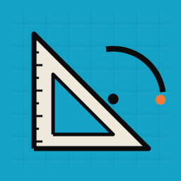
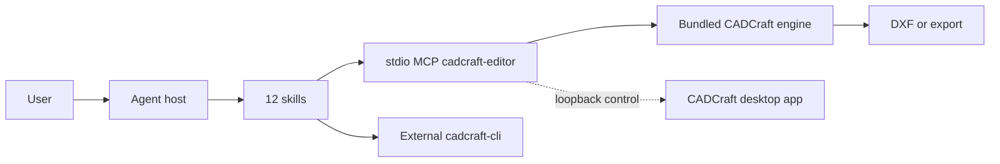

# CADCraft Use

## Plugin marketplaces

This plugin belongs to **AIGC content creation**.

| Category | Marketplace | Purpose |
| --- | --- | --- |
| Full-stack development | [Full Stack Plugins](https://github.com/partme-ai/full-stack-plugins) | Architecture and UI design, code understanding, quality checks, code review, workflow governance, and server operations |
| AIGC content creation | [Full AIGC Plugins](https://github.com/partme-ai/full-aigc-plugins) | Image, video, audio, music, 3D, and multimodal content creation |



> Draw, inspect, render, and save 2D CAD geometry through CADCraft's own command engine, with entity counts and a reopened DXF checked before delivery.

[](#positioning)
[](#skills)
[](#mcp-tools)
[](LICENSE)

[English](README.md) | [简体中文](README.zh-CN.md) · [Install](#installation) · [Quick start](#quick-start) · [Skills](#skills) · [MCP tools](#mcp-tools) · [Limits](#troubleshooting)

## Positioning

`cadcraft` lets an agent drive CADCraft's existing command registry instead of inventing a second CAD engine: start a drawing, run native commands, inspect entities, render the sheet, and save a DXF that reopens with the expected geometry. It packages twelve skills, a portable manifest, and one embedded editor server.

This is a development candidate. Production promotion is blocked, the current build is still pending public release, and GUI acceptance, desktop UI control, and external CAD compatibility remain separate open gates.

| Property | Value |
| --- | --- |
| Plugin ID | `cadcraft` |
| Display name | CADCraft Use |
| Version | `0.1.0-dev.20261018.4` |
| Stage | Installable development candidate, production promotion blocked |
| Native engine | CADCraft 0.3.0 command registry; editor build bundled, CLI external |
| Marketplace | `cadcraft-marketplace` |
| License | Apache-2.0 |

## Installation

### Prerequisites

- Codex is the host with recorded end-to-end evidence. Other hosts are not accepted.
- Node.js 24 or newer is required by the embedded editor. The distributed package contains the editor build; no Rust toolchain and no `npm install` are needed at runtime.
- Headless file tasks and the `cadcraft-cli` skill need an installed `cadcraft-cli` on the host. The plugin does not install it. Build or install it from the upstream CADCraft project, then check `cadcraft-cli --version` and `cadcraft-cli commands` in the host environment.
- The first Git-based launch needs network access or a verified editor cache. `CRAFT_EDITOR_UPDATE=off` uses bundled assets.
- `CADCRAFT_CLI` selects a binary only for `scripts/launch.py`; it does not change the editor entry in `mcp.json`.

### From the plugin marketplace

```bash
codex plugin marketplace add partme-ai/full-aigc-plugins
codex plugin add cadcraft@full-aigc-plugins
```

This candidate is still marked as pending public release, with `releaseStatus: BLOCKED`. To test the exact build, use the repository-local marketplace `cadcraft-marketplace`, pinned to `v0.1.0-dev.20261018.4`. Restart the host, open a new task, and ask for one small drawing before a full sheet.

## Quick start

1. Open the editor with an absolute workspace: “Open CADCraft for this folder and list the available commands.”
2. Query the live command registry before drawing. Do not treat a skill example as the complete schema; parameters and enabled state come from the installed version.
3. Run one bounded command, for example a circle at `[10,10]` with radius `4`, then inspect the drawing and confirm the expected entity count.
4. Save to a **new absolute** `.dxf` path, reopen that exact file, and inspect again. Agree on any overwrite before saving over an existing file.

```text
Draw: Create a 120 × 80 mm plate with four 6 mm holes on a 20 mm inset.
Inspect: List circles, lines, layers, and the handle of each new entity.
Bolt circle: Place six holes on a 60 mm pitch-circle diameter starting at 0°.
Export: Save the sheet to a new DXF, reopen it, and verify entity counts.
```

Direct runtime checks for the external CLI and the optional launcher:

```bash
cadcraft-cli --version
cadcraft-cli commands
python3 scripts/launch.py --doctor
```

## What you can build

| Workflow | Built-in path | Verifiable output |
|:---|:---|:---|
| Draw and inspect parts | `cadcraft-use`, `cadcraft-mcp` | Entity types, counts, handles, layers, and key coordinates |
| Parametric hole patterns | `cadcraft-bolt-circle` | Polar array from a real handle, hole count and pitch circle checked |
| Room plans | `cadcraft-floor-plan` | Room outline, openings, and wall geometry at stated dimensions |
| Dimensions and layers | `cadcraft-dimension-part`, `cadcraft-layer-cleanup` | Part dimensions, cleaned layers, linetypes, duplicates |
| Sheet output | `cadcraft-sheet-export` | Frame, paper, scale, and print output |
| Revision comparison | `cadcraft-compare-revisions` | Geometry and annotation differences between two drawings |
| Trace a reference | `cadcraft-trace-reference` | Two-axis calibration and a dimensioned vector outline |
| Scripted scenarios | `cadcraft-scenario-playbooks` | Eight recipes with real methods, parameters, and reopen checks |
| Visual editing | `cadcraft-editor` | Same-session UI plus a saved drawing file |

## Skills

### Entry and runtime

| Skill | What it does |
|---|---|
| `cadcraft-use` | Choose the CLI or MCP path and define what a verified drawing means |
| `cadcraft-cli` | Run headless file tasks with the installed `cadcraft-cli` |
| `cadcraft-mcp` | Drive interactive, JSON, query, and render tools over MCP, including failure checks |

### Drawing scenarios

| Skill | What it does |
|---|---|
| `cadcraft-bolt-circle` | Build an equal-angle bolt pattern from a real handle and polar array |
| `cadcraft-floor-plan` | Draw rooms, doors, and windows at given dimensions |
| `cadcraft-dimension-part` | Dimension a mechanical part profile, holes, and sizes |
| `cadcraft-layer-cleanup` | Clean layers, linetypes, and duplicate lines in a complex drawing |
| `cadcraft-sheet-export` | Produce a sheet with frame, paper, scale, and print output |
| `cadcraft-compare-revisions` | Compare geometry and annotations between two drawing versions |
| `cadcraft-trace-reference` | Rebuild a dimensioned outline from confirmed reference control points |

### Playbooks and editor

| Skill | What it does |
|---|---|
| `cadcraft-scenario-playbooks` | Eight scenarios covering plates, flanges, door openings, grids, routing, hole rows, notches, and title frames |
| `cadcraft-editor` | Open the real editor in an MCP Apps host or host browser and share one workspace session |

## MCP tools

`.codex-plugin/mcp.json` starts one stdio server, `cadcraft-editor`, from `ui/bootstrap.mjs`. The adapter adds three stable tools and passes through the bundled engine's command catalog.

| Tool | Purpose |
|---|---|
| `open_editor` | Default native design panel, registered as a conversation-side entrypoint; pass the absolute task `workspace` |
| `open_browser_editor` | Explicit browser fallback for the same session; normal editor opening does not require this tool |
| `editor_status` | Report whether the editor actually attached and is ready to accept commands |

The bundled catalog in `ui/catalog.lock.json` exposes `command_line`, `script`, `execute`, `list_commands`, `inspect_drawing`, `query_entities`, `render`, `new_drawing`, `open`, and `save`, plus UI tools when a desktop session is attached. `render` produces an image of drawing content, not a screenshot of an application window; `screenshot`, `ui_inspect`, and `ui_click` require a desktop control connection.

The default entry declares a thread entrypoint and a separate design surface. Tool metadata, resource metadata, and UI initialization all request `fullscreen`, which desktop hosts present as a separate conversation panel. `open_editor` does not return a browser URL. Wait for `editor_status({wait_ms:10000})` to return `state: "ready"`; use the browser fallback only when explicitly needed. Host rendering acceptance is recorded separately from metadata tests.

## Configuration

| Setting | Meaning |
|---|---|
| `${PLUGIN_ROOT}` | Expanded by the portable `plugin.json` and `mcp.json` |
| `${CLAUDE_PLUGIN_ROOT}` | Expanded by the Claude Code manifest and root `.mcp.json` |
| `CRAFT_EDITOR_UPDATE=off` | Use the bundled editor only and skip the update query |
| `CRAFT_EDITOR_CACHE_DIR` | Alternate absolute cache directory; default is `~/.cache/full-aigc/editors` |
| `CRAFT_WORKSPACE_ROOT` | Workspace root when the adapter is started directly |
| `CRAFT_PANEL_METADATA_FILE` | Host panel metadata used by the ZCode and Claude Code entries |
| `CADCRAFT_CLI` | Binary path for `scripts/launch.py --doctor` or its desktop mode only |

## Architecture and security



| Mode | Available tools | State boundary |
|---|---|---|
| Bundled editor over stdio MCP | Drawing commands, inspection, render, open/save | One drawing session per MCP process |
| Desktop control connection | Headless tools plus `screenshot`, `ui_inspect`, `ui_click` | State lives in the running CADCraft app |

- The plugin owns manifests, skill guidance, a source-commit and SHA-256 skill lock, validation scripts, and the editor bridge. The CAD command engine belongs to CADCraft.
- MCP runs over stdio. The editor page uses a loopback HTTP server with a random token and Host/Origin checks; workspace escapes are rejected.
- There is no plugin-side operation journal, command deduplication, transaction, or automatic rollback. A transport response is not an exactly-once guarantee.
- After a timeout on create, delete, or save, treat the outcome as unknown and inspect the drawing or the last saved file before acting again.
- Manual browser exports land in `craft-exports/` with new file names; closing the process ends the session.

## Troubleshooting

| Symptom | Cause | What to do |
|---|---|---|
| `cadcraft-cli` not found | The plugin does not install the external CLI | Install or build it upstream, then put it on the host `PATH` for file tasks |
| `screenshot` or `ui_inspect` missing | A headless session has no desktop UI tools | Start CADCraft with `--control PORT` and connect the launcher to loopback |
| A desktop write times out | The upstream remote backend may replay the request | Inspect the drawing or saved file first; never resend blindly |
| DWG export expected | Web does not support DWG | Deliver DXF, or convert in a desktop workflow that actually supports DWG |
| Dimension text looks wrong in the GUI | GUI dimension text has not passed acceptance | Check the rendered sheet and report the exact version; do not claim GUI text is verified |
| DXF opens here but not in another CAD app | External compatibility is unverified | Record the target application and its exact error; round-trip here is not external proof |
| The embedded panel never appears | The host does not render MCP Apps | Use the `open_browser_editor` URL; a text result is not a rendered panel |
| A hole pattern is treated as production-ready | The sample is a drawing exercise, not manufacturing design | Require an engineering review before fabrication |

## Upgrade

```bash
codex plugin marketplace upgrade full-aigc-plugins
codex plugin add cadcraft@full-aigc-plugins
```

The editor update is independent of the plugin version. `editor_status` reports whether the runtime came from a download, the cache, or bundled assets.

## Contributing and support

Open issues at <https://github.com/full-aigc-plugins/cadcraft-plugin/issues>. Include plugin, engine, and CLI versions, the mode (bundled editor, headless CLI, or desktop control), the command name and parameters, expected versus observed entity counts, and whether the saved file was reopened. Never attach private drawings without authorization.

## License

Apache-2.0. The three pinned upstream skills come from `full-aigc-skills/cadcraft-skills` and are locked by commit and per-file SHA-256; the CADCraft engine and CLI remain external. See [LICENSE](LICENSE) and [assets/official-icon-source.json](assets/official-icon-source.json).
