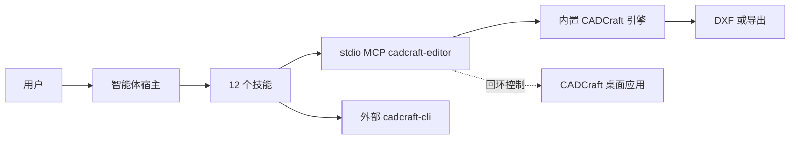

# CADCraft Use

## 插件市场导航

本插件所属分类：**AIGC 内容创作**。

| 分类 | 插件市场入口 | 用途 |
| --- | --- | --- |
| 全栈开发 | [Full Stack Plugins](https://github.com/partme-ai/full-stack-plugins) | 架构与 UI 设计、代码理解、质量检查、代码审查、流程治理与服务器运维 |
| AIGC 内容创作 | [Full AIGC Plugins](https://github.com/partme-ai/full-aigc-plugins) | 图像、视频、音频、音乐、3D 与多模态内容创作 |


> 通过 CADCraft 自己的命令引擎画图、查图、渲染并保存；交付前核对实体数量，再把 DXF 重开一遍。

[](#项目定位)
[](#技能)
[](#mcp-工具)
[](LICENSE)

[English](README.md) | [简体中文](README.zh-CN.md) · [安装](#安装) · [快速开始](#快速开始) · [技能](#技能) · [MCP 工具](#mcp-工具) · [限制](#故障排查)

## 项目定位

`cadcraft` 让智能体直接驱动 CADCraft 已有的命令注册表，而不是再造一个 CAD 引擎：新建图纸、执行原生命令、检查实体、渲染图面，最后保存一个重开后几何仍然正确的 DXF。它打包十二个技能、portable 清单和一个内嵌编辑器服务。

这是开发候选：生产发布仍被阻断，当前版本仍待公开发布，GUI 验收、桌面 UI 控制和外部 CAD 兼容性分别属于尚未关闭的门禁。

| 属性 | 值 |
| --- | --- |
| 插件 ID | `cadcraft` |
| 展示名 | CADCraft Use |
| 版本 | `0.1.0-dev.20261018.4` |
| 阶段 | 可安装的开发候选版本，生产发布仍被阻断 |
| 原生引擎 | CADCraft 0.3.0 命令注册表；编辑器构建内置，CLI 外部安装 |
| 市场名 | `cadcraft-marketplace` |
| 许可证 | Apache-2.0 |

## 安装

### 前置条件

- 只有 Codex 具备已记录的端到端证据，其他宿主尚未验收。
- 内嵌编辑器需要 Node.js 24 或更新版本。分发包已包含编辑器构建，运行时不要求 Rust 工具链，也不需要 `npm install`。
- 无窗口文件任务与 `cadcraft-cli` 技能需要宿主已安装 `cadcraft-cli`。本插件不负责安装；请按 CADCraft 上游说明构建或安装，然后在宿主环境中执行 `cadcraft-cli --version` 与 `cadcraft-cli commands`。
- 首次通过 Git 启动需要网络或已校验的编辑器缓存；`CRAFT_EDITOR_UPDATE=off` 可直接使用内置资源。
- `CADCRAFT_CLI` 只影响 `scripts/launch.py` 选择二进制，不改变 `mcp.json` 的编辑器入口。

### 从插件市场安装

```bash
codex plugin marketplace add partme-ai/full-aigc-plugins
codex plugin add cadcraft@full-aigc-plugins
```

当前候选仍标记为待公开发布，`releaseStatus: BLOCKED`。要测试这一确切构建，请使用仓库自带市场 `cadcraft-marketplace`，它固定到 `v0.1.0-dev.20261018.4`。安装后重启宿主、新建任务，先画一个小图再谈整张图纸。

## 快速开始

1. 用绝对工作区路径打开编辑器：“为这个目录打开 CADCraft，并列出可用命令。”
2. 画之前先查实时命令注册表。技能里的示例不是完整 Schema；参数与启用状态以已安装版本为准。
3. 只执行一条边界清楚的命令，例如圆心 `[10,10]`、半径 `4` 的圆，然后检查图纸并确认实体数量符合预期。
4. 保存到**新的绝对** `.dxf` 路径，重开该文件再检查一次。覆盖已有文件前先取得明确同意。

```text
绘图：画一块 120 × 80 mm 板，四角内缩 20 mm 处各开一个 6 mm 孔。
检查：列出圆、直线、图层以及每个新实体的句柄。
孔列：在 60 mm 节圆直径上从 0° 开始均布六个孔。
出图：另存为新 DXF，重开并核对实体数量。
```

外部 CLI 与可选启动器的直接检查：

```bash
cadcraft-cli --version
cadcraft-cli commands
python3 scripts/launch.py --doctor
```

## 可完成的工作

| 工作流 | 内置路径 | 可验证输出 |
|:---|:---|:---|
| 画图与查图 | `cadcraft-use`、`cadcraft-mcp` | 实体类型、数量、句柄、图层与关键坐标 |
| 参数化孔分布 | `cadcraft-bolt-circle` | 基于真实句柄的极轴阵列，孔数与节圆核对 |
| 房间平面图 | `cadcraft-floor-plan` | 按给定尺寸的墙体轮廓、门窗与几何 |
| 标注与图层 | `cadcraft-dimension-part`、`cadcraft-layer-cleanup` | 零件尺寸、清理后的图层、线型与重复线 |
| 图纸出图 | `cadcraft-sheet-export` | 图框、纸张、比例与打印输出 |
| 版本比对 | `cadcraft-compare-revisions` | 两版图纸的几何与标注差异 |
| 参考图描绘 | `cadcraft-trace-reference` | 两方向校准与带实际尺寸的矢量轮廓 |
| 场景化流程 | `cadcraft-scenario-playbooks` | 八条含真实方法、参数与重开检查的配方 |
| 可视化编辑 | `cadcraft-editor` | 同会话界面，以及已保存的图纸文件 |

## 技能

### 入口与运行时

| 技能 | 作用 |
|---|---|
| `cadcraft-use` | 选择 CLI 或 MCP 路径，并定义什么算验收过的图纸 |
| `cadcraft-cli` | 用已安装的 `cadcraft-cli` 执行无窗口文件任务 |
| `cadcraft-mcp` | 通过 MCP 执行交互命令、JSON 命令、查询与渲染，并处理失败后的核实 |

### 绘图场景

| 技能 | 作用 |
|---|---|
| `cadcraft-bolt-circle` | 从真实句柄建立等角螺栓孔极轴阵列 |
| `cadcraft-floor-plan` | 按给定尺寸绘制房间、门与窗 |
| `cadcraft-dimension-part` | 为机械零件轮廓、孔位与尺寸添加标注 |
| `cadcraft-layer-cleanup` | 清理复杂图纸的图层、线型与重复线 |
| `cadcraft-sheet-export` | 生成含图框、纸张、比例与打印输出的图纸 |
| `cadcraft-compare-revisions` | 对比两版图纸的几何与标注差异 |
| `cadcraft-trace-reference` | 依据已确认的参考控制点重建有尺寸的轮廓 |

### 手册与编辑器

| 技能 | 作用 |
|---|---|
| `cadcraft-scenario-playbooks` | 安装板、法兰、门洞、网格、路由、孔列、缺口与图框八条场景配方 |
| `cadcraft-editor` | 在 MCP Apps 宿主或宿主浏览器中打开真实编辑器，共享同一工作区会话 |

## MCP 工具

`.codex-plugin/mcp.json` 只启动一个 stdio 服务器 `cadcraft-editor`，入口是 `ui/bootstrap.mjs`。适配层新增三个稳定工具，并透传内置引擎的命令目录。

| 工具 | 用途 |
|---|---|
| `open_editor` | 按绝对 `workspace` 打开编辑器；首次调用完成工作区绑定 |
| `open_browser_editor` | 宿主带内置浏览器时，返回同一会话的 `editorUrl` |
| `editor_status` | 报告编辑器是否真的已附着、是否已就绪 |

内置目录记录在 `ui/catalog.lock.json`，提供 `command_line`、`script`、`execute`、`list_commands`、`inspect_drawing`、`query_entities`、`render`、`new_drawing`、`open` 与 `save`，连接桌面会话时另有界面工具。`render` 输出的是图纸内容图像，不是应用窗口截图；`screenshot`、`ui_inspect` 与 `ui_click` 需要桌面控制连接。

## 配置

| 配置项 | 含义 |
|---|---|
| `${PLUGIN_ROOT}` | 由 portable `plugin.json` 与 `mcp.json` 展开 |
| `${CLAUDE_PLUGIN_ROOT}` | 由 Claude Code 清单与根 `.mcp.json` 展开 |
| `CRAFT_EDITOR_UPDATE=off` | 只用内置编辑器，跳过更新查询 |
| `CRAFT_EDITOR_CACHE_DIR` | 改用其他绝对缓存目录；默认为 `~/.cache/full-aigc/editors` |
| `CRAFT_WORKSPACE_ROOT` | 直接启动适配层时的工作区根目录 |
| `CRAFT_PANEL_METADATA_FILE` | ZCode 与 Claude Code 入口使用的面板元数据 |
| `CADCRAFT_CLI` | 仅供 `scripts/launch.py --doctor` 或桌面模式选择二进制 |

## 架构与安全



| 模式 | 可用工具 | 状态边界 |
|---|---|---|
| 内置编辑器（stdio MCP） | 绘图命令、检查、渲染、打开/保存 | 每个 MCP 进程一份图纸会话 |
| 桌面控制连接 | 无窗口工具，外加 `screenshot`、`ui_inspect`、`ui_click` | 状态在运行中的 CADCraft 应用里 |

- 插件负责清单、技能指导、来源提交与逐文件 SHA-256 的技能锁、校验脚本和编辑器桥接；CAD 命令引擎归 CADCraft。
- MCP 走 stdio。编辑器页面使用回环 HTTP、随机令牌与 Host/Origin 校验，工作区外路径会被拒绝。
- 插件没有本地操作账本、命令去重、事务或自动回滚。传输层返回成功不等于 exactly-once。
- 创建、删除或保存超时后，把结果当作未知；先检查图纸或最后保存的文件，再决定是否重试。
- 浏览器手动导出落到 `craft-exports/`，使用新文件名；关闭进程即结束会话。

## 故障排查

| 现象 | 原因 | 处理 |
|---|---|---|
| 找不到 `cadcraft-cli` | 外部 CLI 不由插件安装 | 按上游安装或构建，并把文件任务所需的可执行文件放进宿主 `PATH` |
| 没有 `screenshot` 或 `ui_inspect` | 无窗口会话不提供桌面 UI 工具 | 用 `--control PORT` 启动 CADCraft，再把启动器接到回环地址 |
| 桌面写操作超时 | 上游远程后端可能重放请求 | 先检查图纸或已保存文件，绝不盲目重发 |
| 期望导出 DWG | Web 端不支持 DWG | 交付 DXF，或改用真正支持 DWG 的桌面流程 |
| GUI 里尺寸文字不对 | GUI 尺寸文字尚未通过验收 | 检查渲染图并报告确切版本，不要把 GUI 文字说成已验证 |
| DXF 在本机能开，别的 CAD 打不开 | 外部兼容性未验证 | 记录目标软件与其确切报错；本机往返不等于外部兼容 |
| 内嵌面板始终不出现 | 宿主不支持渲染 MCP Apps | 用 `open_browser_editor` 返回的地址；文字结果不等于面板已渲染 |
| 把孔分布图当成可制造设计 | 示例是绘图练习，不是制造设计 | 生产前必须经过工程评审 |

## 升级

```bash
codex plugin marketplace upgrade full-aigc-plugins
codex plugin add cadcraft@full-aigc-plugins
```

编辑器更新与插件版本相互独立。`editor_status` 会说明运行时来自下载、缓存还是内置资源。

## 贡献与支持

问题请提交到 <https://github.com/full-aigc-plugins/cadcraft-plugin/issues>。请附上插件、引擎与 CLI 版本，模式（内置编辑器、无窗口 CLI 或桌面控制），命令名与参数，预期与实际实体数量，以及保存文件是否重开核对。未经授权不要附上私有图纸。

## 许可证

Apache-2.0。三项固定上游技能来自 `full-aigc-skills/cadcraft-skills`，按提交与逐文件 SHA-256 锁定；CADCraft 引擎与 CLI 仍属外部组件。见 [LICENSE](LICENSE) 与 [assets/official-icon-source.json](assets/official-icon-source.json)。
