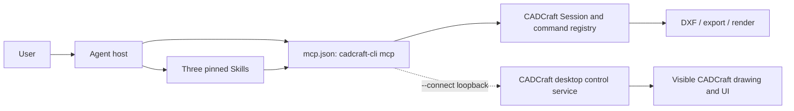
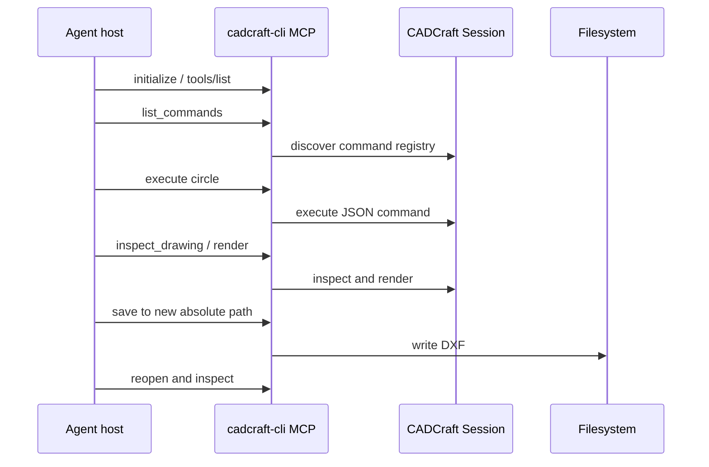

# CADCraft Plugin Architecture

[简体中文](CADCraft-Plugin-Architecture.zh_CN.md) · Current development package `0.1.0-dev.0` · Scope: this plugin, not the CADCraft engine.

## Decision and boundary

The plugin packages CADCraft's **existing** native MCP implementation instead of implementing another CAD command engine or proxy. `mcp.json` starts `cadcraft-cli mcp` directly. The optional Python launcher only discovers the binary, reports its version, validates a loopback desktop address, then replaces itself with the CLI process. The three skills are guidance; they are not an enforcement layer.

| Boundary | Owned here | Owned elsewhere |
| --- | --- | --- |
| Package | Portable and host manifests, MCP declaration, skill copies/lock, validators/tests | Host installation and lifecycle |
| CLI/MCP | No proxy; optional process launcher | Upstream command execution, protocol replies, file I/O, drawing state |
| Desktop | Loopback address validation in optional launcher | CADCraft app, control server, UI state |
| Files | Guidance to use distinct destination and reopen | Actual file contents and external CAD interpretation |

## Core flows

`execute` uses the command registry. `command_line` drives interactive prompts, and a normal tool envelope may still contain a command-level `error`. `render` is a drawing render, not a desktop screenshot. `screenshot`, `ui_inspect`, and `ui_click` are exposed only by a remote MCP instance connected to the CADCraft desktop control service.

## State and failure semantics

| State or failure | Current behavior | Recovery requirement |
| --- | --- | --- |
| Headless process exits | Unsaved in-memory drawing is lost | Save and reopen a file before handoff or restart |
| Tool reports `isError` | Command failed | Inspect drawing before any dependent operation |
| `command_line` includes `error` | Command may have failed despite transport success | Inspect `running`, `prompt`, and drawing state |
| Remote transport fails after a write | Upstream `Remote::call` can replay the same request | Treat result as unknown; inspect state/file before repeating |
| Save/conversion fails | Output may be absent, partial, or stale | Check result and fresh file; preserve the source |

There is no plugin-side durable operation ledger, command deduplication, transaction, or automatic rollback. A transport response is not an exactly-once guarantee. The skill instructions reduce user-facing risk but cannot enforce it if a host bypasses them.

## Package integrity and configuration

`plugin.json`, `.codex-plugin/plugin.json`, and `.claude-plugin/marketplace.json` share version `0.1.0-dev.0`. `mcp.json` is fixed to `cadcraft-cli` and `mcp`. `skills.lock.json` records the independent source package's version/commit and SHA-256 for each skill. `scripts/validate_package.py` checks the expected package shape and hashes; `scripts/sync_skills.py --check` additionally compares a clean sibling source checkout. `CADCRAFT_CLI` selects a binary only for `scripts/launch.py`; it does not override `mcp.json`.

## Evidence and evolution

Current local tests validate the package and, when `CADCRAFT_NATIVE_TEST_CLI` is supplied, native MCP drawing, rendering, DXF save/reopen, and loopback TCP connection. A TCP acceptor test does not verify desktop UI behavior. CI does not provide a native binary, host install, or external CAD test. The separate [comparison and roadmap](CADCraft-Dreamina-Analysis.md) prioritizes first-use/host gates, remote-write uncertainty, file durability, interoperability, and snapshot release controls. Architecture changes that add runtime state or deduplication need their own specification and behavioral tests.
