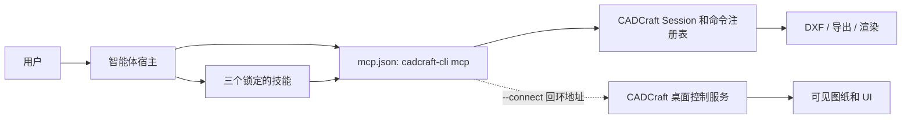
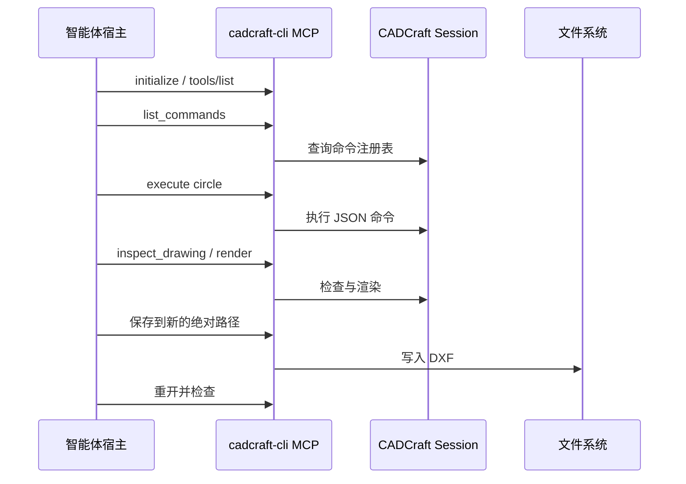

# CADCraft 插件架构

[English](CADCraft-Plugin-Architecture.md) · 当前开发包 `0.1.0-dev.0` · 范围：本插件，不包含 CADCraft 引擎内部设计。

## 决策与边界

插件打包 CADCraft **已有**的原生 MCP，不另建 CAD 命令引擎或协议代理。`mcp.json` 直接启动 `cadcraft-cli mcp`。可选 Python 启动器只发现二进制、报告版本、校验桌面回环地址，然后以 CLI 进程替换自己。三项技能是操作指引，不是强制执行层。

| 边界 | 本仓库负责 | 外部负责 |
| --- | --- | --- |
| 包 | 可移植/宿主清单、MCP 声明、技能副本与锁、验证器和测试 | 宿主安装与生命周期 |
| CLI/MCP | 不做代理；提供可选进程启动器 | 上游命令执行、协议应答、文件 I/O、图纸状态 |
| 桌面 | 可选启动器校验回环地址 | CADCraft 应用、控制服务、UI 状态 |
| 文件 | 指导分离目标路径并重开验证 | 实际文件内容与外部 CAD 解释 |

## 核心流程

`execute` 调用命令注册表；`command_line` 驱动交互提示，即使工具信封成功，内容中仍可能包含命令级 `error`。`render` 是图纸渲染，不是桌面截图。只有连接 CADCraft 桌面控制服务的远程 MCP 实例才暴露 `screenshot`、`ui_inspect` 和 `ui_click`。

## 状态与失败语义

| 状态或失败 | 当前行为 | 恢复要求 |
| --- | --- | --- |
| Headless 进程退出 | 未保存的内存图纸丢失 | 交接或重启前保存、重开文件 |
| 工具返回 `isError` | 命令失败 | 后续操作前检查图纸 |
| `command_line` 含 `error` | 传输成功但命令可能失败 | 检查 `running`、`prompt` 和图纸状态 |
| 写操作后远程传输失败 | 上游 `Remote::call` 可能重放同一请求 | 结果未知；先检查状态/文件再决定是否重试 |
| 保存/转换失败 | 输出可能缺失、部分写入或仍是旧文件 | 检查结果和新文件，保留源文件 |

插件侧没有持久操作账本、命令去重、事务或自动回滚。传输应答不能保证恰好执行一次。技能指引能降低用户侧风险，但宿主绕过技能时无法强制执行。

## 包完整性与配置

`plugin.json`、`.codex-plugin/plugin.json` 和 `.claude-plugin/marketplace.json` 的版本均为 `0.1.0-dev.0`。`mcp.json` 固定使用 `cadcraft-cli` 和 `mcp`。`skills.lock.json` 记录独立技能库的版本/提交和各技能 SHA-256。`scripts/validate_package.py` 检查包形状与哈希；`scripts/sync_skills.py --check` 还能对照干净的本地源检出。`CADCRAFT_CLI` 仅为 `scripts/launch.py` 选二进制，不覆盖 `mcp.json`。

## 证据与演进

现有本地测试验证包；设置 `CADCRAFT_NATIVE_TEST_CLI` 后还验证原生 MCP 绘图、渲染、DXF 保存重开和回环 TCP 连接。TCP 接收器测试不能证明桌面 UI 可用。CI 不提供原生二进制、宿主安装或外部 CAD 测试。独立的[对照与路线图](CADCraft-Dreamina-Analysis.zh-CN.md)按首次使用/宿主门禁、远程写入不确定性、文件持久性、互操作及快照发布控制排序。新增运行时状态或去重机制时，需要另立规格和行为测试。
