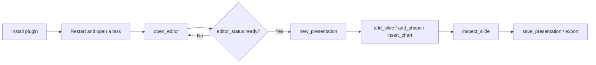

# DeckCraft Use

## Plugin marketplaces

This plugin belongs to **AIGC content creation**.

| Category | Marketplace | Purpose |
| --- | --- | --- |
| Full-stack development | [Full Stack Plugins](https://github.com/partme-ai/full-stack-plugins) | Architecture and UI design, code understanding, quality checks, code review, workflow governance, and server operations |
| AIGC content creation | [Full AIGC Plugins](https://github.com/partme-ai/full-aigc-plugins) | Image, video, audio, music, 3D, and multimodal content creation |


> Author, inspect and export a real presentation from your agent host — one slide at a time, with the editable source deck kept as the deliverable.

[](https://github.com/full-aigc-plugins/deckcraft-plugin/releases)
[](#skills)
[](#mcp-tools)
[](LICENSE)

[English](README.md) | [简体中文](README.zh-CN.md) · [Install](#installation) · [Quick start](#quick-start) · [Skills](#skills) · [Troubleshooting](#troubleshooting)

## Positioning

`deckcraft` lets an agent host drive the DeckCraft engine through a bundled stdio MCP server and a set of presentation skills, so a request ends with an editable `.deckcraft` deck plus the exports you asked for. The plugin owns skill routing, the same-session editor bridge and package pinning. It does not replace DeckCraft, its engine, or the host runtime.

| Property | Value |
| :--- | :--- |
| Plugin ID | `deckcraft` |
| Version | `0.1.0-dev.20261018.4` |
| Status | Development preview; production promotion blocked, all-host acceptance open |
| Editor runtime | Node.js 24, started from `ui/bootstrap.mjs` |
| Upstream reference | DeckCraft `0.3.0` (`d0e57d7e25f9852179cc66be12dd6188f1c05535`) |
| Optional CLI | `deckcraft-cli`, if your host already has it on `PATH` |
| License | Apache-2.0 |

## Installation

### Prerequisites

- Node.js 24 on `PATH`; the bundled stdio MCP server runs on it.
- Network access on the first editor launch. The plugin downloads and verifies the pinned editor archive; a complete release ZIP already contains it, so no Rust toolchain and no `npm install` are required.
- A `deckcraft-cli` installation only if you want the native CLI path. The plugin never installs or upgrades it.
- A host that supports plugins or stdio MCP. Embedded panels additionally require MCP Apps or a built-in browser.

### From the plugin marketplace

```bash
codex plugin marketplace add partme-ai/full-aigc-plugins
codex plugin add deckcraft@full-aigc-plugins
```

Restart the host, open a new task, and ask DeckCraft to start a deck.

### Other host manifests

| Host | Manifest | Path base |
| --- | --- | --- |
| Standard Agent Plugins 1.0.0 | `plugin.json`, `mcp.json` | `${PLUGIN_ROOT}` |
| Codex | `.codex-plugin/plugin.json`, `.codex-plugin/mcp.json` | plugin root relative to `cwd` |
| Claude Code | `.claude-plugin/plugin.json`, `.mcp.json` | `${CLAUDE_PLUGIN_ROOT}` |

Kimi (`kimi.plugin.json`), DeepSeek Harness (`dsh/`) and the WorkBuddy example (`hosts/workbuddy/mcp.json`) are also present. `hosts/native-cli/mcp.json` shows the optional `deckcraft-cli mcp` server instead of the bundled editor.

## Quick start



1. Open the editor with an explicit `workspace` argument.
2. Start a deck with `new_presentation`, or open an existing one with `open_presentation`.
3. Read `list_commands` before complex edits; command IDs and `enabled` state come from the live registry.
4. After each block of edits, call `inspect_document` or `inspect_slide`, and `render_slide` when you need a picture.
5. Save the `.deckcraft` source, then export. Reopen the source to confirm the slides are still editable.

## What you can build

| Workflow | Built-in path | Verifiable output |
| :--- | :--- | :--- |
| Pitch deck with problem, evidence and ask | `deckcraft-pitch-deck` | Slide-per-message deck with speaker notes |
| Weekly or status report | `deckcraft-weekly-report` | Progress, risk and next-step slides |
| Training courseware | `deckcraft-training-slides` | Explanation, example, exercise and recap slides |
| Data narrative | `deckcraft-data-story` + `insert_chart` | Chart bound to your data with title and labels |
| Brand template reuse | `deckcraft-brand-template` | Master-styled slides, consistent layouts |
| Redesign an existing deck | `deckcraft-slide-redesign` | Restructured deck, original retained |
| Option comparison | `deckcraft-option-comparison` + `insert_table` | Editable comparison table with units and sources |
| Delivery | `save_presentation`, `export` | Editable source plus PPTX, PDF or image output |

## Skills

| Skill | What it does |
| :--- | :--- |
| `deckcraft-use` | Main entry: create, modify, inspect or export a deck through the connected MCP or an installed CLI |
| `deckcraft-editor` | Open the real editor in the host and keep agent edits on the same page |
| `deckcraft-pitch-deck` | Problem, solution, evidence and ask for a project pitch |
| `deckcraft-weekly-report` | Progress, issues, metrics and next-week plan |
| `deckcraft-training-slides` | Explanation, examples, exercises and recap |
| `deckcraft-data-story` | Data conclusion and business interpretation, with chart plans |
| `deckcraft-brand-template` | Master style and recurring layouts for a brand |
| `deckcraft-slide-redesign` | Restructure and visually improve an existing deck |
| `deckcraft-option-comparison` | Cost, lead time and risk compared in an editable table |
| `deckcraft-scenario-playbooks` | Step-by-step recipes for metric briefing, comparison, flow, risk matrix, trend, training Q&A and handoff |

Skills come from the independent `deckcraft-skills` source and are pinned by `scenario-candidates.json` with per-skill SHA-256 digests. They carry scenario knowledge and execution contracts, not a second engine.

## MCP tools

One bundled server, `deckcraft-editor`, speaking **stdio**. The local HTTP listener only serves the editor page and its same-session bridge. The catalogue exposes 33 tools: 28 agent-callable tools and 5 `_editor_*` bridge tools the panel uses internally.

| Family | Tools | Purpose |
| :--- | :--- | :--- |
| Session | `open_editor`, `open_browser_editor`, `editor_status` | Open the editor and confirm that it attached |
| Discovery | `list_commands`, `call_app` | List live commands; `call_app` reaches app-level control methods (desktop app only) |
| Command gateway | `run_command`, `batch` | Run one command, or an ordered batch with explicit failure semantics |
| Deck management | `new_presentation`, `open_presentation`, `save_presentation`, `export` | Create, open, save and export |
| Slides | `add_slide`, `go_to_slide`, `inspect_slide`, `render_slide` | Add, navigate, read and render one slide |
| Content | `add_shape`, `add_text_box`, `set_text`, `insert_picture`, `insert_table`, `insert_chart` | Place and edit the objects a slide is made of |
| Inspection | `inspect_document` | Titles, page count, objects and text of the whole deck |
| Interaction | `select`, `select_tool`, `pointer`, `key`, `type_text`, `screenshot` | Drive the same paths a mouse and keyboard would; `screenshot` captures the whole window and needs the desktop app |

## Configuration

| Setting | Where | Effect |
| :--- | :--- | :--- |
| `workspace` argument | `open_editor` / `open_browser_editor` | Binds the task folder; paths outside it are refused |
| `CRAFT_EDITOR_UPDATE=off` | stdio MCP `env` | Use the bundled editor only; no download attempt |
| `CRAFT_EDITOR_CACHE_DIR` | Environment | Absolute directory for verified editor archives |
| `CRAFT_WORKSPACE_ROOT` | Host MCP config | Workspace root for hosts that cannot pass it in a tool call |

Claude Code also reads `CRAFT_PANEL_METADATA_FILE` from `.mcp.json`. Verified archives are cached under `~/.cache/full-aigc/editors`; an active session keeps its version until closed, and a corrupt cache falls back to the bundled build.

## Architecture and security

Agent ↔ plugin traffic is stdio MCP; the browser bridge listens on `127.0.0.1` only, with a random token and Host/Origin checks. Downloads are SHA-256 verified, and the bundled editor is always kept as a fallback. Skills are instructions and do not enforce policy at runtime. The plugin stores no credential and forwards no traffic to the authors.

The editor never claims a capability the upstream engine does not have. Format-specific limits, headless behaviour and unverified modes are recorded in [compatibility](docs/compatibility.md), [operation contract](docs/operation-contract.md) and [verification](docs/verification.md). Source and licence details are in [ATTRIBUTION.md](ATTRIBUTION.md).

## Troubleshooting

| Symptom | Action |
| :--- | :--- |
| Editor tools are missing | Confirm the plugin is enabled, restart the host, open a new task |
| The panel does not render inside the host | Use the URL from `open_browser_editor`; the terminal provides no browser panel |
| First open stalls | The first launch downloads the pinned archive; retry with network, or set `CRAFT_EDITOR_UPDATE=off` |
| A PPTX import looks incomplete | Import is lenient and skips unknown or corrupt parts; validate the reopened deck |
| A write times out | Reopen or inspect the deck before retrying; the engine cannot promise exactly-once execution |
| `deckcraft-cli` is not found | Install it yourself, or stay on the bundled MCP server |

## Upgrade

```bash
codex plugin marketplace upgrade full-aigc-plugins
codex plugin add deckcraft@full-aigc-plugins
```

Release notes are in [CHANGELOG.md](CHANGELOG.md); the published limits are recorded in `docs/verification/release-candidate.json`.

## Contributing and support

Open issues at <https://github.com/full-aigc-plugins/deckcraft-plugin/issues>. Read `AGENTS.md` before touching skills or manifests, keep the root `plugin.json` as the identity source, and never commit user decks, credentials or local session data. Security and privacy expectations are in [SECURITY.md](SECURITY.md) and [PRIVACY.md](PRIVACY.md).

## License

Original repository content is [Apache-2.0](LICENSE). The icon is upstream DeckCraft artwork under MIT, recorded in `assets/official-icon-source.json`. Upstream DeckCraft is a separate project at <https://github.com/storytold/deckcraft> under MIT OR Apache-2.0; this plugin is an integration, not an endorsement.
