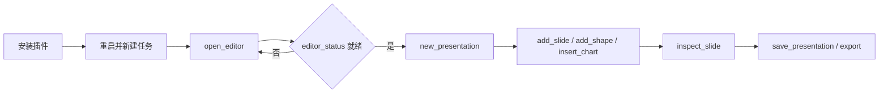

# DeckCraft Use

## 插件市场导航

本插件所属分类：**AIGC 内容创作**。

| 分类 | 插件市场入口 | 用途 |
| --- | --- | --- |
| 全栈开发 | [Full Stack Plugins](https://github.com/partme-ai/full-stack-plugins) | 架构与 UI 设计、代码理解、质量检查、代码审查、流程治理与服务器运维 |
| AIGC 内容创作 | [Full AIGC Plugins](https://github.com/partme-ai/full-aigc-plugins) | 图像、视频、音频、音乐、3D 与多模态内容创作 |


> 在智能体宿主里撰写、检查并导出真实演示文稿——逐页推进，交付物始终是可继续编辑的源文稿。

[](https://github.com/full-aigc-plugins/deckcraft-plugin/releases)
[](#技能)
[](#mcp-工具)
[](LICENSE)

[English](README.md) | [简体中文](README.zh-CN.md) · [安装](#安装) · [快速开始](#快速开始) · [技能](#技能) · [故障排查](#故障排查)

## 项目定位

`deckcraft` 让智能体宿主通过内置 stdio MCP server 和一组演示文稿技能驱动 DeckCraft 引擎，因此任务结果是可编辑的 `.deckcraft` 文稿加上你要求的导出文件。插件负责技能路由、同会话编辑器桥接与包版本锁定；它不替代 DeckCraft、其引擎或宿主运行时。

| 属性 | 取值 |
| :--- | :--- |
| 插件 ID | `deckcraft` |
| 版本 | `0.1.0-dev.20261018.4` |
| 状态 | 开发预览；生产发布被阻塞，全部宿主验收未完成 |
| 编辑器运行时 | Node.js 24，由 `ui/bootstrap.mjs` 启动 |
| 上游参考 | DeckCraft `0.3.0`（`d0e57d7e25f9852179cc66be12dd6188f1c05535`） |
| 可选 CLI | `deckcraft-cli`，仅当宿主已在 `PATH` 上提供 |
| 许可证 | Apache-2.0 |

## 安装

### 前置条件

- `PATH` 上有 Node.js 24；内置 stdio MCP server 依赖它运行。
- 首次打开编辑器需要网络：插件会下载并校验锁定编辑器制品；完整发行 ZIP 已内置该制品，因此无需 Rust 工具链，也无需 `npm install`。
- 只有走原生 CLI 路径时才需要已安装的 `deckcraft-cli`；插件既不安装也不升级它。
- 宿主需支持插件或 stdio MCP。内嵌面板还要求宿主支持 MCP Apps 或自带浏览器。

### 从插件市场安装

```bash
codex plugin marketplace add partme-ai/full-aigc-plugins
codex plugin add deckcraft@full-aigc-plugins
```

重启宿主，新建任务，然后让 DeckCraft 开始一份文稿。

### 其他宿主清单

| 宿主 | 清单 | 路径基准 |
| --- | --- | --- |
| 标准 Agent Plugins 1.0.0 | `plugin.json`、`mcp.json` | `${PLUGIN_ROOT}` |
| Codex | `.codex-plugin/plugin.json`、`.codex-plugin/mcp.json` | 相对 `cwd` 的插件根目录 |
| Claude Code | `.claude-plugin/plugin.json`、`.mcp.json` | `${CLAUDE_PLUGIN_ROOT}` |

此外还提供 Kimi（`kimi.plugin.json`）、DeepSeek Harness（`dsh/`）和 WorkBuddy 示例（`hosts/workbuddy/mcp.json`）。`hosts/native-cli/mcp.json` 展示的是可选的 `deckcraft-cli mcp` server，而不是内置编辑器。

## 快速开始



1. 打开编辑器时显式传入 `workspace` 参数。
2. 用 `new_presentation` 新建文稿，或用 `open_presentation` 打开已有文稿。
3. 复杂编辑前先读 `list_commands`；命令 ID 与 `enabled` 状态来自实时注册表。
4. 每完成一段修改就调用 `inspect_document` 或 `inspect_slide`，需要看图时用 `render_slide`。
5. 先保存 `.deckcraft` 源文稿再导出；重开源文稿确认页面仍可编辑。

## 可完成的工作

| 工作流 | 内置路径 | 可验证输出 |
| :--- | :--- | :--- |
| 含问题、证据与诉求的路演稿 | `deckcraft-pitch-deck` | 每页一个论点的文稿，附讲稿备注 |
| 周报或进展汇报 | `deckcraft-weekly-report` | 进展、风险与下周计划页 |
| 培训课件 | `deckcraft-training-slides` | 讲解、示例、练习与回顾页 |
| 数据叙事 | `deckcraft-data-story` + `insert_chart` | 绑定真实数据的图表，含标题与数据标签 |
| 品牌模板复用 | `deckcraft-brand-template` | 母版风格统一、版式一致的页面 |
| 重排已有文稿 | `deckcraft-slide-redesign` | 结构优化后的文稿，原稿保留 |
| 方案评审对比 | `deckcraft-option-comparison` + `insert_table` | 可编辑对比表，保留口径与来源 |
| 交付 | `save_presentation`、`export` | 可编辑源文稿，加 PPTX、PDF 或图片输出 |

## 技能

| 技能 | 作用 |
| :--- | :--- |
| `deckcraft-use` | 主入口：通过已连接的 MCP 或已安装 CLI 创建、修改、检查与导出文稿 |
| `deckcraft-editor` | 在宿主内打开真实编辑器，让 Agent 修改显示在同一页面 |
| `deckcraft-pitch-deck` | 项目路演的问题、方案、证据与诉求 |
| `deckcraft-weekly-report` | 进展、问题、指标与下周计划 |
| `deckcraft-training-slides` | 讲解、示例、练习与回顾 |
| `deckcraft-data-story` | 数据结论与业务解释，含图表计划 |
| `deckcraft-brand-template` | 品牌母版风格与常用版式 |
| `deckcraft-slide-redesign` | 旧稿结构重排与视觉优化 |
| `deckcraft-option-comparison` | 按成本、交付周期与风险制作可编辑对比表 |
| `deckcraft-scenario-playbooks` | 指标简报、方案比较、流程图、风险矩阵、趋势图、培训问答与交接稿的分步手册 |

技能来自独立的 `deckcraft-skills` 源，并由 `scenario-candidates.json` 以逐技能 SHA-256 摘要固定。它们提供场景知识与执行契约，不是第二套引擎。

## MCP 工具

只内置一个 server：`deckcraft-editor`，使用 **stdio**。本地 HTTP 只承载编辑器页面与同会话桥接。目录共 33 个工具，其中 28 个可供 Agent 调用，5 个 `_editor_*` 是面板内部使用的桥接工具。

| 类别 | 工具 | 用途 |
| :--- | :--- | :--- |
| 会话 | `open_editor`、`open_browser_editor`、`editor_status` | 打开编辑器并确认已接入 |
| 发现 | `list_commands`、`call_app` | 列出实时命令；`call_app` 触达应用级控制方法（仅桌面应用） |
| 命令网关 | `run_command`、`batch` | 执行单条命令，或按明确失败语义执行顺序批次 |
| 文稿管理 | `new_presentation`、`open_presentation`、`save_presentation`、`export` | 新建、打开、保存与导出 |
| 页面 | `add_slide`、`go_to_slide`、`inspect_slide`、`render_slide` | 增页、跳转、读取与渲染单页 |
| 内容 | `add_shape`、`add_text_box`、`set_text`、`insert_picture`、`insert_table`、`insert_chart` | 放置并编辑页面对象的组成元素 |
| 检查 | `inspect_document` | 整份文稿的标题、页数、对象与文字 |
| 交互 | `select`、`select_tool`、`pointer`、`key`、`type_text`、`screenshot` | 走与鼠标键盘相同的执行路径；`screenshot` 截整窗，需要桌面应用 |

## 配置

| 配置 | 位置 | 作用 |
| :--- | :--- | :--- |
| `workspace` 参数 | `open_editor` / `open_browser_editor` | 绑定任务目录；越界路径会被拒绝 |
| `CRAFT_EDITOR_UPDATE=off` | stdio MCP 的 `env` | 只用内置编辑器，不再尝试下载 |
| `CRAFT_EDITOR_CACHE_DIR` | 环境变量 | 已校验编辑器归档的绝对缓存目录 |
| `CRAFT_WORKSPACE_ROOT` | 宿主 MCP 配置 | 供无法在工具调用中传参的宿主指定工作区根 |

Claude Code 还会从 `.mcp.json` 读取 `CRAFT_PANEL_METADATA_FILE`。已校验归档缓存在 `~/.cache/full-aigc/editors`；活动会话在关闭前保持自己的版本，缓存损坏时回退内置版本。

## 架构与安全

Agent 与插件之间只走 stdio MCP；浏览器桥接只监听 `127.0.0.1`，使用随机令牌并校验 Host/Origin。下载内容按 SHA-256 校验，内置编辑器始终保留为回退。技能只是指令，不在运行时强制执行策略。插件不保存凭据，也不向作者转发任何流量。

编辑器不会宣称上游引擎没有的能力。格式限制、headless 行为与未验证模式分别记录在[兼容性](docs/compatibility.md)、[操作契约](docs/operation-contract.md)与[验证说明](docs/verification.md)。来源与许可信息见 [ATTRIBUTION.md](ATTRIBUTION.md)。

## 故障排查

| 现象 | 处理 |
| :--- | :--- |
| 看不到编辑器工具 | 确认插件已启用，重启宿主，新建任务 |
| 宿主内不渲染面板 | 改用 `open_browser_editor` 返回的地址；终端本身不提供浏览器面板 |
| 首次打开卡住 | 首次需要下载锁定归档；联网重试，或设置 `CRAFT_EDITOR_UPDATE=off` |
| 导入 PPTX 后内容不全 | 导入是宽容模式，会跳过未知或损坏的部分；请核对重开后的文稿 |
| 写入超时 | 先重开或检查文稿再重试；引擎无法承诺 exactly-once 执行 |
| 找不到 `deckcraft-cli` | 自行安装，或继续使用内置 MCP server |

## 升级

```bash
codex plugin marketplace upgrade full-aigc-plugins
codex plugin add deckcraft@full-aigc-plugins
```

发行说明见 [CHANGELOG.md](CHANGELOG.md)；当前发布限制记录在 `docs/verification/release-candidate.json`。

## 贡献与支持

问题请提交到 <https://github.com/full-aigc-plugins/deckcraft-plugin/issues>。修改技能或清单前先读 `AGENTS.md`，保持根 `plugin.json` 为身份事实源，不提交用户文稿、凭据或本地会话数据。安全与隐私约定见 [SECURITY.md](SECURITY.md) 与 [PRIVACY.md](PRIVACY.md)。

## 许可证

本仓原创内容采用 [Apache-2.0](LICENSE)。图标为 MIT 许可的上游 DeckCraft 素材，来源记录在 `assets/official-icon-source.json`。上游 DeckCraft 是独立项目 <https://github.com/storytold/deckcraft>，采用 MIT OR Apache-2.0；本插件是集成，不构成背书。
