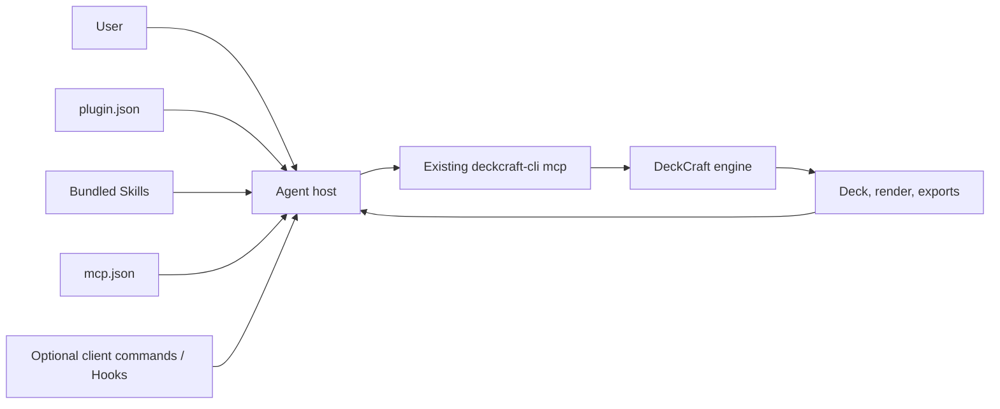

# DeckCraft Plugin Architecture

> 2026-10-09; the minimal local candidate includes `plugin.json`, one skill and native MCP configuration. It targets [Agent Plugins 1.0.0](https://agent-plugins.org/specification); host and runtime verification remain open.

## 1. Portable core

```text
deckcraft-plugin/
├── plugin.json              # required: the portable manifest
├── skills/                  # optional: immediate subdirectories with SKILL.md
├── mcp.json                 # optional: connect to existing deckcraft-cli mcp
└── client extension root/   # add only for a tested client contract
```

The v1 specification defines exactly two portable component types: Skills and MCP servers. Root `plugin.json` contains core metadata and reverse-domain `extensions`, never inline commands, hooks or MCP configuration. `skills/` and `mcp.json` are fixed discovery locations. Package-supplied paths must resolve inside the package root. See [component discovery](https://agent-plugins.org/specification).

Commands and Hooks are client-specific extensions. Other clients may ignore them. No Hook is assumed for the first version. Before adding a user command, check whether the target client already exposes the Skill or MCP tool as needed. See [client extensions](https://agent-plugins.org/plugin-authors/client-extensions).

## 2. Flow and ownership



The host owns discovery, permission interaction, MCP processes and tool calls. DeckCraft owns editing, undo, files and rendering. Skills own routing and operational knowledge. The plugin packages those parts. It has no separate controller, budget ledger, database or duplicate MCP server.

## 3. MCP and configuration

Upstream provides stdio `deckcraft-cli mcp`. Root `mcp.json` uses the single executable token `deckcraft-cli` and separate `mcp` argument, requiring an installed CLI resolvable by the client. The file exists; the actual handshake remains unverified. See the [MCP author guide](https://agent-plugins.org/plugin-authors/mcp-servers).
Desktop Remote mode requires an already running DeckCraft control server and a separate acceptance path. Web does not use the local TCP control port. Start with Headless authoring, inspection, rendering and export.

## 4. Risk and code threshold

Upstream Remote may resend a mutation after a communication error. The initial plugin cannot promise exactly-once execution across such failures. Read back the deck and report uncertainty. Add a small helper only after reproducing a gap, checking host and DeckCraft capabilities, and writing a failure regression. Dreamina's paid approval and budget system does not transfer to this base plugin. See [operation boundaries](operation-contract.md), [requirements](requirements.md) and [verification](verification.md).

## 5. Distribution and compatibility

The skills repository is the authoring source; the plugin must include complete skill files in its own package and cannot depend on a sibling checkout after installation. Pinning source and hashes is a build check, not a resident synchronization service. Manifest conformance, host loading, MCP handshake and real deck calls are distinct evidence layers. No host combination is verified yet. See [compatibility](compatibility.md).
