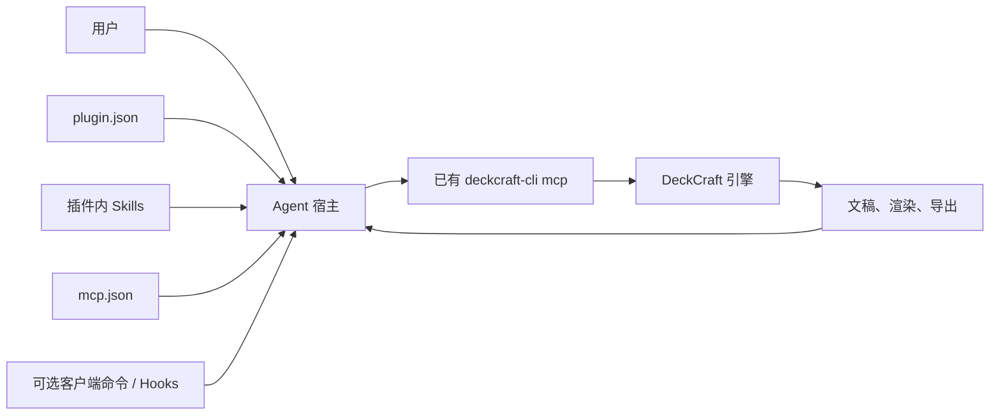

# DeckCraft Plugin 架构

> 2026-10-09；最小本地候选已包含 `plugin.json`、一个技能和原生 MCP 配置。遵循 [Agent Plugins 1.0.0](https://agent-plugins.org/specification)；宿主及运行验证待完成。

## 1. 可移植核心

```text
deckcraft-plugin/
├── plugin.json                 # 必需：唯一可移植 manifest
├── skills/                     # 可选：即时子目录含 SKILL.md
├── mcp.json                    # 可选：连接已有 deckcraft-cli mcp
└── 客户端专有扩展目录/          # 仅在已验证宿主要求时添加
```

规范只定义 Skills 和 MCP servers 两类可移植组件。`plugin.json` 仅放核心元数据与按反向域名命名的 `extensions`；不在根字段内嵌命令、钩子或 MCP 配置。`skills/` 与 `mcp.json` 是固定发现位置，包路径必须留在插件根目录内。[组件发现](https://agent-plugins.org/specification)

命令和 Hooks 按具体客户端扩展实现，并标明支持的宿主；其他客户端可以忽略。初版不预设 Hooks。需要用户显式入口时先检查宿主是否已有 Skills/MCP 暴露方式，再按该客户端规范添加命令。参见 [客户端扩展](https://agent-plugins.org/plugin-authors/client-extensions)。

## 2. 数据流与职责



宿主负责发现、权限交互、MCP 进程与工具调用；DeckCraft 负责编辑、撤销、文件和渲染；技能负责任务路由与操作知识；插件负责把这些能力打包。插件无独立控制器、预算账本、数据库或重复的 MCP 服务端。

## 3. MCP 与配置

DeckCraft 已提供 `deckcraft-cli mcp`（stdio）。根 `mcp.json` 用一个可执行 token `deckcraft-cli` 和分离的参数 `mcp`；需要已安装 CLI 且客户端能从 PATH 找到它。配置已创建，实际握手尚未验证。完整字段与路径规则见 [MCP 指南](https://agent-plugins.org/plugin-authors/mcp-servers)。
Remote 桌面模式需要正在运行的 DeckCraft 控制服务，属于单独验证的能力；Web 不使用本机 TCP 控制端口。初版以 Headless 建稿、检查、渲染和导出为主要路径。

## 4. 风险与增量代码门槛

上游 Remote 发生通信错误时可能重发修改请求，这是现存限制；初版不承诺跨异常恰好执行一次。使用原生文稿回读与人工核对报告不确定结果。只有复现风险、证明宿主/DeckCraft 无现成保障，并有失败回归时才加入最小辅助代码。Dreamina 的付费审批和预算系统不直接移植。[操作边界](operation-contract.md)、[需求](requirements.md)、[验证](verification.md)。

## 5. 分发与兼容

技能库是作者来源，插件分发时需要包内完整技能；不能在安装后依赖相邻仓库。固定来源版本与摘要是构建/校验工作，不要求常驻同步服务。manifest 静态合规、宿主加载、MCP 握手、真实文稿调用是不同验收层。当前没有可声称支持的宿主组合。[兼容性](compatibility.md)
