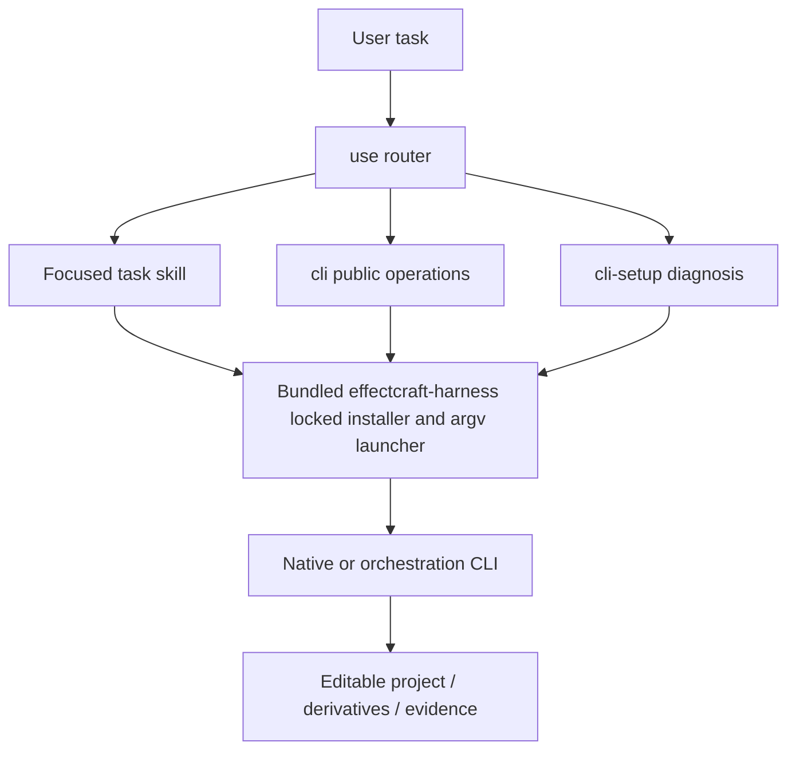

# EffectCraft Skill Suite Architecture

> Updated: 2026-10-13. Plugin 0.1.0-dev.70 re-vendors skill source v0.1.0-dev.69: duplicate execution payloads converged into the bundled `effectcraft-harness` skill (task 10.2, evidence `docs/evidence/effectcraft-harness-convergence-20261013.json`). Native CLI lock: 0.4.0. Target behavior is owned by the existing OpenSpec change.

## 1. Why a suite

The original single use skill gave a working bootstrap and representative native workflow, but had broad discovery and insufficient task routing. The suite follows the entrypoint / CLI / setup / task pattern, with command groups derived from the inspected source and actual installed runtime. It does not create fake auth or generation interfaces. This package contains 16 skills: 15 domain scenario skills plus 1 bundled `effectcraft-harness` execution-payload skill.

## 2. Responsibilities and routing

| Skill | Task boundary |
| :--- | :--- |
| `effectcraft-use` | use |
| `effectcraft-cli` | cli |
| `effectcraft-cli-setup` | cli setup |
| `effectcraft-cli-project` | cli project |
| `effectcraft-cli-footage` | cli footage |
| `effectcraft-cli-composition` | cli composition |
| `effectcraft-cli-layers` | cli layers |
| `effectcraft-cli-animation` | cli animation |
| `effectcraft-cli-effects` | cli effects |
| `effectcraft-cli-masks` | cli masks |
| `effectcraft-cli-expressions` | cli expressions |
| `effectcraft-cli-camera` | cli camera |
| `effectcraft-cli-export` | cli export |
| `effectcraft-cli-tracking` | cli tracking |
| `effectcraft-cli-puppet` | cli puppet |



## 3. Single-skill packaging and CLI lifecycle

The shared execution payload is kept exactly once: the bundled `effectcraft-harness` skill carries the shared scripts (6 public entrypoints plus contract JSON), while the 15 domain skills are thin documentation skills that point `HARNESS_DIR` at the harness skill's actual load directory and route by name instead of shipping their own `scripts/`. Scenario descriptions and command evidence remain individually maintained. This convergence (task 10.2) preserves each single skill's offline cold start, old public entrypoints and unknown-edit recovery, and shared code is still not hand-maintained as multiple implementations.

Before convergence (skill source dev.68) each skill shipped 74 script files and 1,896,367 script bytes — 28,445,505 script bytes across all 15 skills before packaging (the pinned dev.68 source ZIP is 15,644,235 bytes; all skill script trees compress to 10,848,570 bytes, exactly 723,238 bytes per skill). That per-skill duplication is what the bounded task 10.2.1 audit measured and what task 10.2 converged. After convergence (skill source v0.1.0-dev.69) the shared scripts live only once in `effectcraft-harness` (70 script files, 6 public entrypoints); the 15 domain skills no longer duplicate scripts, and 69/70 harness scripts are byte-identical to dev.68. The audit's measurement boundary (on-disk files excluding Python caches; not download-size or runtime-memory) is documented in the [bounded audit evidence](evidence/agent-plugin-boundary-20261009.json) and [convergence evidence](evidence/effectcraft-harness-convergence-20261013.json).

The current plugin has no root `mcp.json`; its skills can use the official CLI, while a portable MCP component needs a cross-platform startup contract and separate host proof. Commands and hooks are client extensions under Agent Plugins 1.0.0. The [OpenSpec boundary decision](../openspec/changes/establish-v1-plugin/design.md#agent-plugin-边界2026-10-09) owns the next architecture change.

The immutable source dev.68 ZIP is 15,644,235 bytes. Its 15 skill script trees account for 10,848,570 compressed bytes, exactly 723,238 bytes per skill; the other skill resources make each complete skill about 0.91–0.93 MB compressed. This cost does not yet justify a new shared-runtime downloader or two incompatible packaging paths. A direct-reference scan found no safe dead-module deletion: `cli.py`, `task_entry.py` and `additional_platforms.py` are public entrypoints; `preserved_stage.py` is loaded dynamically. Future reduction should target proven responsibility overlap, with a failing behavior test before each removal. The [bounded audit evidence](evidence/agent-plugin-boundary-20261009.json) distinguishes these package measurements from target-platform acceptance.

The launcher accepts native argv after `--`, validates the leading subcommand before installation, invokes a fixed checksummed executable without a shell, preserves exit status and bounds waiting. Unknown operation/platform/corrupt install fails. Native parameters, command IDs and enabled state are discovered at runtime. Output timeouts are unknown results, not proof that writes never happened. Save a native checkpoint and inspect before any replay.

## 4. Source evidence and differences

Research checkout: `storytold/effectcraft` at `24fcbdf3d2d6b928d3788d33f1722d8a21b9ad29`. CodeGraph indexed 680 files, 21407 nodes and 120688 edges. CLI parser and engine dispatch were investigated separately from installed command catalogues; current source and release binary may differ. See [research evidence](evidence/upstream-codegraph.json).

FilmCraft uses tick-based timeline commands and save/save-as; EffectCraft has comp/layer property paths and render channels; PhotoCraft has ordered run flags and persistent serve; VectorCraft uses ordered run/export steps and distinct artboard/range indices. Upstream ArtCraft is a Tauri scene/generation application with scene asset persistence and asynchronous provider task notifications. Our ArtCraft CLI is the existing local DAG/ledger runtime, implemented independently; no upstream ArtCraft code or branding assets are copied.

## 5. Validation and release

`tests/test_skill_suite.py` isolates every skill, verifies CLI discovery and catalogue subsets against the pinned runtime, and refuses unsupported subcommands before creating a runtime directory. Existing native workflow suites verify editable delivery and revisions. Individual discovery success does not prove all task commands, creative quality, GUI or cross-editor fidelity. Shared resources are checked and each SKILL.md validated; native/platform and host results are reported separately.

Run from the independent skill repository:

```bash
python3 -B scripts/sync_skill_suite.py --check
python3 -B -m unittest discover -s tests -p test_skill_suite.py -v
CRAFT_LIVE_SUITE=1 python3 -B -m unittest discover -s tests -p test_skill_suite.py -v
```

Install one skill with `npx skills add full-aigc-skills/effectcraft-skills --skill <skill-name>`; invoke its actual absolute directory, not a sibling path. Plugin packaging must bind the complete suite to a fixed source tag, commit and per-skill digest. Former tags remain immutable, and existing use/workflow payloads stay compatible.
