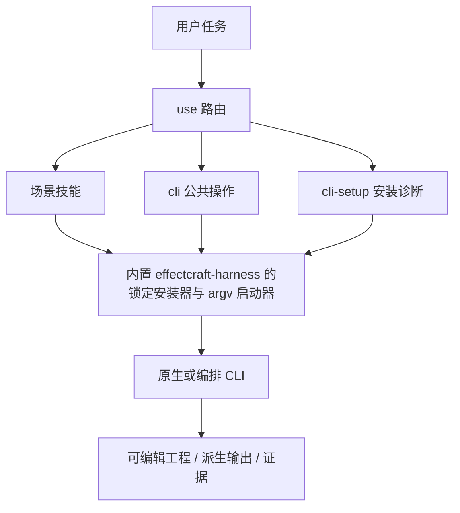

# EffectCraft CLI 场景技能架构

> 更新：2026-10-13。插件 dev.70 重新 vendor 技能源 v0.1.0-dev.69：重复执行载荷收敛进内置 `effectcraft-harness` 技能（任务 10.2，证据 `docs/evidence/effectcraft-harness-convergence-20261013.json`）；原生 CLI 锁定 0.4.0。目标行为以既有 OpenSpec 变更为事实源。

## 1. 为什么拆分

原有单个 use 技能提供安装和原生代表流程，但触发范围过宽、场景路由不足。本技能组按 use / CLI / setup / 任务分层，通过源码和实际运行时命令目录决定划分，不制造虚构 auth 或生成接口。本包包含 16 项技能：15 个领域场景技能与 1 个内置 `effectcraft-harness` 执行载荷技能。

## 2. 职责与路由

| 技能 | 任务边界 |
| :--- | :--- |
| `effectcraft-use` | 组合多个本工具能力并保留可编辑原生交付 |
| `effectcraft-cli` | 查询实际命令参数和能力，调用公开 CLI、MCP 与诊断 |
| `effectcraft-cli-setup` | 首次安装、摘要校验、版本检查与缺失运行时排障 |
| `effectcraft-cli-project` | 建立、保存和重开 ecproj 工程，整理项目项目项 |
| `effectcraft-cli-footage` | 导入图像、视频、矢量或 PSD 素材并登记依赖 |
| `effectcraft-cli-composition` | 创建合成、设置画幅帧率时长和工作区 |
| `effectcraft-cli-layers` | 组织文本、形状、素材图层和层级合成 |
| `effectcraft-cli-animation` | 设置属性、关键帧、缓动和文字图形动画 |
| `effectcraft-cli-effects` | 查询并应用当前版本支持的效果，调整效果顺序与参数 |
| `effectcraft-cli-masks` | 创建和编辑蒙版路径、羽化及局部遮罩 |
| `effectcraft-cli-expressions` | 在用户指定属性上检查、设置和诊断表达式 |
| `effectcraft-cli-camera` | 设置已有合成中的摄像机、灯光和材质参数 |
| `effectcraft-cli-export` | 预览关键帧、渲染序列或视频和透明交接片段 |
| `effectcraft-cli-tracking` | 镜头跟踪、稳定与图形附着 |
| `effectcraft-cli-puppet` | 木偶网格、针脚、录制与跟随动画 |



## 3. 单技能安装与 CLI 生命周期

共享执行载荷只保留一份：内置 `effectcraft-harness` 技能承载共享脚本（6 个公开入口与契约 JSON），15 个领域技能瘦身为薄文档技能，运行时将 `HARNESS_DIR` 指向 harness 技能的实际加载目录并按名称路由，不再各自携带 `scripts/`。场景描述与命令证据仍逐技能维护。此收敛（任务 10.2）保留单技能离线冷启动、旧公开入口与未知编辑防重放，共享代码依旧不手工维护多套实现。

收敛前（技能源 dev.68）每个技能自带 74 个脚本文件、1,896,367 字节，15 份共 28,445,505 字节未压缩脚本（固定 dev.68 技能源 ZIP 15,644,235 字节，全部技能脚本压缩后共 10,848,570 字节，每个技能脚本 723,238 字节）；这一逐技能复制正是任务 10.2.1 限定审计的对象，也是任务 10.2 收敛的动因。收敛后（技能源 v0.1.0-dev.69）共享脚本仅保留在 `effectcraft-harness` 一份（70 个脚本文件、6 个公开入口），15 个领域技能不再重复脚本；69/70 个 harness 脚本与 dev.68 逐字节一致。审计的测量边界（磁盘文件、不含 Python 缓存，非下载体积或运行内存）见[审计证据](evidence/agent-plugin-boundary-20261009.json)与[收敛证据](evidence/effectcraft-harness-convergence-20261013.json)。

Agent Plugins 1.0.0 的可移植核心是 `skills/` 与可选根 `mcp.json`；命令、钩子属于客户端扩展。当前插件没有根 `mcp.json`，不能宣称宿主直接发现了标准 MCP 工具。官方 EffectCraft CLI 负责原生编辑，宿主智能体负责规划、观察实际媒体和创作修订决策。代码保留安装完整性、操作身份、未知编辑防重放、工程重开与媒体技术检查。跨平台 MCP 入口及宿主调用仍需实际验收；[OpenSpec 决策](../openspec/changes/establish-v1-plugin/design.md#agent-plugin-边界2026-10-09)记录完整边界。

当前体积不足以单独证明需要第二套共享运行时下载器或两种不兼容的分发路径。后续先定位职责重叠，逐项用失败用例和公开入口、单技能离线安装、原生交付及恢复回归证明删减不会丢失能力。

启动器接收 `--` 后的原生 argv，在安装前检查首个子命令，通过固定摘要的可执行文件调用且不使用 shell，保留退出码并有界等待。非法操作、不支持平台与损坏安装明确失败；命令 ID、参数和 enabled 状态运行时重查。超时是结果未知，不能证明写入未发生；先保留检查点、核对工程再决定后续操作。

## 4. 源码证据与工具差异

研究提交：`storytold/effectcraft` 的 `24fcbdf3d2d6b928d3788d33f1722d8a21b9ad29`。CodeGraph 索引 680 文件、21407 节点、120688 边；分别检查 CLI 解析与引擎派发，并读取已安装运行时目录。当前源码与发布二进制可能不同，参见[研究证据](evidence/upstream-codegraph.json)。

FilmCraft 用 ticks 与 save/save-as；EffectCraft 使用 comp/layer 属性路径和渲染通道；PhotoCraft 的 run 参数按顺序绑定并可用 serve 保持会话；VectorCraft 按顺序执行 run/export 且画板/范围索引不同。上游 ArtCraft 是 Tauri 场景与生成应用，含素材保存和异步供应商任务通知。本项目 ArtCraft CLI 为独立实现的本地 DAG/账本运行时，不复制上游 ArtCraft 代码或品牌资源。

## 5. 验证与发布

`tests/test_skill_suite.py` 逐个隔离技能，核对固定 CLI 版本、命令目录子集和非法子命令在安装前被拒绝。既有原生工作流回归验证可编辑交付及修订。单项技能发现成功不代表每条场景命令、创作质量、GUI 或跨编辑器保真均通过。共享资源检查与每项 SKILL.md 校验分别执行；原生/平台和宿主证据分别记录。

在独立技能仓库运行：

```bash
python3 -B scripts/sync_skill_suite.py --check
python3 -B -m unittest discover -s tests -p test_skill_suite.py -v
CRAFT_LIVE_SUITE=1 python3 -B -m unittest discover -s tests -p test_skill_suite.py -v
```

单项安装：`npx skills add full-aigc-skills/effectcraft-skills --skill <skill-name>`，使用其实际绝对路径执行，不读取兄弟技能。插件固定完整技能清单的来源标签、提交和逐项摘要；旧发布标签不可变，原 use/workflow payload 保持兼容。
