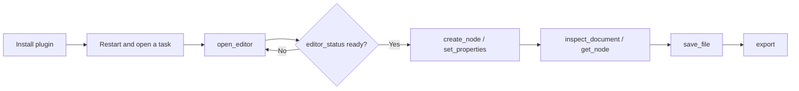

# FigCraft Use

## Plugin marketplaces

This plugin belongs to **AIGC content creation**.

| Category | Marketplace | Purpose |
| --- | --- | --- |
| Full-stack development | [Full Stack Plugins](https://github.com/partme-ai/full-stack-plugins) | Architecture and UI design, code understanding, quality checks, code review, workflow governance, and server operations |
| AIGC content creation | [Full AIGC Plugins](https://github.com/partme-ai/full-aigc-plugins) | Image, video, audio, music, 3D, and multimodal content creation |


> Design, restructure and hand off an interface inside your agent host, with the editable FigCraft document and its tokens kept as the source of truth.

[](https://github.com/full-aigc-plugins/figcraft-plugin/releases)
[](#skills)
[](#mcp-tools)
[](LICENSE)

[English](README.md) | [简体中文](README.zh-CN.md) · [Install](#installation) · [Quick start](#quick-start) · [Skills](#skills) · [Troubleshooting](#troubleshooting)

## Positioning

`figcraft` turns a page requirement into an editable interface document and carries it through design system, responsive layout, prototype and handoff. The plugin bundles a source-built FigCraft Web with same-session MCP automation and workspace file operations; it does not re-implement the design engine or claim pixel fidelity it has not checked.

| Property | Value |
| :--- | :--- |
| Plugin ID | `figcraft` |
| Version | `0.1.0-dev.20261018.3` |
| Status | Development preview; all-host acceptance still open |
| Editor runtime | Node.js 24, started from `ui/bootstrap.mjs` |
| Editor baseline | FigCraft `v0.6.0` fixed source plus this plugin's automation build |
| Optional CLI | `figcraft-cli`, used by recipe scripts as `--cli` |
| License | Apache-2.0 |

## Installation

### Prerequisites

- Node.js 24 on `PATH`; the bundled stdio MCP server runs on it.
- Network access on the first editor launch. The plugin downloads and verifies the pinned editor archive; a complete release ZIP already contains it, so no Rust toolchain and no `npm install` are required.
- `python3` on `PATH` only if you run the optional recipe scripts that ship with four skills.
- `figcraft-cli` only if a recipe should drive the native CLI; the plugin does not install it.
- A host that supports plugins or stdio MCP. Embedded panels additionally require MCP Apps or a built-in browser.

### From the plugin marketplace

```bash
codex plugin marketplace add partme-ai/full-aigc-plugins
codex plugin add figcraft@full-aigc-plugins
```

Restart the host, open a new task, and ask FigCraft to open the editor for your workspace.

### Other host manifests

| Host | Manifest | Path base |
| --- | --- | --- |
| Standard Agent Plugins 1.0.0 | `plugin.json`, `mcp.json` | `${PLUGIN_ROOT}` |
| Codex | `.codex-plugin/plugin.json`, `.codex-plugin/mcp.json` | plugin root relative to `cwd` |
| Claude Code | `.claude-plugin/plugin.json`, `.mcp.json` | `${CLAUDE_PLUGIN_ROOT}` |

Kimi (`kimi.plugin.json`), DeepSeek Harness (`dsh/`) and the WorkBuddy example (`hosts/workbuddy/mcp.json`) are also present. In a development checkout you must build the editor assets first; cloning the source is not an installed runtime.

## Quick start



1. Open the editor with an explicit `workspace` argument.
2. Build the first frame with `create_node`, then style it with `set_properties`; complex structures go through `run_command` or `batch`.
3. Read `inspect_document` for structure and `screenshot` for the actual image.
4. Save with `save_file`, reopen with `open_file`, and confirm the layers are still editable.
5. Export for handoff only after the reopened document matches what you approved.

## What you can build

| Workflow | Built-in path | Verifiable output |
| :--- | :--- | :--- |
| Low-fidelity wireframe | `figcraft-wireframe` | Structured frames and blocks, no invented content |
| Design system with variables | `figcraft-design-system` | Component library, states, colour and text variables |
| Light and dark token card | `figcraft-light-dark-token-card` | Semantic aliases with CSS or JSON delivery |
| Responsive layout | `figcraft-responsive-layout` | Auto-layout frames with wrap and overflow handled |
| Clickable prototype | `figcraft-prototype-flow` | Pages connected with entry, back and overlay states |
| Import an existing Figma file | `figcraft-import-fig` | Imported nodes plus a loss report for fonts and images |
| Editable chart | `figcraft-signed-bar-chart` | Positive, negative and zero values as editable bars |
| Swappable icon button | `figcraft-swappable-icon-button` | Instance swap and boolean visibility, text kept separate |
| Developer handoff | `figcraft-dev-handoff` | Annotations, measurements, CSS or React references |

## Skills

| Skill | What it does |
| :--- | :--- |
| `figcraft-editor` | Open FigCraft in the host, check same-session MCP, diagnose workspace save |
| `figcraft-wireframe` | Turn a page requirement into a low-fidelity wireframe or first interface |
| `figcraft-responsive-layout` | Mobile, tablet and desktop adaptation, auto layout, wrap and overflow |
| `figcraft-design-system` | Component library, button states, colour and text variables, light/dark themes |
| `figcraft-prototype-flow` | Connect pages into a clickable prototype with entry and overlay states |
| `figcraft-import-fig` | Import Figma `.fig`, REST file JSON or SVG and report fidelity loss |
| `figcraft-dev-handoff` | Editable UI, annotations, assets and CSS or React references |
| `figcraft-scenario-playbooks` | Recipes for login, plan card, metric component, navigation, container, dialog, empty and error states |
| `figcraft-light-dark-token-card` | Light/dark theme and semantic colour tokens with real command bindings |
| `figcraft-swappable-icon-button` | Icon swap plus hideable icon, with return-ID binding and re-check |
| `figcraft-signed-bar-chart` | Editable bars including positive, negative and zero values |

Skills come from the independent `figcraft-skills` source and are pinned by `scenario-candidates.json` with per-skill SHA-256 digests.

## MCP tools

One bundled server, `figcraft-editor`, speaking **stdio**. The local HTTP listener only serves the editor page and its same-session bridge. The catalogue exposes 26 tools: 21 agent-callable tools and 5 `_editor_*` bridge tools the panel uses internally.

| Family | Tools | Purpose |
| :--- | :--- | :--- |
| Session | `open_editor`, `open_browser_editor`, `editor_status` | Open the editor and confirm that it attached |
| Discovery | `list_commands` | List live command IDs, parameters and enabled state |
| Command gateway | `run_command`, `batch` | Run one command, or an ordered batch |
| Authoring | `create_node`, `set_properties` | Create nodes and set their properties, returning IDs |
| Inspection | `inspect_document`, `get_node`, `inspect_ui` | Document tree, one node, and interface state |
| Selection and input | `select`, `pointer`, `key`, `type_text` | Select objects and drive the same input paths as a user |
| Files | `open_file`, `save_file`, `export`, `screenshot` | Open, save, export and capture the canvas |
| History | `undo`, `redo` | Step back and forward one change |

## Configuration

| Setting | Where | Effect |
| :--- | :--- | :--- |
| `workspace` argument | `open_editor` / `open_browser_editor` | Binds the task folder; paths outside it are refused |
| `CRAFT_EDITOR_UPDATE=off` | stdio MCP `env` | Use the bundled editor only; no download attempt |
| `CRAFT_EDITOR_CACHE_DIR` | Environment | Absolute directory for verified editor archives |
| `CRAFT_WORKSPACE_ROOT` | Host MCP config | Workspace root for hosts that cannot pass it in a tool call |
| `--cli` | `scripts/run_recipe.py` | Path or name of the native CLI a recipe should drive |

Verified archives are cached under `~/.cache/full-aigc/editors`; an active session keeps its version until closed, and a corrupt cache falls back to the bundled build.

## Architecture and security

Agent ↔ plugin traffic is stdio MCP; the browser bridge listens on `127.0.0.1` only, with a random token and Host/Origin checks. Downloads are SHA-256 verified and the bundled editor is always kept as a fallback. Skills are instructions and do not enforce policy at runtime. The plugin stores no credential and forwards no traffic to the authors.

The editor is an enhanced build from fixed upstream source, not the official Web ZIP; `ui/source.lock.json` records the source commit and `ui/editor.lock.json` the bundled artifact digests. Build steps are in [ui/README.md](ui/README.md).

## Troubleshooting

| Symptom | Action |
| :--- | :--- |
| Editor tools are missing | Confirm the plugin is enabled, restart the host, open a new task |
| The panel does not render inside the host | Use the URL from `open_browser_editor`; the terminal provides no browser panel |
| First open stalls | The first launch downloads the pinned archive; retry with network, or set `CRAFT_EDITOR_UPDATE=off` |
| An imported `.fig` lost fonts or images | Expected for sampled files; read the loss report and fix the affected layers |
| A recipe script cannot find the CLI | Pass `--cli /absolute/path/to/figcraft-cli`, or stay on MCP tools |
| A write times out | Reopen or inspect the document before retrying; do not replay blindly |

## Upgrade

```bash
codex plugin marketplace upgrade full-aigc-plugins
codex plugin add figcraft@full-aigc-plugins
```

The editor archive and skill digests are pinned per release; upgrading the plugin replaces the bundled runtime rather than patching it in place.

## Contributing and support

Open issues at <https://github.com/full-aigc-plugins/figcraft-plugin/issues>. Read `AGENTS.md` before editing skills, `ui/` build inputs or manifests, and keep the Chinese and English documents aligned. New scene skills must be validated against real commands before they are described as working.

## License

Original repository content is [Apache-2.0](LICENSE). The icon is upstream FigCraft artwork under Apache-2.0 OR MIT, recorded in `assets/official-icon-source.json`. Upstream FigCraft is a separate project at <https://github.com/storytold/figcraft>; this plugin is an integration, not an endorsement.
