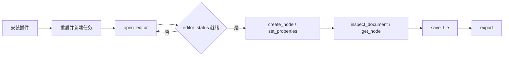

# FigCraft Use

## 插件市场导航

本插件所属分类：**AIGC 内容创作**。

| 分类 | 插件市场入口 | 用途 |
| --- | --- | --- |
| 全栈开发 | [Full Stack Plugins](https://github.com/partme-ai/full-stack-plugins) | 架构与 UI 设计、代码理解、质量检查、代码审查、流程治理与服务器运维 |
| AIGC 内容创作 | [Full AIGC Plugins](https://github.com/partme-ai/full-aigc-plugins) | 图像、视频、音频、音乐、3D 与多模态内容创作 |


> 在智能体宿主里完成界面设计、结构重排与开发交接，可编辑的 FigCraft 文档和设计变量始终是事实源。

[](https://github.com/full-aigc-plugins/figcraft-plugin/releases)
[](#技能)
[](#mcp-工具)
[](LICENSE)

[English](README.md) | [简体中文](README.zh-CN.md) · [安装](#安装) · [快速开始](#快速开始) · [技能](#技能) · [故障排查](#故障排查)

## 项目定位

`figcraft` 把页面需求变成可编辑的界面文档，并一路推进到设计系统、自适应布局、原型与开发交接。插件内置源码构建的 FigCraft Web，提供同会话 MCP 自动化与工作区文件操作；它不重新实现设计引擎，也不宣称未经核对的像素一致性。

| 属性 | 取值 |
| :--- | :--- |
| 插件 ID | `figcraft` |
| 版本 | `0.1.0-dev.20261018.3` |
| 状态 | 开发预览；全部宿主验收未完成 |
| 编辑器运行时 | Node.js 24，由 `ui/bootstrap.mjs` 启动 |
| 编辑器基线 | FigCraft `v0.6.0` 固定源码，加本插件的自动化构建 |
| 可选 CLI | `figcraft-cli`，由配方脚本以 `--cli` 指定 |
| 许可证 | Apache-2.0 |

## 安装

### 前置条件

- `PATH` 上有 Node.js 24；内置 stdio MCP server 依赖它运行。
- 首次打开编辑器需要网络：插件会下载并校验锁定编辑器制品；完整发行 ZIP 已内置该制品，因此无需 Rust 工具链，也无需 `npm install`。
- 只有运行四个技能自带的可选配方脚本时才需要 `python3`。
- 只有让配方驱动原生 CLI 时才需要 `figcraft-cli`；插件不安装它。
- 宿主需支持插件或 stdio MCP。内嵌面板还要求宿主支持 MCP Apps 或自带浏览器。

### 从插件市场安装

```bash
codex plugin marketplace add partme-ai/full-aigc-plugins
codex plugin add figcraft@full-aigc-plugins
```

重启宿主，新建任务，然后让 FigCraft 为你的工作区打开编辑器。

### 其他宿主清单

| 宿主 | 清单 | 路径基准 |
| --- | --- | --- |
| 标准 Agent Plugins 1.0.0 | `plugin.json`、`mcp.json` | `${PLUGIN_ROOT}` |
| Codex | `.codex-plugin/plugin.json`、`.codex-plugin/mcp.json` | 相对 `cwd` 的插件根目录 |
| Claude Code | `.claude-plugin/plugin.json`、`.mcp.json` | `${CLAUDE_PLUGIN_ROOT}` |

此外还提供 Kimi（`kimi.plugin.json`）、DeepSeek Harness（`dsh/`）和 WorkBuddy 示例（`hosts/workbuddy/mcp.json`）。在开发仓中必须先构建编辑器资源，只克隆源码不等于已安装运行包。

## 快速开始



1. 打开编辑器时显式传入 `workspace` 参数。
2. 用 `create_node` 建立首个画框，再用 `set_properties` 设置属性；复杂结构走 `run_command` 或 `batch`。
3. 结构用 `inspect_document` 读，实际画面用 `screenshot` 看。
4. 用 `save_file` 保存，用 `open_file` 重开，确认图层仍然可编辑。
5. 重开结果与你确认的版本一致后，才为交接导出。

## 可完成的工作

| 工作流 | 内置路径 | 可验证输出 |
| :--- | :--- | :--- |
| 低保真线框 | `figcraft-wireframe` | 结构化画框与区块，不编造业务内容 |
| 带变量的设计系统 | `figcraft-design-system` | 组件库、状态、颜色与文字变量 |
| 明暗主题变量卡 | `figcraft-light-dark-token-card` | 语义别名，附 CSS 或 JSON 交付 |
| 自适应布局 | `figcraft-responsive-layout` | 自动布局画框，换行与溢出已处理 |
| 可点击原型 | `figcraft-prototype-flow` | 页面按入口、返回与弹层状态连接 |
| 导入已有 Figma 文件 | `figcraft-import-fig` | 导入节点，加字体与图片损失报告 |
| 可编辑图表 | `figcraft-signed-bar-chart` | 正、负、零值都作为可编辑柱体 |
| 可换图标按钮 | `figcraft-swappable-icon-button` | 实例交换与布尔可见性，文字独立 |
| 开发交接 | `figcraft-dev-handoff` | 标注、尺寸、CSS 或 React 参考 |

## 技能

| 技能 | 作用 |
| :--- | :--- |
| `figcraft-editor` | 在宿主内打开 FigCraft、检查 MCP 是否同会话、诊断工作区保存 |
| `figcraft-wireframe` | 把页面需求变成低保真线框或首版界面 |
| `figcraft-responsive-layout` | 移动端、平板与桌面适配，自动布局、换行与溢出 |
| `figcraft-design-system` | 组件库、按钮状态、颜色与文字变量、明暗主题 |
| `figcraft-prototype-flow` | 把多个页面连成可点击原型，含入口与弹层状态 |
| `figcraft-import-fig` | 导入 Figma `.fig`、REST 文件 JSON 或 SVG 并报告保真损失 |
| `figcraft-dev-handoff` | 可编辑界面、标注、切图与 CSS 或 React 参考 |
| `figcraft-scenario-playbooks` | 登录页、套餐卡、指标组件、导航、自适应容器、确认弹窗、空状态与字段错误的手册 |
| `figcraft-light-dark-token-card` | 明暗主题与语义颜色变量，绑定真实命令返回值 |
| `figcraft-swappable-icon-button` | 图标可替换且可隐藏，含返回 ID 绑定与复核 |
| `figcraft-signed-bar-chart` | 含正负与零值的可编辑柱状图 |

技能来自独立的 `figcraft-skills` 源，并由 `scenario-candidates.json` 以逐技能 SHA-256 摘要固定。

## MCP 工具

只内置一个 server：`figcraft-editor`，使用 **stdio**。本地 HTTP 只承载编辑器页面与同会话桥接。目录共 26 个工具，其中 21 个可供 Agent 调用，5 个 `_editor_*` 是面板内部使用的桥接工具。

| 类别 | 工具 | 用途 |
| :--- | :--- | :--- |
| 会话 | `open_editor`、`open_browser_editor`、`editor_status` | 打开编辑器并确认已接入 |
| 发现 | `list_commands` | 列出实时命令 ID、参数与启用状态 |
| 命令网关 | `run_command`、`batch` | 执行单条命令或顺序批次 |
| 创作 | `create_node`、`set_properties` | 建立节点并设置属性，返回 ID |
| 检查 | `inspect_document`、`get_node`、`inspect_ui` | 文档树、单个节点与界面状态 |
| 选择与输入 | `select`、`pointer`、`key`、`type_text` | 选择对象并走与用户相同的输入路径 |
| 文件 | `open_file`、`save_file`、`export`、`screenshot` | 打开、保存、导出与画布截图 |
| 历史 | `undo`、`redo` | 前进与回退一步变更 |

## 配置

| 配置 | 位置 | 作用 |
| :--- | :--- | :--- |
| `workspace` 参数 | `open_editor` / `open_browser_editor` | 绑定任务目录；越界路径会被拒绝 |
| `CRAFT_EDITOR_UPDATE=off` | stdio MCP 的 `env` | 只用内置编辑器，不再尝试下载 |
| `CRAFT_EDITOR_CACHE_DIR` | 环境变量 | 已校验编辑器归档的绝对缓存目录 |
| `CRAFT_WORKSPACE_ROOT` | 宿主 MCP 配置 | 供无法在工具调用中传参的宿主指定工作区根 |
| `--cli` | `scripts/run_recipe.py` | 配方要驱动的原生 CLI 路径或名称 |

已校验归档缓存在 `~/.cache/full-aigc/editors`；活动会话在关闭前保持自己的版本，缓存损坏时回退内置版本。

## 架构与安全

Agent 与插件之间只走 stdio MCP；浏览器桥接只监听 `127.0.0.1`，使用随机令牌并校验 Host/Origin。下载内容按 SHA-256 校验，内置编辑器始终保留为回退。技能只是指令，不在运行时强制执行策略。插件不保存凭据，也不向作者转发任何流量。

编辑器是基于固定上游源码的增强构建，不是官方 Web ZIP；`ui/source.lock.json` 记录源码提交，`ui/editor.lock.json` 记录内置制品摘要。构建步骤见 [ui/README.md](ui/README.md)。

## 故障排查

| 现象 | 处理 |
| :--- | :--- |
| 看不到编辑器工具 | 确认插件已启用，重启宿主，新建任务 |
| 宿主内不渲染面板 | 改用 `open_browser_editor` 返回的地址；终端本身不提供浏览器面板 |
| 首次打开卡住 | 首次需要下载锁定归档；联网重试，或设置 `CRAFT_EDITOR_UPDATE=off` |
| 导入的 `.fig` 丢字体或图片 | 抽样文件存在此限制；读损失报告并修复受影响图层 |
| 配方脚本找不到 CLI | 传入 `--cli /absolute/path/to/figcraft-cli`，或改走 MCP 工具 |
| 写入超时 | 先重开或检查文档再重试；不要盲目重放 |

## 升级

```bash
codex plugin marketplace upgrade full-aigc-plugins
codex plugin add figcraft@full-aigc-plugins
```

编辑器归档与技能摘要按发行固定；升级插件会替换内置运行时，而不是原地打补丁。

## 贡献与支持

问题请提交到 <https://github.com/full-aigc-plugins/figcraft-plugin/issues>。修改技能、`ui/` 构建输入或清单前先读 `AGENTS.md`，并保持中英文文档一致。新增场景技能必须在真实命令上验证后才能写成可用。

## 许可证

本仓原创内容采用 [Apache-2.0](LICENSE)。图标为 Apache-2.0 OR MIT 许可的上游 FigCraft 素材，来源记录在 `assets/official-icon-source.json`。上游 FigCraft 是独立项目 <https://github.com/storytold/figcraft>；本插件是集成，不构成背书。
