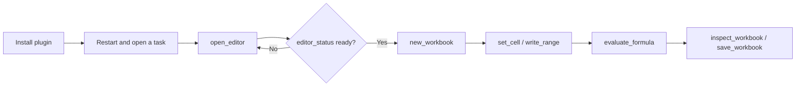

# GridCraft Use

## Plugin marketplaces

This plugin belongs to **AIGC content creation**.

| Category | Marketplace | Purpose |
| --- | --- | --- |
| Full-stack development | [Full Stack Plugins](https://github.com/partme-ai/full-stack-plugins) | Architecture and UI design, code understanding, quality checks, code review, workflow governance, and server operations |
| AIGC content creation | [Full AIGC Plugins](https://github.com/partme-ai/full-aigc-plugins) | Image, video, audio, music, 3D, and multimodal content creation |


> Build and audit a real spreadsheet from your agent host — cells, formulas, tables and charts stay editable instead of arriving as a screenshot.

[](https://github.com/full-aigc-plugins/gridcraft-plugin/releases)
[](#skills)
[](#mcp-tools)
[](LICENSE)

[English](README.md) | [简体中文](README.zh-CN.md) · [Install](#installation) · [Quick start](#quick-start) · [Skills](#skills) · [Troubleshooting](#troubleshooting)

## Positioning

`gridcraft` connects an agent host to the GridCraft workbook engine, so a request ends with an editable workbook whose formulas still recalculate. The plugin owns spreadsheet skills, a same-session editor bridge and package pinning; it does not re-implement the engine, the formula evaluator or the file format.

| Property | Value |
| :--- | :--- |
| Plugin ID | `gridcraft` |
| Version | `0.1.0-dev.20261018.3` |
| Status | Development preview; all-host acceptance still open |
| Editor runtime | Node.js 24, started from `ui/bootstrap.mjs` |
| Host requirements | Plugin or stdio MCP host; MCP Apps or a built-in browser for the panel |
| License | Apache-2.0 |

## Installation

### Prerequisites

- Node.js 24 on `PATH`; the bundled stdio MCP server runs on it.
- Network access on the first editor launch. The plugin downloads and verifies the pinned editor archive; a complete release ZIP already contains it, so no Rust toolchain, `npm install` or Python runtime is required.
- A host that supports plugins or stdio MCP. Embedded panels additionally require MCP Apps or a built-in browser.
- No separate spreadsheet application is needed; the workbook engine is bundled.

### From the plugin marketplace

```bash
codex plugin marketplace add partme-ai/full-aigc-plugins
codex plugin add gridcraft@full-aigc-plugins
```

Restart the host, open a new task, and ask GridCraft to open a workbook for your workspace.

### Other host manifests

| Host | Manifest | Path base |
| --- | --- | --- |
| Standard Agent Plugins 1.0.0 | `plugin.json`, `mcp.json` | `${PLUGIN_ROOT}` |
| Codex | `.codex-plugin/plugin.json`, `.codex-plugin/mcp.json` | plugin root relative to `cwd` |
| Claude Code | `.claude-plugin/plugin.json`, `.mcp.json` | `${CLAUDE_PLUGIN_ROOT}` |

Kimi (`kimi.plugin.json`), DeepSeek Harness (`dsh/`) and the WorkBuddy example (`hosts/workbuddy/mcp.json`) are also present. In a development checkout you must build the editor assets first; cloning the source is not an installed runtime.

## Quick start



1. Open the editor with an explicit `workspace` argument.
2. Create a workbook with `new_workbook`, or open an existing file with `open_workbook`.
3. Read the available commands first with `list_commands`, then use `execute_command` for anything the direct tools do not cover.
4. Write values with `set_cell` or `write_range`, and confirm calculations with `evaluate_formula` — never assume a formula recalculated.
5. Save with `save_workbook`, reopen, and check that formulas and formats survived.

## What you can build

| Workflow | Built-in path | Verifiable output |
| :--- | :--- | :--- |
| Clean a messy table | `gridcraft-clean-table` | Deduplicated, gap-checked, format-normalised sheet |
| Sales summary | `gridcraft-sales-summary` | Totals by period, product or region with live formulas |
| Budget versus actual | `gridcraft-budget-tracker` | Budget, actual and variance columns that recalculate |
| Reconcile two tables | `gridcraft-reconcile-data` | Matched, unmatched and exception rows |
| Formula audit | `gridcraft-formula-audit` | Broken references, hardcoded values and missing ranges listed |
| Business dashboard | `gridcraft-dashboard` | Metric cells, charts and filters on one sheet |
| Shift timesheet | `gridcraft-shift-timesheet` | Cross-midnight hours and break handling |
| Fixed-rate payment schedule | `gridcraft-fixed-payment` | Principal, rate and term turned into monthly rows |
| Month calendar | `gridcraft-month-calendar` | Weekday-accurate grid including leap years |

## Skills

| Skill | What it does |
| :--- | :--- |
| `gridcraft-editor` | Open the editor in the host and keep agent edits on the same page |
| `gridcraft-clean-table` | Handle duplicates, missing values and inconsistent formats |
| `gridcraft-sales-summary` | Aggregate sales by time, product or region |
| `gridcraft-budget-tracker` | Manage budget, actual and variance |
| `gridcraft-reconcile-data` | Compare orders, statements or stock between two tables |
| `gridcraft-formula-audit` | Find broken references, hardcoded numbers and range gaps |
| `gridcraft-dashboard` | Metrics, charts and filters on one sheet |
| `gridcraft-shift-timesheet` | Cross-midnight shifts, break hours, missing and invalid rows |
| `gridcraft-fixed-payment` | Fixed nominal annual rate and equal monthly payments |
| `gridcraft-month-calendar` | Month grid with Monday start, weekend columns and leap years |
| `gridcraft-scenario-playbooks` | Recipes for quotes, replenishment, weighted scoring, expense review, duplicate keys and task tables |

Skills come from the independent `gridcraft-skills` source and are pinned by `scenario-candidates.json` with per-skill SHA-256 digests.

## MCP tools

One bundled server, `gridcraft-editor`, speaking **stdio**. The local HTTP listener only serves the editor page and its same-session bridge. The catalogue exposes 29 tools: 24 agent-callable tools and 5 `_editor_*` bridge tools the panel uses internally.

| Family | Tools | Purpose |
| :--- | :--- | :--- |
| Session | `open_editor`, `open_browser_editor`, `editor_status` | Open the editor and confirm that it attached |
| Discovery | `list_commands`, `list_functions` | Live command IDs, parameters, and supported spreadsheet functions |
| Command gateway | `execute_command` | Run any registered engine command with JSON params |
| Workbook | `new_workbook`, `open_workbook`, `save_workbook`, `inspect_workbook` | Create, open, save and summarise a workbook |
| Cells and ranges | `set_cell`, `get_cell`, `read_range`, `write_range` | Read and write individual cells or rectangular ranges |
| Calculation | `evaluate_formula` | Evaluate a formula expression without changing any cell |
| Structure | `create_table`, `sort_range`, `filter`, `format_range` | Tables, ordering, filtering and cell formatting |
| Charts | `insert_chart` | Insert a chart bound to a range |
| Interaction | `select`, `screenshot` | Select a range; `screenshot` saves a window PNG (desktop app) |
| History | `undo`, `redo` | Step back and forward one change |

## Configuration

| Setting | Where | Effect |
| :--- | :--- | :--- |
| `workspace` argument | `open_editor` / `open_browser_editor` | Binds the task folder; paths outside it are refused |
| `CRAFT_EDITOR_UPDATE=off` | stdio MCP `env` | Use the bundled editor only; no download attempt |
| `CRAFT_EDITOR_CACHE_DIR` | Environment | Absolute directory for verified editor archives |
| `CRAFT_WORKSPACE_ROOT` | Host MCP config | Workspace root for hosts that cannot pass it in a tool call |

Verified archives are cached under `~/.cache/full-aigc/editors`; an active session keeps its version until closed, and a corrupt cache falls back to the bundled build.

## Architecture and security

Agent ↔ plugin traffic is stdio MCP; the browser bridge listens on `127.0.0.1` only, with a random token and Host/Origin checks. Downloads are SHA-256 verified and the bundled editor is always kept as a fallback. Skills are instructions and do not enforce policy at runtime. The plugin stores no credential and forwards no traffic to the authors.

Format behaviour and the current acceptance scope are described in [editor integration](docs/editor-integration.md) and `docs/verification/release-candidate.json`. A workbook that opens is not proof that every formula, format or external reference survived; check after reopening.

## Troubleshooting

| Symptom | Action |
| :--- | :--- |
| Editor tools are missing | Confirm the plugin is enabled, restart the host, open a new task |
| The panel does not render inside the host | Use the URL from `open_browser_editor`; the terminal provides no browser panel |
| First open stalls | The first launch downloads the pinned archive; retry with network, or set `CRAFT_EDITOR_UPDATE=off` |
| A formula shows a stale value | Re-run `evaluate_formula` after the write; do not trust a cached cell |
| A reopened workbook lost formatting | Re-check the affected range after `open_workbook` and reapply the format |
| A write times out | Reopen or inspect the workbook before retrying; do not replay blindly |

## Upgrade

```bash
codex plugin marketplace upgrade full-aigc-plugins
codex plugin add gridcraft@full-aigc-plugins
```

The editor archive and skill digests are pinned per release; upgrading the plugin replaces the bundled runtime rather than patching it in place.

## Contributing and support

Open issues at <https://github.com/full-aigc-plugins/gridcraft-plugin/issues>. Read `AGENTS.md` before editing skills or manifests, and keep the Chinese and English documents aligned. A scene skill is described as working only after a real command run and a reopen check.

## License

Original repository content is [Apache-2.0](LICENSE). The icon is upstream GridCraft artwork under MIT, recorded in `assets/official-icon-source.json`. Upstream GridCraft is a separate project at <https://github.com/storytold/gridcraft>; this plugin is an integration, not an endorsement.
