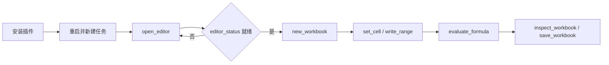

# GridCraft Use

## 插件市场导航

本插件所属分类：**AIGC 内容创作**。

| 分类 | 插件市场入口 | 用途 |
| --- | --- | --- |
| 全栈开发 | [Full Stack Plugins](https://github.com/partme-ai/full-stack-plugins) | 架构与 UI 设计、代码理解、质量检查、代码审查、流程治理与服务器运维 |
| AIGC 内容创作 | [Full AIGC Plugins](https://github.com/partme-ai/full-aigc-plugins) | 图像、视频、音频、音乐、3D 与多模态内容创作 |


> 在智能体宿主里建立并审查真实电子表格——单元格、公式、表格与图表都可继续编辑，而不是交付一张截图。

[](https://github.com/full-aigc-plugins/gridcraft-plugin/releases)
[](#技能)
[](#mcp-工具)
[](LICENSE)

[English](README.md) | [简体中文](README.zh-CN.md) · [安装](#安装) · [快速开始](#快速开始) · [技能](#技能) · [故障排查](#故障排查)

## 项目定位

`gridcraft` 把智能体宿主接到 GridCraft 工作簿引擎，因此任务结果是公式仍可重算的可编辑工作簿。插件负责表格技能、同会话编辑器桥接与包版本锁定；它不重新实现引擎、公式求值器或文件格式。

| 属性 | 取值 |
| :--- | :--- |
| 插件 ID | `gridcraft` |
| 版本 | `0.1.0-dev.20261018.3` |
| 状态 | 开发预览；全部宿主验收未完成 |
| 编辑器运行时 | Node.js 24，由 `ui/bootstrap.mjs` 启动 |
| 宿主要求 | 支持插件或 stdio MCP；内嵌面板还需 MCP Apps 或内置浏览器 |
| 许可证 | Apache-2.0 |

## 安装

### 前置条件

- `PATH` 上有 Node.js 24；内置 stdio MCP server 依赖它运行。
- 首次打开编辑器需要网络：插件会下载并校验锁定编辑器制品；完整发行 ZIP 已内置该制品，因此无需 Rust 工具链、`npm install` 或 Python 运行时。
- 宿主需支持插件或 stdio MCP。内嵌面板还要求宿主支持 MCP Apps 或自带浏览器。
- 不需要另装电子表格软件；工作簿引擎随包提供。

### 从插件市场安装

```bash
codex plugin marketplace add partme-ai/full-aigc-plugins
codex plugin add gridcraft@full-aigc-plugins
```

重启宿主，新建任务，然后让 GridCraft 为你的工作区打开工作簿。

### 其他宿主清单

| 宿主 | 清单 | 路径基准 |
| --- | --- | --- |
| 标准 Agent Plugins 1.0.0 | `plugin.json`、`mcp.json` | `${PLUGIN_ROOT}` |
| Codex | `.codex-plugin/plugin.json`、`.codex-plugin/mcp.json` | 相对 `cwd` 的插件根目录 |
| Claude Code | `.claude-plugin/plugin.json`、`.mcp.json` | `${CLAUDE_PLUGIN_ROOT}` |

此外还提供 Kimi（`kimi.plugin.json`）、DeepSeek Harness（`dsh/`）和 WorkBuddy 示例（`hosts/workbuddy/mcp.json`）。在开发仓中必须先构建编辑器资源，只克隆源码不等于已安装运行包。

## 快速开始



1. 打开编辑器时显式传入 `workspace` 参数。
2. 用 `new_workbook` 新建工作簿，或用 `open_workbook` 打开已有文件。
3. 先用 `list_commands` 读可用命令；直接工具覆盖不到的动作走 `execute_command`。
4. 用 `set_cell` 或 `write_range` 写值，并用 `evaluate_formula` 确认计算结果——不要假设公式已经重算。
5. 用 `save_workbook` 保存后重开，检查公式与格式是否保留。

## 可完成的工作

| 工作流 | 内置路径 | 可验证输出 |
| :--- | :--- | :--- |
| 清洗杂乱表格 | `gridcraft-clean-table` | 去重、补缺失、格式统一的表 |
| 销售汇总 | `gridcraft-sales-summary` | 按时间、商品或区域汇总，公式仍然生效 |
| 预算与实际对比 | `gridcraft-budget-tracker` | 预算、实际与差异列，可重算 |
| 两表对账 | `gridcraft-reconcile-data` | 匹配、未匹配与异常行分列 |
| 公式检查 | `gridcraft-formula-audit` | 引用错误、硬编码与范围遗漏清单 |
| 业务看板 | `gridcraft-dashboard` | 同一张表上的指标、图表与筛选 |
| 班次工时表 | `gridcraft-shift-timesheet` | 跨午夜工时与休息小时处理 |
| 等额还款测算 | `gridcraft-fixed-payment` | 本金、利率与期数展开为按月行 |
| 月历模板 | `gridcraft-month-calendar` | 星期准确的网格，含闰年处理 |

## 技能

| 技能 | 作用 |
| :--- | :--- |
| `gridcraft-editor` | 在宿主内打开编辑器，让 Agent 修改显示在同一页面 |
| `gridcraft-clean-table` | 处理重复、缺失与格式不一致的数据 |
| `gridcraft-sales-summary` | 按时间、商品或区域汇总销售 |
| `gridcraft-budget-tracker` | 管理预算、实际与差异 |
| `gridcraft-reconcile-data` | 核对订单、账单或库存两张表 |
| `gridcraft-formula-audit` | 找出引用错误、硬编码数字与范围缺口 |
| `gridcraft-dashboard` | 在同一张表上组织指标、图表与筛选 |
| `gridcraft-shift-timesheet` | 跨午夜班次、休息小时、缺失与异常行 |
| `gridcraft-fixed-payment` | 固定名义年利率与按月等额付款 |
| `gridcraft-month-calendar` | 周一起始、含周末列与闰年的月历网格 |
| `gridcraft-scenario-playbooks` | 报价明细、库存补货、加权评分、费用复核、重复键标记与结构化任务表的手册 |

技能来自独立的 `gridcraft-skills` 源，并由 `scenario-candidates.json` 以逐技能 SHA-256 摘要固定。

## MCP 工具

只内置一个 server：`gridcraft-editor`，使用 **stdio**。本地 HTTP 只承载编辑器页面与同会话桥接。目录共 29 个工具，其中 24 个可供 Agent 调用，5 个 `_editor_*` 是面板内部使用的桥接工具。

| 类别 | 工具 | 用途 |
| :--- | :--- | :--- |
| 会话 | `open_editor`、`open_browser_editor`、`editor_status` | 打开编辑器并确认已接入 |
| 发现 | `list_commands`、`list_functions` | 实时命令 ID、参数，以及支持的表格函数 |
| 命令网关 | `execute_command` | 用 JSON 参数执行任意已注册引擎命令 |
| 工作簿 | `new_workbook`、`open_workbook`、`save_workbook`、`inspect_workbook` | 新建、打开、保存与汇总工作簿 |
| 单元格与区域 | `set_cell`、`get_cell`、`read_range`、`write_range` | 读写单个单元格或矩形区域 |
| 计算 | `evaluate_formula` | 在不改动任何单元格的前提下求值公式 |
| 结构 | `create_table`、`sort_range`、`filter`、`format_range` | 表格、排序、筛选与单元格格式 |
| 图表 | `insert_chart` | 基于区域插入图表 |
| 交互 | `select`、`screenshot` | 选择区域；`screenshot` 保存窗口 PNG（桌面应用） |
| 历史 | `undo`、`redo` | 前进与回退一步变更 |

## 配置

| 配置 | 位置 | 作用 |
| :--- | :--- | :--- |
| `workspace` 参数 | `open_editor` / `open_browser_editor` | 绑定任务目录；越界路径会被拒绝 |
| `CRAFT_EDITOR_UPDATE=off` | stdio MCP 的 `env` | 只用内置编辑器，不再尝试下载 |
| `CRAFT_EDITOR_CACHE_DIR` | 环境变量 | 已校验编辑器归档的绝对缓存目录 |
| `CRAFT_WORKSPACE_ROOT` | 宿主 MCP 配置 | 供无法在工具调用中传参的宿主指定工作区根 |

已校验归档缓存在 `~/.cache/full-aigc/editors`；活动会话在关闭前保持自己的版本，缓存损坏时回退内置版本。

## 架构与安全

Agent 与插件之间只走 stdio MCP；浏览器桥接只监听 `127.0.0.1`，使用随机令牌并校验 Host/Origin。下载内容按 SHA-256 校验，内置编辑器始终保留为回退。技能只是指令，不在运行时强制执行策略。插件不保存凭据，也不向作者转发任何流量。

格式行为与当前验收范围见[编辑器接入](docs/editor-integration.md)和 `docs/verification/release-candidate.json`。工作簿能打开并不证明每个公式、格式或外部引用都保留；重开后必须再检查。

## 故障排查

| 现象 | 处理 |
| :--- | :--- |
| 看不到编辑器工具 | 确认插件已启用，重启宿主，新建任务 |
| 宿主内不渲染面板 | 改用 `open_browser_editor` 返回的地址；终端本身不提供浏览器面板 |
| 首次打开卡住 | 首次需要下载锁定归档；联网重试，或设置 `CRAFT_EDITOR_UPDATE=off` |
| 公式显示旧值 | 写入后重新执行 `evaluate_formula`；不要相信缓存单元格 |
| 重开后格式丢失 | 用 `open_workbook` 打开后复查受影响区域并重新应用格式 |
| 写入超时 | 先重开或检查工作簿再重试；不要盲目重放 |

## 升级

```bash
codex plugin marketplace upgrade full-aigc-plugins
codex plugin add gridcraft@full-aigc-plugins
```

编辑器归档与技能摘要按发行固定；升级插件会替换内置运行时，而不是原地打补丁。

## 贡献与支持

问题请提交到 <https://github.com/full-aigc-plugins/gridcraft-plugin/issues>。修改技能或清单前先读 `AGENTS.md`，并保持中英文文档一致。场景技能只有在真实命令执行并重开核对之后，才能描述为可用。

## 许可证

本仓原创内容采用 [Apache-2.0](LICENSE)。图标为 MIT 许可的上游 GridCraft 素材，来源记录在 `assets/official-icon-source.json`。上游 GridCraft 是独立项目 <https://github.com/storytold/gridcraft>；本插件是集成，不构成背书。
