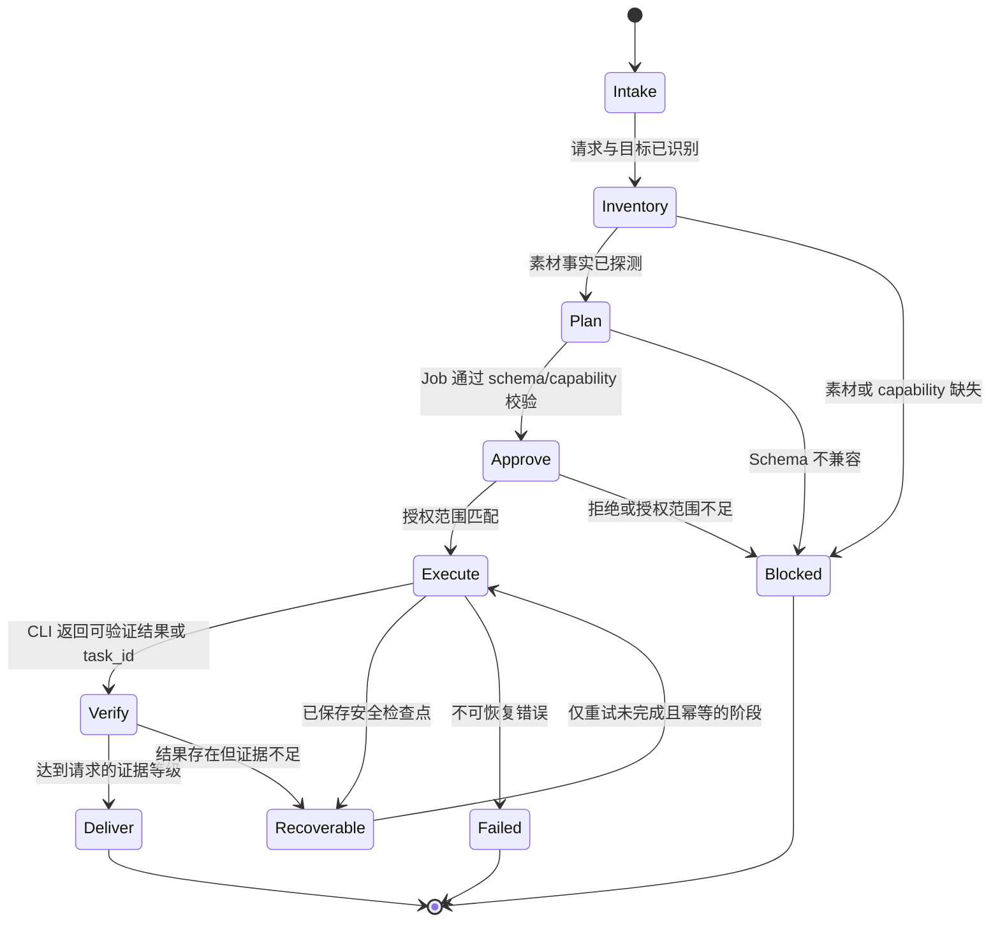

# Rust CLI Harness 状态机

本基线用于迁移期间固定三宿主的可观察语义。共享 Harness 已能通过 Rust Runtime
Adapter 执行 create 和受支持的隔离 edit；commands、hooks、skills 的默认路径仍未执行
最终 cutover，也未删除迁移期旧文件。

## 状态记录

每个任务至少保存：请求摘要、目标路径、素材哈希、Job Schema、所需 capability、CLI 版本与摘要、CLI task ID、批准的 command/arguments/cwd/target、最后验证检查点和证据等级。

## 兼容基线

- Codex、ZCode、Kimi 对相同 fixture 必须得到相同阶段、终态原因和下一动作。
- `recoverable` 只能从已验证检查点恢复，不能重复付费 ASR、原生导出或已提交写入。
- CLI capability 不足时进入 `blocked`，不得静默回退到 Python 或外部 fork。
- `jianying-cli` 已提供 `jianying-job/v2` 和真实 `job run edit`。Harness 对 edit 仅放行
  `replace_text`、`move_segment`、`remove_segment`，并使用 `job.run.edit` + 最终输出目录
  做一次性高风险批准绑定；新增素材/片段仍按 capability fail closed。
- 真实三平台发布制品、修正版技能锁和真实剪映 canary 未完成前，不执行默认路径最终切换。
