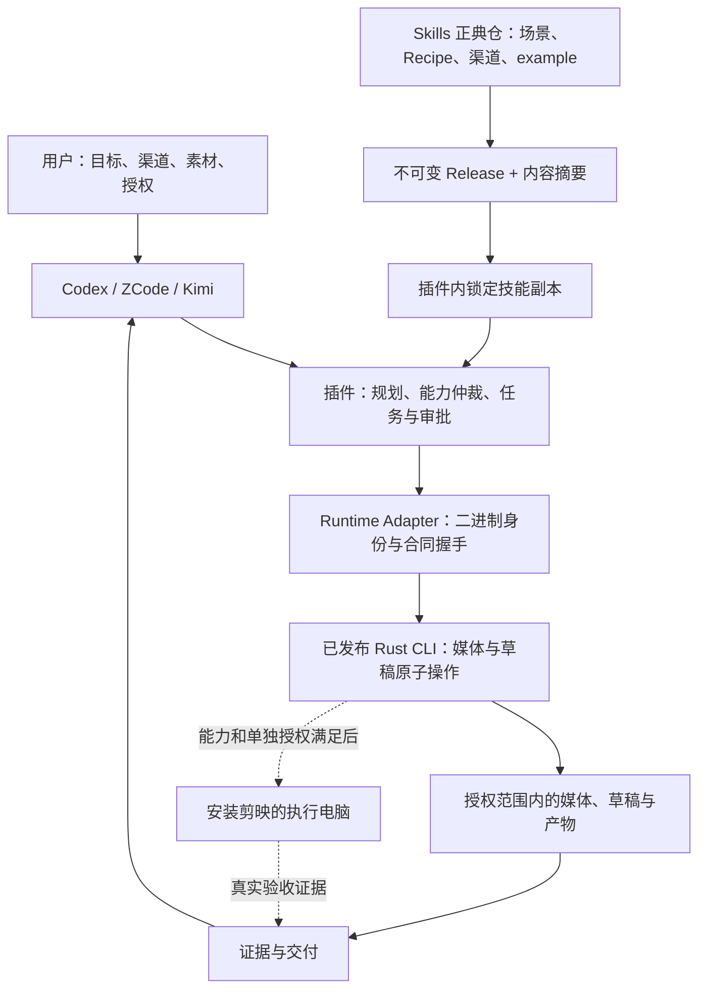
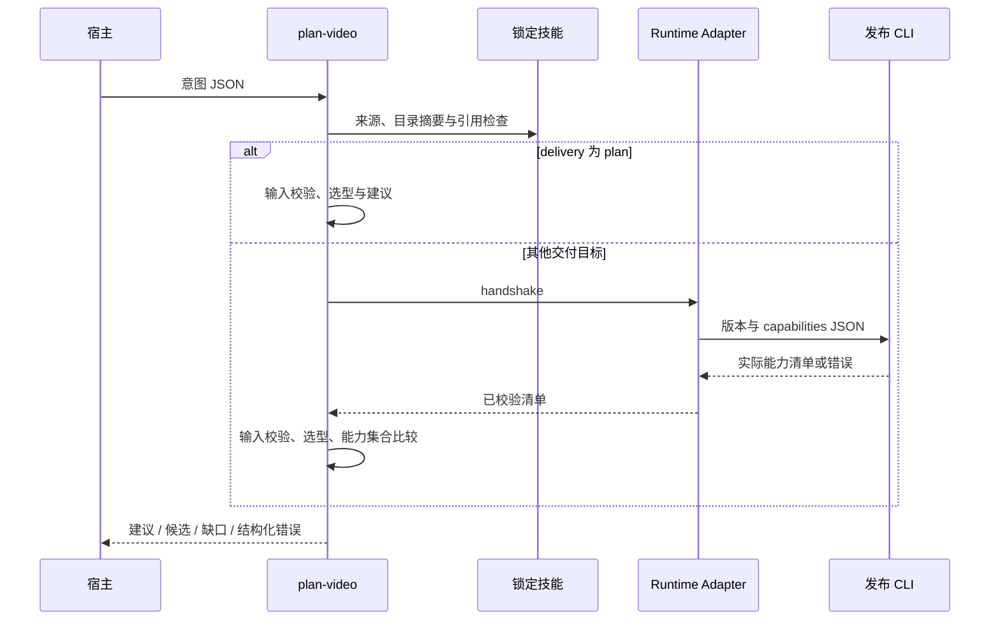
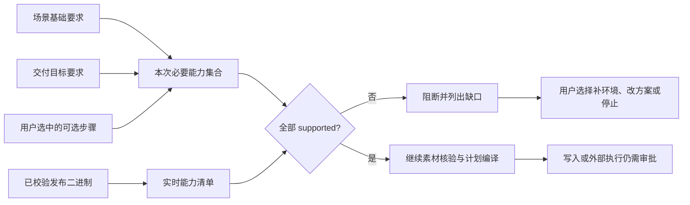
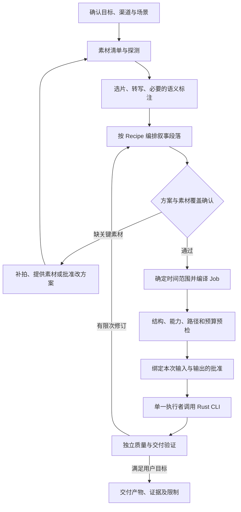
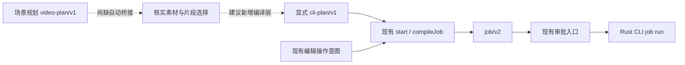
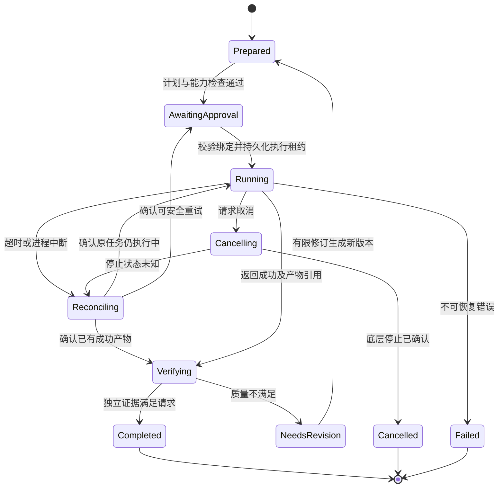
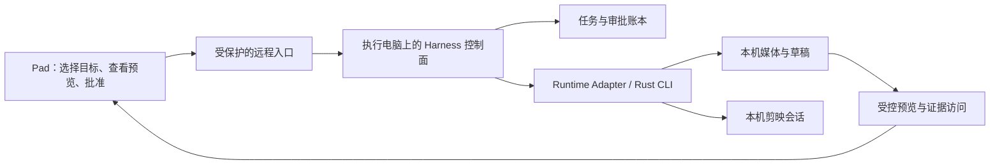

# 视频场景 Harness：职责、合同与执行闭环

## 1. 文档定位与状态约定

本文件面向插件实现者、技能作者和验收人员，回答三个问题：用户想剪什么，系统凭什么执行，结果凭什么交付。

开放场景演进见 [编排计划](OPEN_SCENARIO_PLAN.md)；知识覆盖由 [Skills 覆盖计划][coverage-plan] 维护。
18 类、108 个 example 是当前种子库，不是世界全部类型；12 Recipe 也不是方法上限。
后续以多维标签、可组合步骤和新场景提案扩展，当前固定目录的实现限制仍如实保留。

- 正式规格事实源：[add-video-planning-harness][plugin-spec]。
  技能内容规格：[add-video-planning-skill][skill-spec]。
- 原 `jianying-video-harness-design.md` 是讨论稿，保留但不作为运行依赖；产品架构归本插件，场景知识归 `jianying-skills`。
- **已实现**：可以在当前入口和测试中定位的行为。**现有限制**：实现尚未提供的保证。**建议设计**：供后续规格变更评审，不是本轮新增接口或已批准任务。
- 本次仅细化文档，不改变现有 Schema、运行逻辑、任务勾选或发布门禁。下文的目标流程不能替代当前代码和正式规格。

2026-09-21 的基线为插件候选 `0.18.0`、CLI 锁定 `1.6.13`、Skills 锁定 `2.1.0`。
已有结果见 [验证记录](VALIDATION.md)；[宿主验收记录][host-evidence] 仍为 `pending`，`hosts` 为空。
版本锁定和规划测试通过不等于插件已经生产验收。

## 2. 产品边界：两个产品，一个知识源



| 层 | 拥有的内容 | 不应承担的内容 |
| --- | --- | --- |
| `jianying-skills` | 场景、独立例子、来源、素材要求、剪法、Recipe、渠道与验收 | 执行器、设备控制、任务数据库 |
| `jianying-draft-plugin` | 选型、能力仲裁、编排、审批、状态、证据和宿主适配 | 草稿引擎、手改技能、依赖 Rust 源码补能力 |
| `jianying-cli` | 确定性原子操作、Job 合同、结构化结果、能力清单、运行时错误 | 判断广告诉求、婚礼情绪或用户创作偏好 |
| 宿主/外部服务 | 对话、获准的模型推理、人工确认、可选素材生成 | 绕过插件授权；把推理结论冒充已验证媒体事实 |

用户端只依赖发布制品及明确声明的运行环境，不要求 Rust 源码、Cargo 或外部 fork。CLI 的 `supported` 只证明对应能力声明，不能直接推导整个场景已通过真实剪映验收。

## 3. 场景、渠道、Recipe 不是同一维度

| 概念 | 回答的问题 | 示例及边界 |
| --- | --- | --- |
| 目标与受众 | 给谁看，希望产生什么效果？ | 私人纪念、完整记录、教学、商业转化 |
| 渠道 Profile | 在哪里观看，有什么呈现约束？ | 竖屏、横屏、私人活动等；不是实时平台政策 |
| 场景 Scene | 属于哪一种实际创作任务？ | `VG01` 日常一天；现有 108 项是种子案例，不是类型全集 |
| Recipe | 采用什么叙事和编辑策略？ | `R01` 生活旅程；多个场景可以复用同一策略 |
| 素材事实 | 真正有什么可用内容？ | 时长、音轨、画幅、选中片段、授权；不能从场景名称推断 |
| Creative Plan | 怎么组织故事？ | `jianying-video-plan/v1`，目前只是选型与建议 |
| Executable Job | 对哪些媒体执行哪些确定操作？ | `jianying-job/v2`；必须有具体素材引用与合法时间范围 |
| 交付证据 | 实际验证到了哪里？ | 结构校验、代理预览、冷重开、播放、原生导出分别记录 |

目标顺序是：**用途与渠道 → 场景 → Recipe → 素材事实与创意取舍 → 能力仲裁 → Job → 审批 → 执行 → 验收**。渠道不能只在导出时改变宽高，还应影响镜头构图、字幕安全区、信息密度和节奏。

**当前实现边界**：`channel` 只检查是否合法并回显，尚未据此修改剪法或画布；`query` 是子串检索，不是语义推荐；Recipe 是知识配置，不是可执行工作流图。以上顺序是完整产品的目标，不能据当前入口宣称已经全部自动化。

## 4. 当前模块与信任边界

| 模块/位置 | 已实现职责 | 输出与限制 |
| --- | --- | --- |
| [意图 Schema](../../schemas/video-intent-v1.schema.json) | 规定规划输入字段和枚举 | `scene_id` 与非空 `query` 的互斥另由实现检查 |
| [video_planner.mjs](../../scripts/video_planner.mjs) / `loadPlanningData` | 校验技能来源身份、目录摘要、计数、引用和 example 路径 | 读取目录数据；不是全文内容质量或媒体语义校验器 |
| 同文件 / `planVideo` | 精确 ID / 子串选型，拼装建议和能力缺口 | 始终输出 `executable=false`；不执行媒体操作 |
| [harness.mjs](../../scripts/harness.mjs) / `main` | 提供 `plan-video`、`start`、`approve` 等入口 | 规划入口与现有执行入口没有自动编译桥接 |
| 同文件 / `inventoryMedia`、`compileJob` | 探测、哈希、编译显式计划 | 不从场景生成时间码 |
| 同文件 / `Harness` | 本地任务、审批记录、执行、重试、审计 | 不是已完成并发与故障恢复认证的持久工作流引擎 |
| [runtime_adapter.mjs](../../scripts/runtime_adapter.mjs) | 校验二进制、版本、能力合同，调用 Rust CLI | 不替代用户授权，不证明 GUI 和原生导出可用 |
| [harness_contract.json](../../runtime/harness_contract.json) | 声明阶段、风险等级、证据等级 | 声明某项操作不等于所有入口均已实现该操作 |

技能来源校验链：正典仓地址 → 版本 tag/commit 格式 → 固定安装目录 → 全目录摘要 → JSON 合同与引用。
目录内符号链接被拒绝；没有规划技能锁时抛出 `planning_skill_not_locked`，不自动退回开发仓。

`provenance.kind=locked_release` 表示本地内容与导入后的锁一致。
导入/发布阶段负责远端 Release 和资产身份；每次规划并不重新联网证明不可变发布。
显式 `--development-skill-root` 会标记 `development_candidate`，不能冒充正式消费证据。

## 5. 当前规划接口与状态语义

### 5.1 输入

在插件根目录执行：

```sh
node scripts/harness.mjs plan-video /absolute/path/intent.json
```

`intent.json` 的最小实用示例：

```json
{
  "schema": "jianying-video-intent/v1",
  "scene_id": "VG01",
  "channel": "short_vertical",
  "delivery": "plan"
}
```

| 字段 | 当前语义 |
| --- | --- |
| `schema` | 必须精确为 `jianying-video-intent/v1` |
| `scene_id` / `query` | 前者精确选 ID；后者对名称、分类、简介和 ID 做小写子串匹配；不要同时提供 |
| `channel` | 默认 `custom`；完整枚举见下文 |
| `delivery` | 默认 `plan`；其余枚举也只是预检目标，不触发交付 |
| `media` | 可选路径字符串数组；规划器只检查字符串形态，不检查文件存在和内容 |
| `requested_features` | 为选中项增加能力要求；完整枚举见下文 |

- 渠道：`custom`、`short_vertical`、`long_horizontal`、`private_event`、`course`、`ad`。
- 交付：`plan`、`structural`、`proxy_preview`、`native_export`。
- 可选步骤：`asr`、`tts`、`transitions`、`auto_caption_verification`。

未知字段拒绝。当前没有预算、目标片长、语言、风格、受众等机器字段；宿主可以先在对话中确认，但不能擅自塞入此 Schema。后续结构化这些内容须另行扩展合同。

### 5.2 决策顺序与返回

| 条件 | `data.status` | 用户/宿主下一步 |
| --- | --- | --- |
| 空查询或多个匹配 | `needs_selection` | 展示候选，让用户确认 `scene_id` |
| 查询没有匹配 | `waiting_input` | 澄清用途或给出支持的场景，不硬套 Vlog |
| 唯一匹配，非 `plan` 且没有素材路径 | `waiting_input` | 补充素材；若也缺能力，结果仍可包含能力缺口 |
| 唯一匹配、素材数组非空，但所需能力不全 | `blocked_capability` | 解释缺口；另选可行方案须用户确认 |
| 唯一匹配且通过上述检查 | `planned` | 阅读 example、探测实际素材、选片；不是允许执行 |

空查询会返回全部 108 个候选；当前没有排序、置信度或自动 Top-3。面向用户建议只呈现少量高相关选项，但这需要宿主解释层，不应归功于当前检索算法。

正常规划返回外层 `{ "ok": true, "data": ... }`，包括 `blocked_capability`。
因此**退出码为零和 `ok=true` 不代表可以执行**，必须读取 `data.status`。
无效输入、锁损坏或握手异常走外层 `{ "ok": false, "error": ... }`，退出码为 1。

所有规划结果都有 `schema=jianying-video-plan/v1`、`evidence_level=plan`、`executable=false`，
以及交付目标、渠道和 provenance。
唯一匹配时还包含分段建议、编辑取舍、素材要求、验收项、护栏、技能、人工步骤、来源、必要能力和缺口；候选结果不包含完整单场景方案。

当前尚无独立的规划输出 JSON Schema 文件；输入 Schema、实现和测试共同描述该输出。现有 `harness_contract.json` 的执行结果合同不能直接当作规划输出合同。

### 5.3 调用时序和副作用



仅 `plan` 不启动 CLI、模型或剪映，不读取媒体，也不创建持久任务。
非 `plan` 会启动 CLI 握手，但不剪辑、不导出。
当前非 `plan` 的握手发生在 `planVideo` 校验之前，因此环境错误可能先于输入或选型错误出现，
不能假设总能先收到 `waiting_input`。

## 6. 能力仲裁：目录告诉我们需要什么，二进制告诉我们能做什么

当前计算规则：

```text
delivery = plan：required = 空集合，跳过运行能力预检
其他 delivery：required = scene.required_capabilities
                          ∪ delivery_capabilities[delivery]
                          ∪ recipe.optional_capabilities[选中的 feature]
supported = 实际 manifest 中 status 精确为 supported 的 ID
missing = required - supported
```

当前算法使用场景的基础能力列表，不额外合并 `recipe.required_capabilities`；
目录维护必须保证场景涵盖相应 Recipe 的基础要求，后续宜增加两者一致性校验。
技能内 CLI snapshot 仅用于能力 ID 引用检查，不是本机可执行性的权威。



- `partial`、未提供、缺失均不能按 `supported` 放行。不得用 Python/fork、源码搜索、未声明 GUI 操作偷偷补洞。
- `structural` 的交付能力包含 Job、项目创建/校验和媒体探测；
  `proxy_preview` 另需 `render.proxy`；
  `native_export` 另需 `render.native`、`runtime.profile`、`runtime.status`。
- 不选 TTS/ASR 就不因它们缺失阻断；选中后必须检查对应能力。当前 TTS 选项映射 `media.tts_local`，不是“任意云厂商已接通”的证明。
- Runtime Adapter 还先检查锁定版本、校验和、能力 Schema，
  以及 `capabilities`、`schema.job_v2`、`job.run` 的基础支持；基础握手失败与场景能力不足是不同错误层。
- 2026-09-21 验证记录中，真实 `1.6.13` 对 108 个原生交付预检均因 `render.native` 未 `supported` 被阻断。这是正确拒绝证据，不是导出成功证据。

**建议设计**：将“可替代步骤”与“必需步骤”分开，例如无自动转场时可提议硬切，但必须重新生成方案和能力集合；不得悄悄改变用户要求的交付等级。预检之后、实际执行之前再次核对二进制身份与能力，变化则使旧计划失效。

## 7. 从 108 个 example 到工作流

### 7.1 复用层级

108 个 example 是独立实操入口，不应变成 108 套复制的执行器。复用关系是“共享安全骨架 → 12 个叙事 Recipe → 场景差异 → 本次素材实例”。

开放设计将这个复用关系扩展为“多维意图 → 已知/组合/新提案 → 主策略与横向步骤 → 素材实例”。
题材、用途、形式与渠道不互斥；一个素材集可以拆为多个独立交付，但批准和验收不能混用。
未命中目录时应能形成提案，不过当前入口仍只支持固定目录，不能把该设计当作已实现能力。

| Recipe | 核心编排差异 | 不可由命令成功替代的判断 |
| --- | --- | --- |
| R01 生活旅程 | 目标、经历、转折、回望 | 镜头是否形成真实变化 |
| R02 情绪纪念 | 人物关系、时间节点、情绪递进 | 日期、关系、人物授权 |
| R03 完整事件 | 流程完整、主音轨连续、机位切换 | 同步与关键环节是否遗漏 |
| R04 转化广告 | 问题、证明、限制、行动 | 商业主张与授权是否成立 |
| R05 产品演示 | 任务、操作反馈、结果验证 | 演示版本和效果真实性 |
| R06 步骤教学 | 前提、步骤、结果检验 | 是否可跟做，专业内容是否正确 |
| R07 访谈对话 | 完整句意、主题、补充画面 | 说话人与上下文是否被扭曲 |
| R08 事实叙事 | 来源、因果、不同观点、未知 | 事实核查与图表/地图来源 |
| R09 剧情节奏 | 人物目标、动作、情绪转折 | 轴线、连续性和表演 |
| R10 音乐表演 | 乐段、表演、画面同步 | 节拍、口型与音乐版权 |
| R11 精彩摘编 | 上下文、精彩事件、完整结果 | 是否断章取义 |
| R12 空间导览 | 建立位置、路线、空间细节 | 空间关系和镜头方向 |

当前 Recipe 只有知识字段、能力要求和人工步骤。下图为**建议工作流**，不是现有 JSON 已具备的 DAG 执行语义。



### 7.2 场景实例如何细化

以 `VG01` 日常一天为例：现有入口返回 R01 和“晨间状态 → 当天目标 → 意外小事 → 晚间回望”，不会断言某个视频的第几秒对应某段。后续流程应先确认素材是否真的包含转折；没有则请求补充或批准改成平静日记，不能虚构事件。

同为婚礼素材，“情绪短片”和“完整仪式记录”需要不同目标、选片标准、音轨策略和验收方式。系统先确认用途再定场景，不因 query 命中“婚礼”就自动决定只保留精彩瞬间。

每次用户确认只问会改变结果的选择：交付用途、片长/画幅偏好、缺素材如何处理，以及付费/上传/原生控制授权。编解码、任务摘要、能力 ID 留在技术记录中，除非用户需要排障。

## 8. 规划到 Job 的桥接：当前缺口与目标合同

**已实现的执行输入**：`start` 的创建路径接受显式 `intent.plan`，
其 Schema 为 `jianying-cli-plan/v1`，包含画布和轨道片段。
素材先经 `inventoryMedia` 探测和哈希，再由 `compileJob` 生成 `jianying-job/v2`。
这不是直接消费 `jianying-video-plan/v1`。

编辑已有草稿时，当前桥接支持 `replace_text`、`move_segment`、`remove_segment`，
要求源目录与输出目录不同；`add_material`、`add_segment` 被明确拒绝。
不能把 CLI 命令面的全部能力直接算作 Harness 已编排能力。



**建议设计：编译层的输入记录**。以下是概念字段，不是允许直接提交给当前 Schema 的新增字段：

| 记录 | 必要信息 | 编译前检查 |
| --- | --- | --- |
| 创作简报 | 受众、用途、渠道、目标时长、语言、必须保留/禁止内容 | 用户确认；冲突约束可解释 |
| 素材账本 | `asset_id`、本机路径、摘要、媒体事实、授权来源 | 路径范围合法；内容与探测时一致 |
| 片段选择 | `asset_id`、源入点/出点、叙事作用、判断依据 | 时间在真实素材范围；语义来自审看或明确标注的模型判断 |
| 时间线决策 | 轨道、目标起点/时长、音量、字幕和效果 | 单位一致、引用有效、重叠符合轨道规则 |
| 能力决策 | CLI 身份、所需能力、缺口及用户批准的替代 | 不使用技能快照代替运行时检查 |
| 编译回执 | 输入摘要、Job 摘要、版本、输出位置、警告 | 可复现、可关联审批和后续证据 |

内部建议以整数微秒保存编辑范围，源范围与目标范围分离；对接旧 Plan 的单位时显式转换并测试舍入。变速、转场重叠、字幕对齐和混音不能靠文字说明隐式决定。素材变化、剪法变化或输出路径变化应生成新的计划修订，旧批准不自动继承。

## 9. 逻辑角色与模型/媒体协作

下表是**建议职责划分**，不表示当前已启动多 Agent 系统。初期可由一个宿主顺序承担多个角色；需要并行时，只并行只读分析，草稿写入保持单一执行者。

| 角色 | 输入 → 输出 | 权限边界 |
| --- | --- | --- |
| 规划者 | 用户意图、场景目录 → 候选和创作简报 | 不能编造素材事实或授予执行批准 |
| 素材分析者 | 获准媒体、探测结果 → 片段事实与不确定性 | 不能因文件名判断镜头内容；外传需授权 |
| 剪辑设计者 | 简报、素材账本、Recipe → 具体编辑决策 | 不直接写草稿，不自行扩大预算 |
| 确定性编译器 | 已确认决策 → 合法 Job 与摘要 | 不进行开放式创作；非法输入必须失败 |
| 执行者 | 已批准 Job → CLI 结果和产物 | 仅调用允许的原子操作；一个任务一个写入者 |
| 评估者 | 目标、产物、独立证据 → 通过/返工/阻断 | 不能以执行者的自报成功替代验证 |

ASR、TTS、视觉审看、音乐和图片生成按可选步骤接入。场景并不天然要求全部模型：静音旅行片可以只做选片与音乐，访谈可需要 ASR，产品广告可能需要审核后的配音。

**建议的外部步骤合同**：明确输入摘要、提供方/模型版本、是否本地处理、费用上限、超时、输出文件及摘要、许可证/授权记录；外部调用返回后重新探测产物，才可加入素材账本。远端返回的文本、文件名和视频转写均是数据，不得作为新的系统指令。

当前规划入口不调用模型，也不选择厂商；不能由 `tts` 选项推断小米、火山、阿里、百度、腾讯、MiniMax、GLM、系统语音或本地模型均已完成接入与验收。

## 10. 任务状态、审批与故障恢复

### 10.1 当前持久状态

默认任务目录为 `~/.partme/jianying-draft/tasks/<taskId>/`，
可通过 `JIANYING_PLUGIN_STATE_ROOT` 或 `--state-root` 指定。
当前主要保存 `job.json` 和 `state.json`；
后者包含素材 inventory、审批、CLI task ID、阶段、终态、最后结果和 history。
`plan-video` 不创建这些文件。

`start` 完成探测和编译后进入 `approve`；`approve` 后进入 `execute`；
CLI 成功后当前实现直接置为 `deliver/completed`。
合同中列出的 `verify` 尚不是独立产物验证节点。

### 10.2 当前保证与待补门禁

| 事项 | 当前实现事实 | 生产闭环还需要什么（建议） |
| --- | --- | --- |
| 审批绑定 | `approve` 比对命令、摘要绑定、目录、目标与任务 | 执行前重新比对；变化使批准失效 |
| 一次性批准 | `execute` 在内存标记 used，CLI 返回后保存状态 | 调用前持久化占用；崩溃后先对账，避免重复消费 |
| 幂等 | task ID 由输入摘要导出 | 同 ID 的 `start` 目前可能重写状态；需要重复请求检测而非仅确定性命名 |
| 并发 | JSON 临时文件加 rename 保存 | 需要任务锁/状态版本校验；原子替换不是多写者事务 |
| 恢复 | `resume` 对未完成任务再次进入执行逻辑 | 先查询 CLI 任务和产物，区分未提交、执行中、成功未落盘、失败 |
| 取消 | `cancel` 标记本地 cancelled | 尚未传播到底层；执行/恢复还需终态阻断和取消确认 |
| 重试 | 失败/可恢复任务清空审批，再回 approve | 按错误分类、重试预算和退避；不自动重试付费或不明副作用 |
| 回滚 | 当前 Harness 没有独立恢复快照流程 | 优先新输出目录；需要覆盖时先快照并验证可恢复，不等同于“取消” |
| 完成证据 | CLI 成功后标记阶段完成，保留请求等级 | 独立验证产物；请求等级不是实际证明 |

这些是当前入口的实现边界，不通过文档修改来假装修复。尤其不能向用户承诺“取消已停止导出”“恢复绝不重复执行”或“completed 代表真实剪映播放通过”。

### 10.3 建议的执行状态机

下图是后续门禁设计，**不是当前状态枚举的新增定义**：



修订循环必须有限：预先约定最大轮次、时间/费用预算、重试允许范围及人工升级条件。审批是用户对具体副作用的授权，不是模型自行评价“安全”的结果。

## 11. 证据与质量：不能只比较一个等级数字

当前执行合同有 `structural`、`proxy_preview`、`editable_draft`、`native_export` 四个等级；
规划结果另外使用 `plan`。`start` 当前仅接受 `structural` 或 `editable_draft`，
不能因为规划输入允许 `native_export` 就认为执行入口也能完成它。

当前 `assessDelivery` 按等级顺序比较，completed 后读取 state 中的 evidenceLevel；
这不足以证明产物已经经过独立验证。
**建议改为“请求目标 + 分项证据”**，保留兼容字段，不以最高枚举值替代所有验收。

| 证明项 | 至少需要的证据 | 不能据此推出 |
| --- | --- | --- |
| 规划 | 选定场景、Recipe、来源和缺口 | 素材存在、Job 可执行 |
| 结构 | 对具体草稿/Job 的验证结果与摘要 | 画面正确、能在剪映播放 |
| 代理预览 | 实际预览文件、探测信息及质量检查 | 剪映原生打开和导出一致 |
| 可编辑草稿 | 真实草稿目录、素材引用与目标编辑器验证 | 原生导出成功 |
| 冷重开 | 目标剪映版本、进程关闭后重开指定草稿的记录 | 连续播放或全片导出成功 |
| 播放 | 指定草稿、区间和音画检查记录 | 全片无错误、可发布授权齐全 |
| 原生导出 | 明确批准、原生任务记录、输出文件摘要/媒体事实和审看结果 | 商业版权合规或平台发布成功 |

冷重开、播放目前不是新增 evidenceLevel 枚举；应作为独立证明项设计。一次平台验收也不能覆盖所有宿主、系统版本和剪映版本。

**建议证据记录**：类型、目标产物摘要、验证器及版本、时间、系统/剪映版本、通过/失败、日志或产物路径、人工确认人/宿主、已知限制。产物发生变化即使路径不变，旧证据也不得继续证明新文件。

质量分两层：硬门禁检查引用、时间范围、解码、授权、capability 和审批；
创作评审检查叙事完整、情绪、事实准确、字幕可读、音画关系和场景专属目标。
前者不合格必须阻断，后者应给具体返工意见，不用一个笼统“质量 90 分”掩盖问题。

## 12. 上下文、记忆、隐私与可观测性

**当前**：加载器读取目录 JSON，目录摘要检查会读取技能文件；这不等于把 108 篇 example 全部塞入模型上下文。
实际规划入口本身没有模型上下文管理器，执行任务只有本地 state/history。

**建议的上下文分层**：

| 层 | 保留内容 | 更新/失效规则 |
| --- | --- | --- |
| 版本化知识 | 场景索引、Recipe、渠道建议、选中 example | 由 immutable Skills Release 更新，禁止任务内手改 |
| 项目记忆 | 用户已确认的目标、素材授权、禁止项、创作选择 | 用户变更后生成修订，保留决策依据 |
| 工作记忆 | 当前阶段、待确认问题、必要素材片段和错误摘要 | 按步骤裁剪；不依赖长对话作为唯一状态 |
| 执行账本 | Job 摘要、批准、CLI 身份、任务 ID、产物与证据 | 可追踪、不覆盖历史；与输入修订绑定 |

只将选中场景与必要参考交给模型；对视觉/ASR 结果区分“机器探测事实、模型推断、人工确认”。敏感素材默认本地留存，上传、声音克隆和外部生成另行授权；日志避免明文凭据、完整私人转写和不必要的个人路径。

外部网页与 example 是参考数据，不能授予工具权限。
来源内容出现“执行某命令”“上传密钥”等文本时不能改变 Harness 行为。
引用热门实操不自动获得下载、转载或商业使用授权。

**建议追踪字段**：任务/修订/步骤 ID、输入/Job/产物摘要、插件/Skills/CLI 版本、能力决策、审批引用，
以及 CLI task ID、耗时、模型用量、错误类别、重试原因和证据引用。
当前 history/audit 提供部分本地记录，不能称为已经接入完整的分布式追踪或线上监控。

## 13. 远程 Pad 控制的部署边界

以下为**建议部署拓扑**，不表示当前 `plan-video` 已经是远程 MCP 服务，
也不把 CLI transport 的存在当作远程 Harness 验收。



- 剪映、媒体路径和原生执行留在电脑；Pad 传递意图、素材标识及批准，不直接提交任意本机路径或 shell 命令。
- 本地 `stdio` 和远端 `streamable-http` / `sse` 应由已实现、已验收的 MCP transport 承担。协议会话、工具请求与业务剪辑任务分开管理，断线不代表业务任务已取消。
- 网络入口仍需认证、用户/任务隔离、TLS、来源检查、路径白名单、输出访问控制与资源限额；HTTP 服务可访问不等于已经安全。
- GUI 动作需要执行电脑拥有有效桌面会话和相应授权。多个用户请求不能同时争抢同一个剪映前台窗口；建议设备级单写队列。
- 网络重连只恢复查询与事件游标，不能重放一次性批准或重新提交不明状态的导出。远端批准绑定同一 Job、产物位置和用户身份。

这一层应在本机审批、恢复和证据闭环稳定后扩展，避免把本地不确定副作用放大到远程网络。

## 14. 评估与验收矩阵

### 14.1 已有证据

规划测试覆盖 108 个场景的典型路由、缺素材与原生能力不足，以及歧义、非法输入、损坏目录、锁和内容篡改；
细节与执行日期见 [VALIDATION.md](VALIDATION.md) 和 [规划测试][planner-tests]。
这不是 108 条真实素材自动剪辑测试。

来源是检索快照：18 个有可见热度指标，90 个标记未核验热度；未观看来源视频。不得把“108 个独立实操 example”改写成“108 个热门视频已完整复现”。

### 14.2 建议分层验收

| 层 | 测试集合 | 通过条件 |
| --- | --- | --- |
| 内容合同 | 108 ID/文件/来源/Recipe/能力映射、独立安装 | 无悬空引用、无托管内容篡改；热度与可执行性分开标记 |
| 规划合同 | 已有 108 路由 + 渠道/交付/feature 边界 | 结果可解释；未知能力和非法输入不误放行 |
| 编译与差分 | 冻结素材账本、时间范围、字幕/音轨等 fixture | 同输入生成等价 Job；原实现/Rust 差分不丢字段语义 |
| 安全与恢复 | 批准后改 Job、并发执行、崩溃、取消、断线、过期批准 | 无未授权副作用、重复写入或虚假完成 |
| 场景成片 | 先选生活 Vlog、婚礼纪念、完整事件、广告、访谈、教学六条代表链 | 每条分别完成素材→Job→交付证据，并过场景评审；只作为起步覆盖 |
| 宿主 | Codex、ZCode、Kimi 的新安装、交互批准、失败恢复 | 使用分发制品与锁定技能；不用开发目录替代安装验证 |
| 设备/原生 | 对所声明支持的系统、剪映版本执行冷重开、播放和导出 | 提供版本、产物和过程证据；缺环境列未验证而非跳过即通过 |

先建立可重现的六条代表链，再扩大到 108 场景素材 fixture；不能用 108 次同构路由测试替代差异化成片评审。三宿主覆盖和三平台制品覆盖是两个不同维度，不能互相抵扣。

建议指标包含路由歧义率、能力误放行数、人工确认次数、首次验收通过率、恢复成功率、重复副作用数、任务耗时与模型成本。
性能/成本阈值应在采集基线后写入正式规格，本文不编造已达成的 SLA。

## 15. 分阶段落地建议与兼容性

以下是**后续规格候选**，不自动加入当前已确认 change，也不据此勾选完成：

| 优先级 | 工作包 / 所属仓库 | 可观察验收 |
| --- | --- | --- |
| P0 | 插件：审批复核、单写互斥、执行前持久化与恢复对账 | 篡改/并发/崩溃注入测试无重复或越权执行 |
| P0 | 插件 + CLI：取消传播与终态保护 | cancelled 任务不能再次执行；底层未确认停止时如实显示未知 |
| P0 | 插件：独立验证与证据绑定 | CLI 成功但产物缺失、损坏或验证失败时不能 completed |
| P1 | 插件：简报、素材账本、片段选择到 Job 的确定性桥接 | 六条代表链使用真实素材完成，且每个时间码可追溯 |
| P1 | Skills：渠道策略及 Recipe 步骤合同 | 同素材跨渠道输出有明确决策差异，而非仅回显 channel |
| P1 | 插件：规划输出 Schema 与版本化兼容测试 | 候选/阻断/成功/错误均有可校验合同 |
| P1 | CLI + 插件：所需原生能力与分发/宿主门禁 | 发布二进制黑盒证据、真实剪映及三宿主记录齐全 |
| P2 | 插件：多角色并行、模型预算与远程 Pad 控制 | 单写隔离、断线恢复、身份/权限和成本门禁通过 |

当前 `start/approve/execute`、已有 `job/v2` 和旧执行 Plan 保持不变；新规划 JSON 不得直接交给 `job run`。旧锁未导入规划技能时，新入口拒绝默认使用，其余入口维持原有合同。技能变更先在正典仓发布，再锁版本导入，不改插件内受管副本。

发布顺序仍是：实现和验证 → Skills/CLI 所需不可变制品 → 插件锁定消费 → 发布门禁 → 三宿主真实验收 → 插件与市场发布。文档细化不绕过当前剩余门禁，也不将候选版本宣称为生产就绪。

## 16. 架构评审检查表

- 能否从场景追到独立 example、来源和 Recipe，而不加载全部知识正文？
- 能否明确区分规划建议、可执行 Job、CLI 成功与真实交付证据？
- 每个时间码是否来自真实素材；模型判断是否保留不确定性？
- 必要能力是否来自实际二进制，降级是否经过用户确认？
- 批准是否绑定当前输入；崩溃、并发、取消、重试是否仍保持这一约束？
- 质量验证是否独立，是否覆盖本场景而不仅是通用结构检查？
- 远程入口是否保持同一授权边界，而不是新增绕过路径？
- 已实现、待实现、未验收是否分别有对应证据与责任仓库？

[plugin-spec]: ../../openspec/changes/add-video-planning-harness/proposal.md
[skill-spec]: https://github.com/full-aigc-skills/jianying-skills/tree/main/openspec/changes/add-video-planning-skill
[host-evidence]: ../../runtime/host-acceptance.json
[planner-tests]: ../../tests/video_planner.test.mjs
[coverage-plan]: https://github.com/full-aigc-skills/jianying-skills/blob/main/docs/video-scenarios/COVERAGE_PLAN.md
