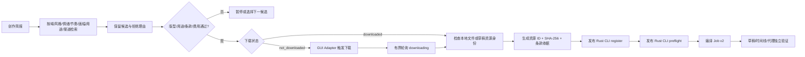
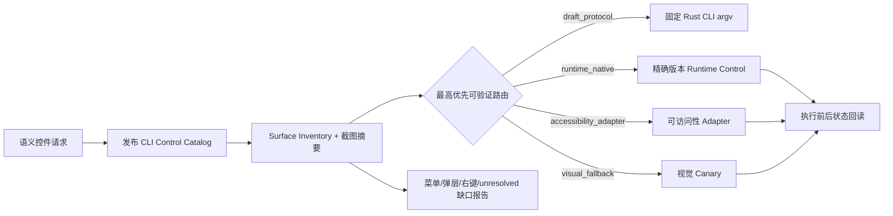

# 剪映原生能力编排基线

本基线冻结 2026-09-21 当前剪映专业版界面中已观察到的原生能力域。界面可见、菱形、限免和下载按钮仅是观察证据，不等同于账号权益、资源授权或执行成功。

## 能力域矩阵

| 域 ID | 界面能力 | 主要子类或动作 | 执行类别 | 关键前置条件 | 完成证据 |
|---|---|---|---|---|---|
| `media` | 素材 | 导入、官方视频/图片、云素材、AI 生成 | 资源取得与应用 | 画幅、时长、用途、权益、文件身份 | 下载文件摘要、草稿素材引用、时间线片段 |
| `music` | 音频/音乐库 | 推荐、会员热榜、旅行、欢乐、纯音乐、音效 | 资源取得与应用 | 发布渠道、商用范围、时长、节奏、权益 | 音频身份、轨道范围、响度与用途收据 |
| `text` | 文本 | 默认文本、花字、文字模板、智能文本、AI 口播稿 | 资源与参数化编辑 | 字体、语言、可读性、安全区、模板权益 | 文本内容、样式节点、时间范围 |
| `sticker` | 贴纸 | 热门、Vlog、互动、情绪、电商、节日 | 资源取得与应用 | 风格、遮挡、安全区、权益 | 贴纸资源 ID、变换、片段引用 |
| `effect` | 特效 | 基础、动感、氛围、边框、多屏、有声、人物特效 | 资源与参数化编辑 | 作用范围、强度、声音、性能、权益 | 效果资源、参数、绑定片段、代理预览 |
| `transition` | 转场 | AI、叠化、幻灯片、运镜、模糊、自然 | 资源与参数化编辑 | 相邻片段、句柄长度、时长、节奏 | 两侧片段、转场资源、时长和冷重开结果 |
| `caption` | 字幕 | 字幕生成、字幕样式、批量样式 | 资源与参数化编辑 | ASR/文本来源、语言、可读性、时间对齐 | 字幕内容、时间码、样式与语境评估 |
| `smart_package` | 智能包装 | 智能推荐、科技风、生活 Vlog、营销带货、知识分享、综艺娱乐 | AI/生成型组合 | 风格目标、允许轨道、受保护内容、预算、预览 | 组合变更集、应用前后差分、人工批准 |
| `filter` | 滤镜 | 分类筛选、强度调整、片段或全局应用 | 参数化本地编辑 | 色彩目标、素材色域、强度、作用范围 | 滤镜资源、强度、范围、画面验证 |
| `adjustment` | 调节 | 曝光、对比度、色温、饱和度等 | 参数化本地编辑 | 素材色域、镜头匹配、参数边界 | 参数差分、关键帧与代理画面 |
| `template` | 模板 | 成片模板、版式与轨道组合 | 资源取得与应用 | 画幅、槽位、素材数量、权益、替换规则 | 模板 ID、槽位映射、生成草稿差分 |
| `digital_human` | 数字人 | 形象、声音、脚本、背景、预览、生成 | AI/生成型组合 | 肖像/声音权利、上传批准、费用、脚本、权益 | 请求摘要、任务 ID、费用、产物与应用引用 |

智能 B-Roll 是 `smart_package` 的专用子流程：结果必须拆分为补充画面、字幕、花字、音效和特效证据；在无法拆解时只能作为整体预览等待人工批准。

## 所有权矩阵

| 职责 | `jianying-cli` | `jianying-draft-plugin` | 宿主 GUI Adapter | 真实剪映 | 人工批准/评审 |
|---|---|---|---|---|---|
| 能力事实 | 发布二进制 capability 与 Schema | 锁定并消费，不自行发明 | 报告当前可见性 | 提供实际界面与草稿行为 | 不覆盖机器事实 |
| 搜索与筛选 | 定义查询、候选和过滤合同 | 根据创作简报编译策略 | 在 GUI 中履行查询 | 返回实际候选 | 审阅高风险选择 |
| 权益与许可 | 校验版型、收据、用途和摘要 | 聚合 Job 用途与渠道 | 观察菱形、限免、下载/应用状态 | 实施账号实际能力 | 处理无法自动证明的条款 |
| 原子写入 | 预检、动作合同、状态、恢复和证据 | 排序、批准、重试/停止策略 | 执行获准 GUI 动作 | 写入草稿或生成任务 | 批准不可逆、付费、上传动作 |
| 组合编排 | 提供可组合原子能力 | 拥有 WorkflowPlan 和质量循环 | 不自行改变计划 | 执行步骤 | 批准智能包装/数字人结果 |
| 完成判定 | 验证草稿、资源、时间线和产物 | 汇总独立验证与交付门禁 | 只提交观察证据 | GUI 成功提示不是最终证据 | 叙事、音画和权利最终复核 |

## 资源取得执行闭环

资源卡片显示下载图标时，系统不得把它归类为“缺少资源”。Harness 必须先履行资源取得步骤，再判断资源是否可用于草稿。



路由优先级固定为：CLI 直接目录/操作 → 版本绑定的可访问性 Adapter → 视觉 Computer Use Canary。Computer Use 只负责底层暂时不能表达的 GUI 检索、预览、下载或会话动作；资源落地后立即回到 CLI 收据、预检、组合和验证链。固定坐标、Cookie、Token 和私有接口都不是生产合同。

下载失败、超时或结果不明确分别返回 `resource_download_failed`、`resource_download_timeout`、`resource_download_ambiguous`。三者都禁止静默换素材或自动重复付费动作。

## 普通资源目录与逐域预检

普通资源目录固定覆盖 `media/music/text/sticker/effect/transition/caption/filter/adjustment/template`
十个域。目录 Adapter 只能执行只读 `listCatalog`，输出绑定编辑器版本、版型观察、候选稳定 ID、
权益、用途、下载状态和观察时间；本地落地路径会从目录快照中剥离，账号秘密不得进入候选或持久化证据。
隐藏、未知和未枚举的域分别保留为 `unavailable` 或 `unresolved`，不能用空候选伪装成完整目录。

资源应用在 Job 编译前执行 `jianying-native-resource-use-preflight/v1`：

- 转场必须绑定两个不同且相邻的片段以及时间线内的切点；
- 音乐必须同时通过用途、渠道和时间范围校验；
- 特效、滤镜和调节必须声明有效范围，且不得覆盖受保护片段；
- 模板必须明确支持目标画幅；
- 限免到期、未知版型、用途冲突、渠道冲突和资源身份漂移均 fail closed。

发布包黑盒矩阵分别验证基础版与专业版成功注册/预检，以及限免过期、用途冲突在下载和 CLI
副作用前被拒绝。该矩阵不替代真实 GUI 的搜索、预览、应用、移除和冷重开验证。

## 智能包装与智能 B-Roll 子计划

智能包装固定编译为 `preview → human review → apply → independent verify` 四步 WorkflowPlan 子图。
请求冻结输入素材、允许轨道、受保护对白/品牌声明/镜头、预算、最大时长和必须人工批准的预览。
六个界面风格只映射为开放路由标签：智能推荐、科技风、生活 Vlog、营销带货、知识分享、综艺娱乐；
标签不作为 GUI 命令。

提案必须拆解为 `b_roll/caption/fancy_text/sound_effect/effect/transition` 六类可观察变更；每项带稳定
change ID、动作、轨道、范围、目标和内容摘要。未解释的变更、超预算、越过允许轨道、删除受保护对白、
修改品牌声明或覆盖锁定镜头均拒绝。批准绑定请求摘要、变更集摘要和过期时间，不能复用于另一份预览。

应用前必须取得快照。应用返回不明确状态，或应用后检查发现受保护内容、范围、摘要漂移时，Adapter
必须恢复原快照并验证 `restored`；没有恢复能力的 Adapter 不得进入生产执行。

## 数字人库存、授权与远程任务

数字人 WorkflowPlan 固定拆为 `inventory → preview → approve → submit once → resume → verify artifact`。
库存形象和声音分别按类别、语言、声音风格、版型、用途与预算筛选；预览计划永远
`submit_allowed=false`，不能借预览隐式上传或付费。

自定义真人照片/视频和声音必须使用稳定素材 ID，并分别绑定：

- 肖像权批准；
- 声音权批准；
- 目标 Provider、具体素材和用途范围的上传批准。

专业版订阅不能替代上述批准。脚本必须先人工审阅并保存内容摘要；背景、用途、渠道、权益、预算和
Provider 都进入稳定请求摘要。远程提交使用由完整请求派生的 `digital-human-<digest>` 作为幂等键。
账本已有 submitted/running/completed/failed/cancelled 状态时只恢复；已有 ambiguous 状态时暂停人工对账，
不得再次 submit。

Provider 必须返回供应商 request ID 与 remote task ID。估算或实际费用越过批准上限立即停止；完成提示
仍需验证本地产物为普通文件、字节长度和 SHA-256 均匹配，才生成数字人证据。

## 时间线控件语义编译

插件只从锁定发布 CLI 读取 `jianying-timeline-control-catalog/v1` 与
`jianying-timeline-surface-inventory/v1`。Surface 是逐入口事实：两个按钮或手势即使指向同一
`semantic_id` 也分别保留，不能为了“去重”丢掉界面覆盖证据。



- `split/trim/move/remove/keyframe/filter/effect/transition` 编译为固定参数数组，不解释目录中的自由命令字符串。
- `undo/redo/磁吸/吸附/联动/录音/缩放` 必须带 `state_contract`，并验证执行前后回读；只有成功提示不算完成。
- 非草稿路由必须绑定 `bundle_id + version + build + platform` 的通过 Canary。
- 请求中出现 `x/y/rect/bounds/coordinates` 等坐标字段直接返回 `coordinate_control_forbidden`。
- `unresolved` Surface 永不执行；未展开的页签菜单、选择工具、联动、预览轴和右键菜单进入
  `jianying-control-coverage-report/v1`，因此当前版本不得声称“全部按钮已覆盖”。

发布二进制只读探测：

```bash
node scripts/harness.mjs native-controls-inspect --out control-inspection.json
node scripts/harness.mjs native-controls-plan requests.json --out control-plan.json
```

第二条命令默认只启用 `draft_protocol`。Runtime、可访问性或视觉路由必须额外传入精确版本
`--canary`，且 Canary 中声明的 Adapter 必须与实际可用执行器一致。

## 强制边界

- 插件默认运行路径只调用锁定的发布 Rust CLI；不得通过读取 Rust 源码推断二进制能力。
- GUI Adapter 不拥有工作流决策，只执行已经过 CLI 预检和插件批准的动作。
- 未知能力域、未知权益、限免失效、缺少用途证据和不明确执行结果全部 fail closed。
- 涉及真人照片、视频或声音的数字人任务，必须在上传前取得具体数据、目标服务和用途授权。
- GUI 显示成功后仍需 CLI 验证草稿或产物；无法验证时进入不明确状态，禁止静默重试。
