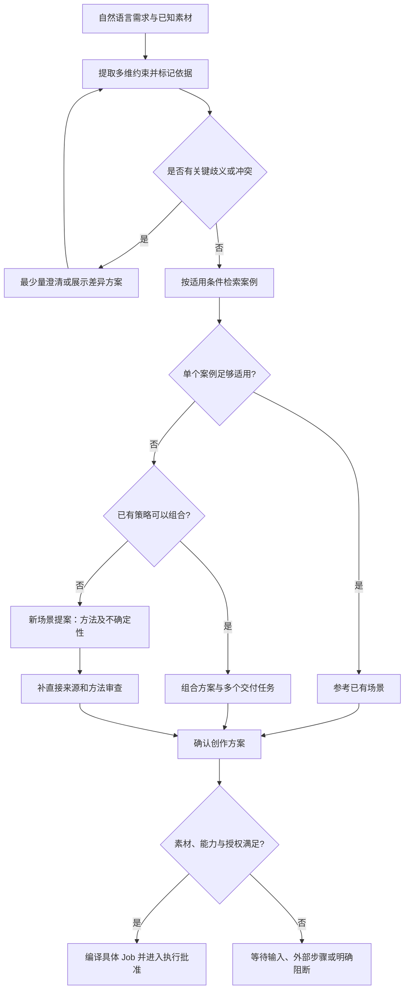
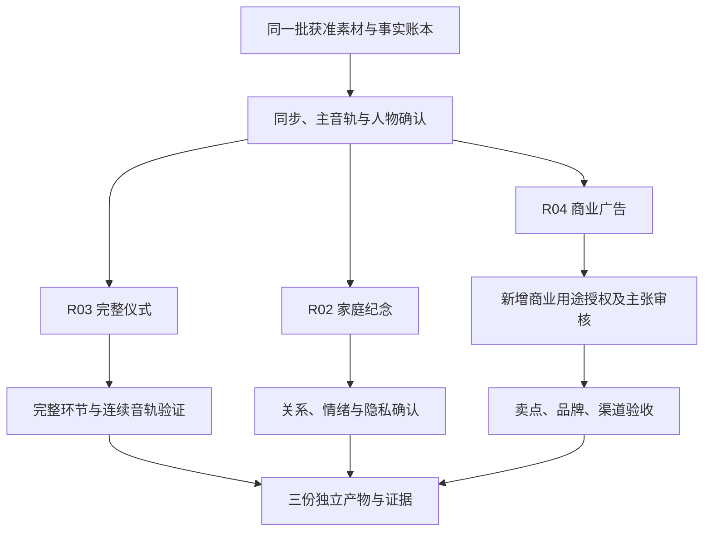
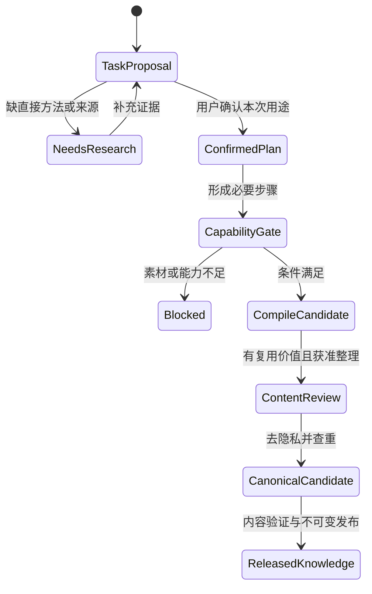

# 开放场景 Harness 编排计划

状态：规划草案，2026-09-21；未实现、未发布，不改变当前输入合同。
本文件回答“不在 108 个例子中的需求如何处理”，不维护另一份场景目录。
场景知识唯一规划源：[Skills 开放覆盖计划][coverage]；当前实现证据见 [架构](ARCHITECTURE.md)。

## 1. 目标、非目标与事实源

目标不是继续扩大固定菜单，而是让系统具备以下可验证路径：

1. 已知需求：准确选择案例，并说明适用原因与不适用条件。
2. 混合需求：拆出目标、素材和交付差异，组合方法而非复制案例。
3. 未知题材：用已知制作方法形成可解释提案，明确新增知识与验证缺口。
4. 未知方法或能力不足：停止在规划层，提出补素材、人工步骤、外部依赖或能力研发需求。
5. 无论哪条路径，实际写入和外部调用仍走现有授权与二进制能力门禁。

非目标：本轮不实现语义检索、媒体识别、自动成片、厂商模型接入或原生导出；
不手改受管技能，不用文档改写当前 OpenSpec 的已完成事项。

| 内容 | 事实源 | 本轮处理 |
| --- | --- | --- |
| 已实现规划 | `add-video-planning-harness`、现有入口与测试 | 保持不变 |
| 已发布案例 | Skills Release 与插件技能锁 | 保留 108 项 |
| 多维分类、候选和来源 | Skills `docs/video-scenarios/` | 新增规划，不是运行数据 |
| 开放路由与组合执行 | 本文件 | 后续规格输入，不是新增 API |
| 原子能力 | 已发布 CLI 实时 manifest | 不用领域名称推导能力 |

## 2. 从意图到路线

### 2.1 最小澄清

先提取用户已提供的用途、受众、渠道、交付目标和素材条件，不重复询问。
缺少会改变叙事或权限的内容再问：例如“完整记录还是情绪短片”“是否允许上传素材”。
不知道技术细节的用户可以看两三个有差异的方案，不必先理解分类体系。

“我不知道怎么剪”不应直接返回 108 个名称，也不应自动按 Vlog 执行。
规划时允许保留未知；执行时素材、时间范围、输出目标、必要能力和授权必须确定。

### 2.2 三条规划路径与停止出口

未知题材可能只是已有方法的新应用，不必马上建新场景；未知技术或交付方式则可能需要新能力。
例如宠物日记可复用生活叙事，但 360 度导览不能仅把普通导览改名后放行。

### 2.3 检索与解释规则（建议）

- 先按硬条件筛选：完整保留、目标语言、隐私、关键素材、不可删片段、交付限制。
- 再比较用途、表达形式、素材匹配和领域相似度；题材相同不优先于目标一致。
- 每个候选给出命中条件、冲突条件、所缺素材与需要的人工判断，不只返回排名。
- 多个合理结果交给用户选择；不把模型自报百分比当作校准后的置信度。
- 无模型时仍可用标签、别名、规则与人工确认完成规划；联网研究和模型调用不是默认副作用。
- 语义检索即使加入，也不能替代结构化过滤、来源审查或实际媒体探测。
- 查询成本、候选数量和上下文大小有界；开放目录不等于无上限读取全部正文。

当前只有 ID/子串查询；上述行为必须有新测试和实现，不能从这份文档直接宣称支持。

## 3. 规划合同演进建议

### 3.1 新旧合同隔离

现有 `jianying-video-intent/v1` 拒绝未知字段，不能直接加入用途、预算和组合图。
建议在正式规格中设计版本化扩展；以下字段是概念设计，不是可执行请求示例。

| 对象 | 建议信息 | 责任 |
| --- | --- | --- |
| Brief | 用户目标、十二维标签、未知项、不可改变约束 | 宿主提取，用户确认关键项 |
| Fact | 值、来源类型、原始引用、时间、确认状态 | 探测器/模型/人工分别署明 |
| RouteDecision | 已知/组合/新提案、候选、命中和冲突原因 | 规划器；不能授予权限 |
| ScenarioProposal | 适用条件、方法、来源、缺口、验收 | 技能知识层；需内容评审 |
| WorkflowPlan | 主目标、步骤依赖、输出变体、能力、成本 | 插件编排层 |
| CompileReceipt | 输入摘要、计划修订、CLI 身份、Job 摘要 | 确定性编译器 |
| Evidence | 实际产物、验证过程、结论、版本与限制 | 独立验证步骤 |

建议把规划路线与就绪状态分成两个字段：
“组合方案”是路线，不意味着 ready；“能力缺失”是就绪结论，不意味着不能给出方法提案。
新提案未入库时只能使用任务内临时标识，不伪造正式场景 ID 或自动写进锁定技能。

### 3.2 硬门禁

1. 计划不得产生不存在的素材、伪造时间码或替用户签署素材授权。
2. 新场景的原子能力必须来自已知 capability ID；未知动作产生缺口，不任意生成命令。
3. `partial`、缺失或外部依赖未满足时，不把规划可用当作可执行。
4. 修改故事、素材或输出产生新修订；旧批准不能隐式覆盖新 Job。
5. 交付目标可以是多份成果，各自验证；不能用一个预览满足所有输出。
6. 用户确认“创意方案”不等于允许付费、上传、声音克隆、GUI 或原生导出。

## 4. 可组合步骤与能力责任

B 编号只用于设计讨论，不是 CLI capability、现有 command 或已注册 Agent 工具。
当前 ID 依据锁定技能快照核对，执行仍需与真实二进制握手。

| 步骤 | 输入 → 输出 | 技能/能力与边界 |
| --- | --- | --- |
| B01 素材盘点 | 获准路径 → 哈希、媒体事实、权限记录 | inspect；`media.probe`；授权不能自动推断 |
| B02 转写与语义选片 | 音视频 → 片段、句意、待确认项 | narration；ASR 能力不等于视觉理解 |
| B03 多机同步 | 多机文件 → 同步映射、主音轨 | 人工/外部步骤；不虚构同步 capability |
| B04 叙事编排 | 简报、片段 → 叙事段落和剪法 | planning；模型/人工判断，不直接写草稿 |
| B05 视觉资产 | 图表、动画或生成要求 → 可用媒体 | 外部工具；需事实、预算与权利检查 |
| B06 字幕语言 | 已确认文本 → 对齐字幕和语言版本 | subtitles；导入/样式与人工审校分离 |
| B07 声音编排 | 主音轨、旁白、音乐 → 音频决策 | audio；音量/淡化；TTS 按选定提供方检查 |
| B08 时间线编译 | 确定的片段决策 → Job 与编译回执 | draft/edit；`schema.job_v2`、`job.run` |
| B09 渠道变体 | 母版决策 → 独立输出计划 | 裁剪/关键帧不等于自动主体跟踪 |
| B10 预览验证 | 草稿或代理文件 → 验证证据 | inspect/export-prep；不能冒充原生导出 |
| B11 原生交付 | 批准与环境 → 导出任务及真实文件 | export-prep；原生能力与设备检查 |
| B12 归档交接 | 产物、版本、来源 → 可追溯交付包 | harness/recover；不自动发布到社交平台 |

完整技能名均以 `jianying-` 为前缀；实际安装与交接使用正式技能名，不依赖兄弟目录存在。
本表中的能力只是步骤示例，不是充分的 capability 清单；具体 Job 编译后再求本次必要集合。

### 4.1 组合节点必须有什么

每步需声明输入/输出类型、前置条件、依赖节点、执行者、素材访问范围、
必要能力、批准类型、超时、费用/资源预算、允许重试条件、结果验证器和失败出口。
缺一项与副作用相关的定义，不得把知识 Recipe 当成可执行节点。

### 4.2 组合限制

- 主叙事目标只能明确选择，互相冲突的目标拆成输出变体。
- 步骤依赖图无环；评审返工用显式、有预算的外层修订循环表示。
- 只读分析可并行；草稿和同一剪映设备的写入必须串行且持有任务锁。
- 未确认的模型输出不能直接连接执行节点，中间必须经过类型校验与必要人工确认。
- 付费或结果不明步骤先核查原任务，不自动重试；取消请求不等于底层已停止。
- 外部素材缺失时返回具体缺口；降级或删除步骤必须重算验收目标并取得确认。

## 5. 多交付的具体示例

请求：“把婚礼素材剪成完整仪式、给家人的短片，再做一条给婚庆公司的广告。”

共享的只能是允许共享的媒体事实与分析缓存，不能共享未覆盖用途的批准。
商业授权缺失时广告子任务阻断，其他任务是否继续由用户意图决定；父任务必须报告部分完成。
严禁因为私人纪念已通过，就自动把同一人物素材用于商业版本。

此例验证“一个素材集、多目标、多批准、多证据”，比机械组合三个 Recipe 更重要。

## 6. 新场景的生命周期

图中是规划/知识演进，不是现有 Harness 任务枚举。
任务能执行不意味着自动入库；不把用户私人素材、品牌资料、语音或身份信息写入公共技能。
一般性的剪法可以独立整理；任何可识别素材或专有信息必须另获授权。

只因题材名称新而没有方法差异时，增加别名/标签即可；存在新素材、步骤、风险或验收时再写独立例子。
需要新原子能力时向 CLI 提出功能需求，但不让“待开发”进入运行时 supported 集合。

## 7. 兼容迁移与发布顺序

现有加载器约束不只 108：还固定 18 家族、每家族 6 项、12 Recipe、108 来源，
并要求 `[A-Z]{2}[0-9]{2}` ID。只删除一处长度判断不能完成开放目录迁移。

建议分阶段：

1. 冻结 v1 的 108 项与旧结果 fixture；保留旧 tag 和旧消费者的确定行为。
2. 设计新目录与输出合同，约定旧短 ID 别名、去重、来源多对多和兼容适配。
3. 新加载器按 Schema/manifest 验证唯一性、引用、摘要及资源限额，不按固定总量认定有效。
4. 未知版本明确拒绝；旧插件读新目录时给出不兼容诊断，不偷偷截掉第 109 项。
5. 新消费者先完成隔离兼容测试；新技能 Release 声明兼容范围，再由插件正式锁定导入。
6. 默认运行路径切换前完成分发、旧输入回归、宿主和真实媒体代表链验收。

需要在新规格中决定是一份新版目录提供旧版视图，还是保留独立 v1 资源；
无论选择哪种方案，都不手改已发布不可变资产，不在本轮擅自决定具体新版本号。

## 8. 评测样本与通过条件

下表是后续验收设计，不是已运行测试。每项都需固定输入、预期路线、能力条件和证据。

| ID | 用户需求/故障 | 期望结果 |
| --- | --- | --- |
| O01 | 精确指定 VG01 | 旧 ID、例文、Recipe 与 v1 行为兼容 |
| O02 | “婚礼视频” | 澄清用途，不自动选快剪 |
| O03 | “宠物领养故事”且目录无精确项 | 形成提案与事实约束，不硬套人物案例 |
| O04 | 一场婚礼要全程、纪念和广告 | 独立子任务、用途授权与验收 |
| O05 | 同素材横屏课与竖屏预告 | 不只是改宽高，保留两套信息结构 |
| O06 | 无障碍课程 | 澄清字幕、描述、手语等具体需求 |
| O07 | 全景导览但只有普通视频能力 | 可以规划，特殊交付明确阻断 |
| O08 | “热门、电影感、一定爆款” | 风格可选，不承诺传播效果 |
| O09 | 没有素材却要求精确片段时间码 | 等待素材，不生成假事实 |
| O10 | 多机访谈，机器没有同步能力 | 人工/外部同步单列，未完成不编译 |
| O11 | 医疗/财经/法律解释 | 领域审稿与来源待办，不自动认证内容 |
| O12 | 同一宠物场景换标题 | 复用或别名，不重复收录刷数量 |
| O13 | 新目录 109+ 项 | 新版合法加载；旧版明确不兼容 |
| O14 | 目录未知能力、重复 ID、路径逃逸 | 验证失败，不继续生成可执行计划 |
| O15 | 批准后更换素材或 Job | 旧批准失效，需要新批准 |
| O16 | 子任务付费后断线 | 对账，不重复扣费或重新提交 |
| O17 | 用户取消后再请求恢复 | 检查终态与底层状态，不盲目重放 |
| O18 | CLI 成功但产物验证失败 | 不标记交付完成 |
| O19 | 新场景包含私人素材 | 不自动进入公共技能库 |
| O20 | 网页参考中含工具调用指令 | 作为不可信数据，不提升权限 |

补充边界：纯音频、无声视频、照片、录屏、跨语言、超长素材、资源预算耗尽、
不可访问来源、无模型、外部服务失败及未知渠道。按风险和成对组合采样，不声称穷举。

离线指标分别统计候选召回、错误硬套、虚构事实、能力误放行和旧版兼容；
在线验收再看实际成片质量、审批次数、恢复、耗时与成本。没有验证样本时不报告百分比。

## 9. 分仓实施清单

本轮仅完成规划文档；以下保留未勾选，之后转入对应仓库的增量 OpenSpec。

- [ ] Skills：定义可扩展目录、标签、别名和来源合同，保留 108 项兼容基线。
- [ ] 插件：定义新意图/规划输出与兼容适配，先写 O01–O14 的失败用例。
- [ ] 插件：实现解释性候选、组合路线、新提案和独立能力决策。
- [ ] Skills：按覆盖计划 W2 编写新增独立例子，逐场景补直接来源。
- [ ] 插件：实现确定性桥接、审批复核、单写、取消对账和独立验证。
- [ ] CLI：仅对实际缺失原子能力建立独立需求及黑盒证据，不按场景造重复命令。
- [ ] 联合：冻结真实媒体 fixture，运行代表链和 O15–O20 安全恢复测试。
- [ ] 联合：技能不可变发布、插件锁定消费、新安装和三宿主验收，再发布产品。

原生、Windows 和宿主门禁沿用已有真实证据要求；本文不宣称这些门禁已被解除。

[coverage]: https://github.com/full-aigc-skills/jianying-skills/blob/main/docs/video-scenarios/COVERAGE_PLAN.md
