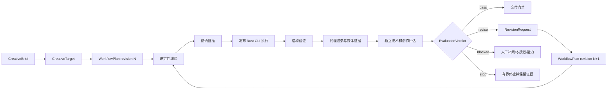
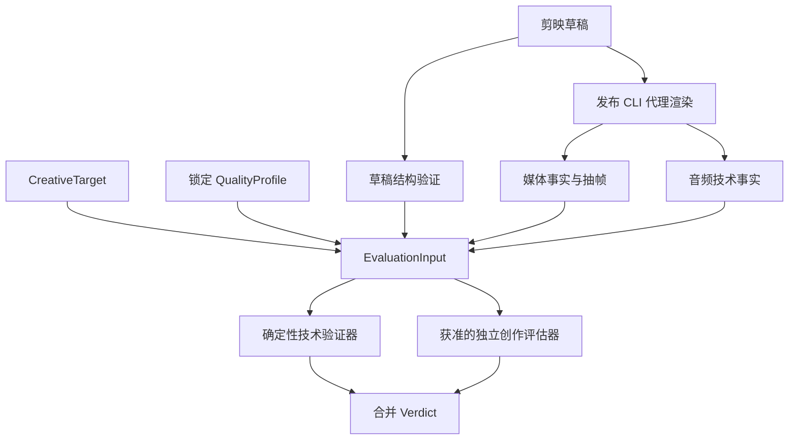
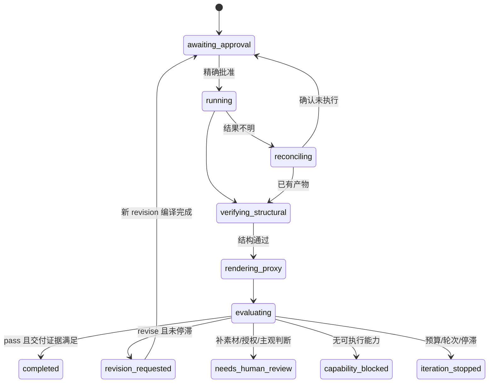

## Context

参见 [proposal](proposal.md)。本变更建立在 `add-open-workflow-compiler` 之上：当前插件已有开放路由、`jianying-workflow-plan/v1`、素材账本、`jianying-job/v2` 编译、发布 CLI 身份校验、精确批准、单写、对账恢复和草稿结构验证。现有验证只证明草稿存在、摘要与基础结构正确；代理验收主要证明媒体可解码，不能证明作品满足场景创作目标。

Dream Loop 提供“目标基准 → 实现 → 独立评估 → 定向返工 → 再次验证”的方法，但它以单张目标图、自然语言 Judge 和宿主自律为主，没有剪映工作流要求的版本化合同、批准失效、未知副作用对账、Rust-only 执行和视频多模态证据。本设计吸收方法，不直接复制其运行代码。

## Goals / Non-Goals

**Goals:**

- 将创作目标、场景评审规则、评估输入、评估结论和返工请求变成可验证、可版本化、可摘要绑定的合同。
- 将结构验证、技术验证、创作评估、真实剪映证据和原生导出证据分开记账。
- 保证评估者与执行者职责分离，模型不能自批、不能直接写草稿、不能生成任意命令。
- 将返工表达为新的 WorkflowPlan revision；素材、目标、Job、CLI 或输出变化后旧批准和旧证据失效。
- 用轮次、累计预算、时间和停滞规则形成有界循环，不自动重试未知、付费或有外部副作用的步骤。
- 先跑通 VLOG-01，再验证课程多输出和婚礼多用途的质量档案与授权隔离。

**Non-Goals:**

- 不把 Dream Loop 仓库或 Fal/3D 批处理脚本作为插件运行依赖。
- 不用一张参考图、一个总分或固定三轮代表所有视频类型。
- 不在插件中重新实现剪映原子操作；缺失原子能力进入 `capability_blocked` 并在 CLI 独立立项。
- 不让模型、Skills Recipe 或目录内容携带 shell、脚本路径、任意 handler 或用户批准。
- 不以代理视频评审替代冷重开、播放、原生导出、版权或人工终审。
- 不在本变更中宣称所有场景、模型供应商、系统和剪映版本已生产验证。

## Decisions

### 1. 在现有开放工作流外层增加质量循环

不建立第二套执行 Harness。新的质量循环复用 WorkflowPlan、编译回执、批准绑定、单写、恢复和证据账本，以新 revision 表达返工。

替代方案是把 Judge 放进每个 `jianying-job/v2`。拒绝该方案，因为 Job 是确定性剪辑执行合同，模型评估、人工判断和外部调用有独立权限、成本、重试和证据语义。

### 2. 六个版本化合同

所有合同未知字段默认拒绝，仅 namespaced `metadata` 可扩展且不得改变执行语义。

| 合同 | 核心职责 |
| --- | --- |
| `jianying-creative-target/v1` | 用户确认的叙事目标、目标受众/渠道、参考工件、必须保留/禁止内容、目标时长、QualityProfile pin |
| `jianying-quality-profile/v1` | 场景维度、硬门禁、评分规则、权重、可接受阈值、必需证据、可建议动作集合 |
| `jianying-evaluation-input/v1` | 目标、当前 revision、产物/代理摘要、媒体事实、字幕/ASR、前次结论和评估权限 |
| `jianying-evaluation-verdict/v1` | `pass/revise/blocked/stop`、分项评分、硬门禁、带时间范围发现、证据引用和评估者身份 |
| `jianying-revision-request/v1` | 经策略过滤后的返工意图、允许动作、影响输出、所需能力/批准、不可执行建议与原因 |
| `jianying-evidence-bundle/v1` | 分项证据、工件摘要、验证器身份、环境、时间、结论和限制 |

`CreativeTarget` 不能直接从参考作品推导版权或授权。目标字段按 `user_confirmed`、`observed`、`inferred_pending_review` 区分；只有前两者可成为硬约束。

### 3. 视频评估使用多模态证据而非单截图

每次评估按 QualityProfile 选择最小必要证据：

- 代理视频及其 SHA-256、媒体时长、画幅、帧率、音视频流信息。
- 确定性抽帧或镜头边界帧，记录时间码和生成参数。
- 音量、静音、峰值、响度等本地技术事实。
- 已确认字幕、ASR 文本和语言审校状态；未确认转写明确标记推断。
- CreativeTarget、场景档案和上一轮 verdict。
- 对真实剪映的冷重开、播放、原生导出证据使用独立类型，不伪装为模型评估输入。

评估器不得声称观察了未提供的完整视频、GUI 播放或音频。证据不足返回 `blocked`，不能用推测补齐时间码。

### 4. QualityProfile 属于 Skills，执行策略属于插件

`jianying-skills` 提供 Vlog、课程、婚礼等场景的知识档案，包含：

- 评估维度和定义。
- 硬门禁与建议阈值。
- 常见失败模式。
- 所需证据类型。
- 可以表达的修复动作类别。
- 专业/语言/版权等必须人工确认的边界。

插件通过 immutable `skills.lock.json` 读取正式安装内容，验证 profile schema、版本和内容摘要。Skills 不包含执行器、命令、供应商凭据或批准记录。

插件负责评估适配、证据选择、动作过滤、停滞判断、revision、批准与执行。这样知识目录可扩展为数百案例，而运行能力仍受固定注册表与 CLI capability 限制。

### 5. 扩展受信步骤注册表

计划只能引用下列受信类型，不允许目录或模型定义实现：

| 步骤类型 | 执行者 | 主要输出 | 副作用/批准 |
| --- | --- | --- | --- |
| `proxy_render` | `cli` | ProxyMedia | 本地输出写入；绑定 Job/草稿摘要 |
| `technical_validation` | `plugin` | TechnicalEvidence | 无外部副作用 |
| `creative_evaluation` | `model/human` | EvaluationVerdict | 模型费用、上传和隐私分别批准 |
| `human_review` | `human` | ReviewDecision | 责任人和输入摘要绑定 |
| `revision_planning` | `plugin` | RevisionRequest/WorkflowPlan | 不写草稿；不能自批 |
| `native_export` | `cli` | NativeMedia | GUI/原生导出单独批准和对账 |
| `delivery_validation` | `plugin/human` | EvidenceBundle | 只汇总真实证据，不提升证据等级 |

现有 `draft_edit`、`caption_mapping`、`asr`、`tts` 保持。若当前 CLI 未将对应能力标为 `supported`，编译返回具体 blocker，不使用 Cargo、Rust 源码、Python 引擎或外部 fork 兜底。

### 6. 评估结论必须可追溯且不可直接执行

Verdict 中每个 finding 至少包含：稳定 code、严重度、受影响输出、时间范围或工件引用、观察证据、关联目标/规则、建议动作类别。总分不能覆盖硬门禁；即使总分达标，只要存在未通过的必需门禁也不得 `pass`。

插件把 finding 映射到动作注册表：

- 当前 CLI 和编译器支持：生成 `RevisionRequest` 候选，等待规划及批准。
- 有 CLI 能力但缺批准：进入 `awaiting_approval`。
- 当前 capability 不支持：`capability_blocked`。
- 需要补拍、专业审校、版权或主观选择：`needs_human_review` 或 `needs_more_media`。
- 未注册动作：保留为建议，不生成 Job。

禁止评估模型输出 shell、文件路径写入、任意 CLI 参数或已获授权声明。最终 Job 必须由确定性编译器从已确认编辑决策生成。

### 7. Revision 和批准失效

以下任一变化生成新 revision，并使相关批准、评估和下游证据失效：

- CreativeTarget 或 QualityProfile 内容摘要变化。
- 源媒体、字幕、选段、音频、画布、用途或输出路径变化。
- 编译后的 Job、CLI 版本、CLI SHA-256 或 capability 快照变化。
- 代理视频、草稿或原生输出内容变化。
- 评估策略中硬门禁或阈值变化。

新 revision 可以复用摘要完全匹配且不受影响的只读事实，不能复用写入批准。评估输入和 verdict 都绑定 revision、artifact digest、profile digest 和 evaluator identity。

### 8. 有界循环和停滞检测

`IterationPolicy` 随 WorkflowPlan 冻结：

- `maximum_revisions`
- `maximum_model_calls`
- `maximum_budget`
- `deadline`
- `minimum_material_improvement`
- `repeated_finding_limit`
- `regression_tolerance`
- `required_human_review_points`

进入以下任一条件即停止自动规划：

- 到达轮次、预算、调用或时间上限。
- 连续两轮关键评分提升低于阈值。
- 同一 major/critical finding 达到重复上限。
- 修复导致另一硬门禁回退。
- 找不到当前能力可执行的修复动作。
- 需要新增素材、用途许可、付费/上传批准或专业判断。

质量循环不能绕过现有 `reconciling`。未知副作用必须先对账，不能因为 Judge 希望返工而重复创建草稿或导出。

### 9. 评估供应商和隐私边界

确定性技术验证优先本地运行。模型评估通过 provider adapter 接入，但统一受以下门禁约束：

- 本地和远程 provider 使用相同 EvaluationInput/Verdict 合同。
- 上传视频、音频、人物画面、转写和声音克隆分别声明资源范围。
- 每次调用绑定 provider、model、版本、价格快照或预算上限、输入摘要和请求 ID。
- 超时或结果不确定时先查询原请求；无法查询则人工对账，不自动重复付费。
- 日志不保存密钥、完整私人转写或不必要的本机绝对路径。
- 模型输出通过严格 Schema 和大小限制后才能进入规划器。

首版可以只支持人工评审和一个获准 provider adapter；供应商数量不是完成条件，合同一致性和失败行为才是门禁。

### 10. 三条代表链的验收顺序

#### VLOG-01

第一条完整链。目标档案至少覆盖叙事建立、事件变化、结尾回望、重复镜头、音画关系和隐私。必须完成“第一版 → 独立评估发现可定位问题 → 新 revision → 重新批准 → 第二版 → 再评估”的可观察闭环。

#### COURSE-01

验证母版和三个派生输出分别评估：教学完整性、预告语境、字幕可读性、画幅安全区和语言审校。一个输出通过不能使其他输出完成。

#### WEDDING-01

验证完整仪式、私人纪念和商业广告的用途、授权、评审档案及交付证据隔离。情绪短片评分不能替代完整仪式连续性；商业分支缺用途许可时保持阻塞。

每条链分四级保存：离线合同测试、发布二进制黑盒、真实剪映、Codex/ZCode/Kimi 目标宿主。低层通过不能自动提升高层状态。

### 11. 完成定义和可观测性

工作流只有同时满足以下条件才能 `completed`：

- 必需输出全部存在且摘要绑定。
- 结构和技术硬门禁全部通过。
- 每个输出的 QualityProfile 必需规则得到独立 verdict。
- 用户要求的真实剪映/播放/原生导出证据已经实际取得。
- 没有未处理的 critical/major finding、未知副作用或待批准步骤。
- EvidenceBundle 标明验证器、环境、时间、工件摘要和限制。

记录指标：首次评估通过率、平均 revision 数、重复 finding 数、能力阻塞率、人工介入率、评估成本、重复副作用数、恢复成功率和按场景的交付通过率。指标不得记录私人素材内容。

## Risks / Trade-offs

- [模型评价不稳定] → 使用场景 Profile、严格 Schema、输入摘要、硬门禁和可重复的确定性技术验证；关键交付保留人工终审。
- [代理视频与真实剪映表现不同] → 分项证据，不用代理通过代替冷重开、播放或原生导出。
- [评估建议超出 CLI 能力] → 动作注册表与 capability check 过滤；无法执行时阻塞，不生成猜测 Job。
- [循环消耗失控] → 轮次、调用、预算、时间和停滞多重上限；新增授权不自动继承。
- [返工覆盖正确产物] → 每个 revision 使用隔离输出，验证通过并获准后才晋级，不原地覆盖最后已知良好版本。
- [Skills 内容漂移] → immutable lock、profile digest、schema validation；开发注入结果不得作为发布证据。
- [状态机复杂度增加] → 复用现有 WorkflowRuntime，先 Vlog 单输出，再课程/婚礼多输出；故障注入先于启用真实副作用。
- [外部模型隐私和许可] → 本地优先、最小上传、资源范围批准、provider 审计和可禁用远程评估。

## Migration Plan

1. 先完成 `add-open-workflow-compiler` 的并发/崩溃故障测试、Vlog 真实剪映门禁和回滚验证，不在不稳的副作用路径上启用自动返工。
2. 在插件中以只读、无副作用模式加入六个 Schema、QualityProfile 导入校验和 fixture。
3. 加入代理/技术证据生成和人工 evaluator，跑通不调用外部模型的 Vlog 评估。
4. 加入一个受批准的模型 adapter、Verdict 校验、RevisionRequest 和停滞策略；默认 feature flag 关闭。
5. 用发布 Rust CLI 跑通 Vlog 两个 revision，并完成真实剪映冷重开、播放和原生导出证据。
6. 扩展课程和婚礼；完成三宿主和 Windows 能力矩阵后再默认启用。

回滚时关闭质量循环入口并恢复上一插件锁版本；保留所有运行账本、证据、未决请求和资源占用用于对账。不得删除用户草稿、自动恢复旧批准或让旧入口读取未完成 revision 后继续写入。
