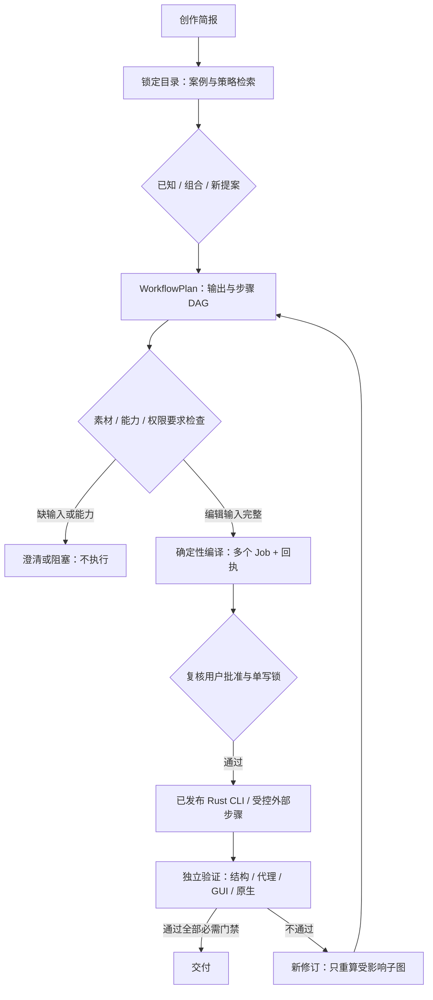
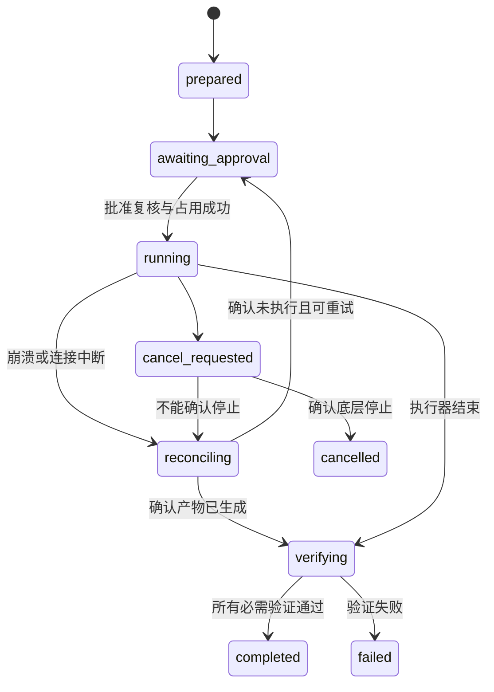

# 开放工作流设计

## Context

本设计实现边界由 [proposal](proposal.md) 和本变更四份增量规格约束。
Skills 配套变更为 `evolve-open-scenario-catalog`，知识合同归 Skills，执行合同归插件。
现有 `plan-video`、`compileJob` 和旧 Harness 不等于这里的工作流编译器。
本文件是待实施设计，不代表下列入口、Schema、状态机或真实链路已经存在。

现有执行路径不能作为新闭环的充分保证：取消状态不证明底层任务停止，进程成功不证明作品合格。
新路径必须独立落实批准绑定、写前记录、对账与验证；不以复用旧函数代替门禁。

## Goals / Non-Goals

**Goals**：可扩展目录、可解释路由、类型化 DAG、确定性编辑编译、受控执行、分级独立证据。
首批用生活 Vlog、课程多版本、婚礼多交付证明一套合同能够支持不同生产结构。

**Non-Goals**：穷举视频世界；生成任意 shell；把全部阶段塞进一个 Job；自动授予权限；
宣称全部剪映效果、全部多机位同步或所有模型厂商已经支持；本规格阶段直接执行或发布。

## Decisions

### 1. 两段编译，保留旧入口

拒绝直接让模型输出命令列表，也不为每个案例复制一套执行器。
采用“知识约束 → 工作流 → 已确认编辑决策 → Job”的分层结构。
新增 opt-in `workflow-*` 入口，旧 `plan-video` 继续读取 v1，不自动升级语义。
以下名称为待实施接口，不是当前可用命令：

| 入口 | 输出/副作用边界 |
| --- | --- |
| `workflow-plan` | 读取锁定目录与用户简报，输出候选或未执行计划；不访问素材、模型或 GUI |
| `workflow-check` | 显式请求后检查素材和已发布 CLI 能力；不写草稿、不调用模型 |
| `workflow-compile` | 已确认决策编译为 Job 和回执；不执行 Job |
| `workflow-start` | 保存执行快照及待批准要求；不开始有副作用步骤 |
| `workflow-approve` | 记录用户授予的精确批准范围，不接受模型自批 |
| `workflow-execute` | 复核身份、输入、批准与锁之后执行 |
| `workflow-show/resume/cancel/retry` | 查询、对账恢复、请求取消、显式重试；不得绕过批准与单写 |

生产目录来自插件 immutable lock。开发目录仅允许显式开发模式，结果标记不可作为发布证据。
v2 不存在时返回 `catalog_v2_unavailable`，不把 v1 当作 v2 或自动读取开发源码。

### 2. 数据合同与职责归属

Schema 在插件中实现并版本化；未知字段默认拒绝，只有 `metadata` 接受非执行扩展。
同一字段不能同时作为用户授权与模型推断；所有推断必须携带来源和待确认状态。

| 合同 | 用途 |
| --- | --- |
| `jianying-creative-brief/v1` | 用户意图与有来源的事实 |
| `jianying-workflow-plan/v1` | 跨步骤、跨输出的中间计划 |
| `jianying-workflow-compilation/v1` | 就绪判断与编译结果 |
| `jianying-compilation-receipt/v1` | 可复现输入与产物身份 |

所有合同必需 `schema` 字段，值为上表对应标识。其余必需字段：

- Brief：`request_id`、`intent`、`constraints`、`dimensions`、
  `output_intents`、`facts`、`metadata`。
- WorkflowPlan：`workflow_id`、正整数 `revision`、`catalog_ref`、
  `tool_requirements`、`brief`、`assets`、`route`、`outputs`、`steps`、
  `limits`、`risk_requirements`、`proof_requirements`、`metadata`。
- Compilation：`plan_digest`、`can_compile`、`can_execute`、`blockers`、
  `job_bindings`、`receipt`。
- Receipt：编译器/注册表版本与摘要、目录 pin、CLI 身份和能力快照、
  规范化输入摘要、每份 Job 语义摘要、警告、编译时间。

缺输入而不能编译时 `job_bindings` 为空、`receipt` 为 null；不得虚构编译成功回执。

`catalog_ref` 绑定 schema、版本、commit 和内容摘要；`tool_requirements` 不冒充实际握手结果。
`facts` 每项包含值、来源 `user/observed/inferred`、来源引用及确认状态；观察事实须附采集时间。
`route` 包含 `known/composed/proposed` 或尚无可选路径时的 null、候选及命中/排除理由。
计划 readiness 为 `needs_selection/needs_input/needs_review/capability_blocked/planned`，不是执行状态。

素材记录以稳定 `asset_id` 引用，区分 `declared/verified`，声明路径不能冒充已探测事实。
verified 素材至少保存内容 SHA-256、字节数、时长微秒、流属性及探测证据引用。
内容变化即失效，不仅比较路径或修改时间。未知时长不能填写估计值绕过编译。

每个输出包含 `output_id`、用途、画幅、语言/字幕策略、时长约束、编辑决策引用、
目标逻辑位置、必需验证层级和对应权利要求；最终物理路径在执行绑定中冻结。
私享、公开展示、商业广告是不同用途，不能共享一个隐含授权。

### 3. 路由不是固定分类枚举

12 个维度是简报坐标，40 个领域是检索标签，20 个横向需求是可组合覆盖层；均非数量上限。
先过滤硬约束，再按结构化字段匹配；同分按稳定 ID 排序。第一页最多三个候选，游标带目录摘要。
目录变化使旧游标失效；解释展示命中证据，不输出未经校准的“匹配概率”。
已知路线选择 Recipe；组合路线合并多个已注册策略要求；新提案只产生待审计划。
缺少执行映射时可以有创作建议，但不得返回可执行 Job。

### 4. 步骤合同与 DAG

每个步骤必需字段如下；可选步骤也必须先选入计划才能获得能力和批准要求。

| 字段 | 合同 |
| --- | --- |
| `id`, `type`, `type_version` | 稳定步骤 ID；类型与版本必须存在于插件注册表 |
| `executor` | `cli/human/model/external`；须与注册类型一致，不能自定义 handler |
| `depends_on` | 上游 ID 数组；无环、无缺失、无自依赖 |
| `inputs`, `outputs` | 端口名、数据类型、工件引用；每个工件仅一个生产者 |
| `preconditions`, `capabilities` | 可机器验证条件及能力 ID；不可将自然语言当作通过结果 |
| `approval_requirements` | 所需授权类型、用途和资源范围；不包含已获批准的声明 |
| `timeout_ms`, `budget` | 正整数超时；费用上限与币种，免费也须显式为零 |
| `retry`, `reconcile` | 重试分类、上限、退避、对账策略；未知副作用不得自动重试 |
| `validator` | 独立验证类型、版本和必需证据层级 |

类型化工件包括 Brief、AssetLedger、Selection、EditDecision、JobBundle、Draft、Media、Evidence。
注册表由插件代码维护类型、端口、执行器、能力映射、副作用级别、对账与验证器；
Skills Recipe 只能提出语义需求。目录中的脚本、URL、任意命令或未注册操作均不能成为执行器。

第一批类型覆盖检索、素材探测、人工选段、分支编辑、字幕映射、Job 编译、草稿执行、
代理输出、人工审核、原生导出及验证。类型注册不等于对应环境支持该能力。
ASR/TTS 是选入时才检查的独立外部/模型节点，不让未使用的模型阻塞纯剪辑。

类型检查包含端口兼容、引用完整、重复写入和资源冲突；同一草稿/输出单写，不同分支可并行。
修订是 DAG 外层有界循环，设置最大修订次数与累计预算；不允许图内无限回边。
人工审核生成带责任人和输入摘要的事实工件；不能由执行器自己填写“用户已确认”。

### 5. 编辑决策到 Job 的编译规则

未选定素材/片段的 WorkflowPlan 合法但不可编译。编译只处理输入已闭合的编辑节点，
探测、ASR、TTS、人工审核和原生导出保留为独立步骤，不塞入 `jianying-job/v2`。
第一批只映射已证实支持的剪切、拼接、位置与字幕决策，不臆造时间线字段或能力。

- 时间统一为非负安全整数微秒，源区间半开 `[in_us, out_us)`，持续时间必须大于零且不越界。
- 首批使用常速片段；目标持续时间等于源区间长度。变速、多机位自动同步和未知效果没有映射时拒绝。
- 画幅、帧率与坐标遵循被锁定 CLI 的正式 Schema；必要量化必须显式记录误差，禁止静默修正。
- 每个输出独立编译；素材为只读来源，禁止覆盖源媒体。字幕截取、平移及语言关联都绑定输出时间线。
- Job 仍由现有版本 Schema 校验，再通过实际二进制能力检查；不检查开发源码推断用户端能力。

规范化对象键按序排列，数组保留语义顺序，UTF-8 编码，不擅自改变文本 Unicode 内容。
DAG 采用稳定拓扑排序并以步骤 ID 打破同序；生成 ID 来自稳定结构路径。
Job 语义模板使用素材/输出逻辑 ID；临时目录、尝试 ID 和时间戳不参与语义摘要。
执行时解析物理路径并保存完整 Job 字节摘要与路径绑定摘要；批准绑定后者，不能用语义等价掩盖换输出位置。

编译结果区分 `can_compile` 和 `can_execute`：编译通过而等待批准时，前者 true、后者 false。
实际能力为 partial、缺失或环境不满足时返回 blocker；`supported` 标签也不能替代运行前置条件。
编译及执行前分别复核 CLI 版本、制品摘要和能力快照，变化后重新编译/批准。

### 6. 批准、单写、恢复与取消

批准保存在运行账本，不放入可由模型生成的 WorkflowPlan。批准绑定用户、工作流修订、步骤、
输入摘要、实际 Job 摘要、CLI 身份、用途、输出位置、预算及有效期；任一关键值变化即失效。
每次使用都复核到期和撤回状态。没有获批的模型调用、GUI 或导出必须停在待批准阶段。

执行先持久化快照、attempt 和资源占用，再启动副作用。采用带 epoch 的租约，拒绝旧持有者写账。
设备/草稿/输出锁须跨插件进程生效；底层不可 fencing 时，不得因租约超时直接启动第二个写入者。
相同请求幂等键返回已有运行；显式重试建立新 attempt，仍受批准及对账约束。
不承诺外部剪映 exactly-once：启动后失联且无法确认结果时保留锁并要求人工对账。

运行状态另允许 `partially_completed` 表示部分交付成功而整体未完成。
步骤失败、输入不兼容或批准拒绝须记录结构化原因；不得用成功空产物隐藏失败。
prepared 的无副作用运行可以直接取消；cancelled 不允许直接 resume 启动，必须显式新 attempt 和复核批准。
无法查询或取消底层任务时返回人工对账需求，不把本地状态修改称为底层取消成功。

默认失败策略为 `stop_all`；`continue_independent` 只在事先明确选择后允许无依赖分支继续。
它不授予新权限，也不允许父工作流在必需输出缺失时标为 completed。
重新选段、素材变化或审核返工产生新 revision，只复用内容摘要和合同仍匹配的上游工件。

### 7. 独立验证与三条验收链

验证器从产物重新读取数据，不仅相信执行日志；至少检查存在性、摘要、结构及用户要求。
证据层级分别记录：结构、代理渲染、真实剪映冷重开、播放、原生导出；不能互相代替。
人工与模型质量评价须有输入工件摘要和评价者身份；生成者自述不算独立验证。

以下时间只是待建立的合成测试向量，不是已存在素材或真实作品的描述：

| 链路 | 输入与输出 | 关键断言及失败用例 |
| --- | --- | --- |
| VLOG-01 | 四段各取 3 秒，输出 12 秒 | 单输出叙事；同路径换素材使批准失效 |
| COURSE-01 | 120 秒课程母版及三段各 10 秒预告 | 四视频分别关联中英字幕；语境/画幅独立验收 |
| WEDDING-01 | 60 秒仪式、15 秒回忆、10 秒宣传 | 三用途分别授权；缺商业批准负例 |

Vlog 源素材各 6 秒，均取 `[1s,4s)`；课程预告分别取 `[10s,20s)`、
`[50s,60s)`、`[90s,100s)`，验证字幕截取重定位，不隐含翻倍视频输出。
婚礼使用单机位基线，不宣称已实现多机位同步。

课程向量用于时序与分支测试，不能替代真实长课质量验收。
婚礼向量采用无隐私合成素材；真实人物、音乐和商用范围另行确认。
每条链的输出选择均需要可追溯编辑决策，不能只核对文件个数。

验收分三组且分别记账：

1. 离线 Schema/路由/编译/状态机测试，含 mock 故障注入；只能证明合同实现。
2. 发布二进制黑盒测试：无 Rust 源码、无 Cargo，通过真实 CLI 生成 Job、草稿与对应可用产物。
3. 真实剪映冷重开/播放/原生导出及目标宿主验收；未运行的平台与宿主保持未验证。

缺少真实素材、授权、Windows 环境或宿主证据时不勾选对应门禁，不阻碍如实交付较低层的结果。

## Risks / Trade-offs

- 双入口维护成本：用冻结 v1 黑盒与 v2 独立测试防止升级改变旧用户行为。
- 开放目录可能被当成执行指令：只允许已注册步骤、强类型引用及本地受控资源。
- 复杂状态恢复成本高：宁可暂停对账，也不在未知副作用状态自动重试原生导出。
- 策略组合不能保证审美：保留选段/叙事审核和独立质量评价，不用结构通过替代内容可用。
- CLI 能力可能不足：保留 capability_blocked，不引入 Python 引擎或源码兜底。
- 本地进程租约无法控制已经运行的外部 GUI：资源占用必须保留到确认结束，必要时人工介入。

## Migration Plan

1. Skills 冻结 v1 并提供 v2 合同、开发 fixture；插件先做无副作用读取与路由。
2. 实现 WorkflowPlan Schema、步骤注册表、类型检查与第一批编辑编译，差分检查 Job 语义。
3. 用故障注入完成写前记录、批准和独立验证后才启用 opt-in 执行。
4. Skills 独立发布后由插件锁版本消费；开发注入不能作为不可变发布证据。
5. 三条链依次完成离线、真实二进制、真实剪映与宿主验收，再考虑扩大案例与能力覆盖。

回滚先由宿主为 Harness 设置 `JIANYING_OPEN_WORKFLOW_DISABLED=1`，拒绝新规划、编译、启动、批准、执行和恢复，
保留只读绑定与取消请求；确认后再恢复上一兼容 Skills 锁版本。清除该开关必须是单独的重新启用决策。
保留运行账本与未完成资源占用供对账。
旧入口不得读取新工作流状态并继续执行；不得删除有争议产物或自动重跑副作用。
本变更不删除旧 Python 引擎或修改历史发布门禁的完成状态。

## Open Questions

- 实施后实际发布版本号、验收操作者和真实素材样本待发布/验收时登记，不影响合同开发。
- 第三方能力不足导致的新增 CLI 原子操作应单独立项，不能借本变更把 partial 改成 supported。
- 真实商业交付的用途许可需由有权用户逐项确认；本设计不替代授权。
