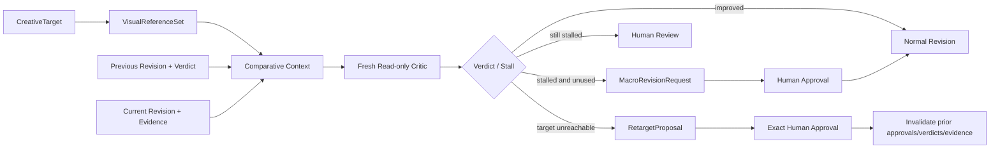

## Context

`add-iterative-video-quality-loop` 已提供 CreativeTarget、QualityProfile、EvaluationInput/Verdict、RevisionRequest、证据分层、独立 evaluator、停滞检测和恢复。当前缺口是目标视觉工件没有独立版本合同，评估输入不能同时证明“对目标的差距”和“相对上一版的变化”，停滞后没有受控的单次宏观重规划路径。

本变更采用 Dream Loop 的方法，不依赖其实现：固定目标、执行与评审分离、目标/当前/上一版比较、停滞后最多一次大改、仍未改善则人工处理。

## Decisions

### 1. 视觉目标独立于 CreativeTarget

`jianying-visual-reference-set/v1` 绑定 workflow、output、revision 和 CreativeTarget 摘要。每个引用必须携带内容摘要、来源类型、用途、许可状态和允许偏离范围；本机路径、下载命令和执行授权不进入合同。

目标变化产生新摘要并使下游比较上下文、批准、verdict 和 evidence 失效。

### 2. Critic 使用全新只读上下文

`jianying-comparative-evaluation-context/v1` 同时绑定：

- VisualReferenceSet 摘要；
- 当前 EvaluationInput 摘要与当前代理摘要；
- 上一版 EvaluationInput/Verdict/代理摘要；
- `absolute_quality`、`target_gap`、`prior_delta` 三类比较维度；
- 唯一 `critic_session_id`、`fresh_context=true`、`write_access=false`；
- 固定只读工具白名单。

Critic 不获得 CLI、GUI、草稿写入、导出、审批或 shell 工具。

### 3. 停滞只允许一次宏观重规划

`jianying-macro-revision-request/v1` 只能由已经验证的停滞结果和比较上下文生成。策略限制为结构重排、素材替换、节奏重构、音频策略重做和视觉风格重置；不得携带命令或任意 handler。

调用方必须提供该输出的历史宏观请求摘要。历史非空时拒绝第二次请求。宏观请求必须绑定 `human_macro_revision` 批准要求，实际修改仍编译为普通受信动作。

### 4. Retarget 必须精确人工批准

`jianying-retarget-proposal/v1` 仅表达目标为何不可达、建议的新目标摘要和对应参考集摘要。应用函数要求未过期、摘要精确匹配且用户身份非空的 `jianying-retarget-approval/v1`；未批准、已过期、摘要不匹配均失败。

生效结果只返回新的目标绑定及明确的失效摘要列表，不直接执行草稿修改，也不自动降低质量阈值。

### 5. 不扩大外部验收任务

本变更的完成标准是合同、状态转换、权限隔离、负向测试、回归和 OpenSpec strict 全部通过。真实剪映、Windows、三宿主和不可变发布继续由现有变更跟踪，避免重复任务和虚假完成。

## Flow

## Source and License

- Design source: [achimala/dream-loop](https://github.com/achimala/dream-loop), fixed at commit `9bddb901f7d071cfefdd21e264267c757177a9df`, MIT.
- Imported runtime code: none.
- Production dependency: none.
- Attribution remains in repository third-party notices; this change only reimplements generic workflow concepts.
