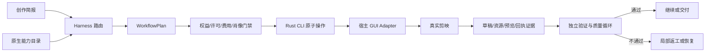
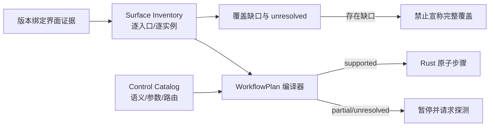

## Context

插件已有开放工作流编译器、Rust Runtime Adapter、质量循环和副作用账本，但原生剪映能力仍被压缩为少量通用时间线操作。当前界面证据显示这些能力同时包含本地编辑、官方资源下载、复合 AI 改写和远程生成，风险与恢复语义并不相同。

## Goals / Non-Goals

**Goals:**

- 把剪映原生能力纳入统一 WorkflowPlan，而不是写成提示词建议。
- 让 CLI 原子合同、插件编排和宿主 GUI Adapter 各自边界清晰。
- 支持按目标检索和组合资源，并保留候选、选择、授权和结果证据。
- 对智能包装和数字人建立可批准、可恢复、可验证的专用流程。

**Non-Goals:**

- 不逆向剪映私有网络协议、账号数据库或会员接口。
- 不使用固定屏幕坐标作为跨版本生产合同。
- 不因专业版订阅而推定音乐、肖像、声音和商业发布权利。
- 不在缺少发布 CLI capability 时恢复 Python 引擎或外部 fork。

## Decisions

### 1. 四层能力模型

CLI 是原子能力事实源，插件是工作流事实源，GUI Adapter 只履行已批准动作，真实草稿和产物是完成证据。拒绝让 Skill 文本或 GUI 成功提示覆盖任一机器事实源。

### 2. 三种执行类别

| 类别 | 代表能力 | 副作用边界 |
|---|---|---|
| 资源取得与应用 | 素材、音乐、文字、贴纸、特效、转场、字幕、滤镜、模板 | 权益收据、下载/应用、草稿验证 |
| 参数化本地编辑 | 调节、滤镜参数、文字和效果参数 | 快照、可逆写、前后差分 |
| AI/生成型组合 | 智能包装、智能 B-Roll、数字人 | 上传、费用、远程任务、组合变更、人工门禁 |

每类使用不同的审批与恢复策略，不用统一的 `apply=true` 掩盖差异。

### 3. 候选检索先于选择

资源步骤保存 `query`、`filters`、候选集合、选择策略和最终资源收据。筛选维度至少包含资源域、关键词、风格、情绪、节奏、时长、画幅、版型、用途、发布渠道和成本。模型不得仅凭缩略图或名称推断版权范围。

### 4. 智能包装编译为子计划

智能包装不是一个不透明按钮。Adapter 取得其预览/提案后，插件将可观察结果拆为字幕、花字、B-Roll、音效、特效、转场等变更集，并与受保护内容规则比较。无法解释的变更保持整体预览和人工批准，不自动写入。

### 5. 数字人使用独立任务与账本

数字人选择、配音、脚本和背景形成稳定请求摘要。库存数字人与自定义真人素材使用不同政策。涉及真人照片/声音上传时必须单独授权；费用、供应商任务 ID 和不明确状态进入现有副作用账本，禁止静默重提。

### 6. 按钮控制编译为语义动作

插件不保存按钮坐标，而是消费 CLI 发布的 Control Catalog。每个动作包含 `semantic_id`、`route`、`parameters`、`preconditions`、`verify` 和 `rollback`。WorkflowPlan 编译器按照 `draft_protocol > runtime_native > accessibility_adapter > visual_fallback` 排序；如果更高优先级路由标记 supported，低优先级路由不得被选择。

撤销/重做属于会话级动作，只能作用于插件拥有的独立编辑会话；不能用它恢复用户并行编辑。草稿写入仍采用快照与原子副本恢复。

插件同时消费 CLI 的 Control Catalog 与 Surface Inventory。Control Catalog 用于去重能力和选择执行路由；Surface Inventory 用于覆盖审计，保留同一能力的多个按钮实例、未知入口、可展开父入口和证据来源。两者不能互相替代：有语义能力不代表所有界面入口已盘点，有入口也不代表具备可执行能力。

### 7. 面板分类技能只描述和路由，不实现第二引擎

素材、音频、文本、贴纸、特效、转场、字幕、智能包装、滤镜、调节、模板、数字人和剪辑控制台分别拥有独立 Skill。Skill 用 `<domain>.<group>.<action>` 语义 ID 描述入口、事实读取、筛选/预览、固定 argv 或 Harness 合同、验证与恢复；原子执行仍只来自发布 Rust CLI，GUI-only 动作仍受版本 Canary 和批准约束。

技能正文由 `jianying-skills` 不可变 Release 提供。插件通过 manifest、commit 和逐目录 SHA-256 导入，不在 vendored 副本中修补说明。

## Risks / Trade-offs

- [剪映 UI 随版本变化] → Adapter 使用可访问性语义和视觉证据，版本变化时 fail closed 并重新 Canary。
- [资源只有缩略图和名称] → 保留候选但不提升授权等级，要求下载/应用后的收据与草稿证据。
- [AI 包装产生不可解释修改] → 强制预览、受保护内容差分和人工批准。
- [数字人费用或权利不明确] → 在提交前停止，不以专业订阅替代费用或肖像授权。
- [同一功能在基础版/专业版表现不同] → 运行时目录按当前权益生成，不使用静态全局开关。

## Migration Plan

1. 先发布 CLI 原生能力目录、权益与资源验证命令，保持自动应用关闭。
2. 插件接入只读目录和候选检索，验证 WorkflowPlan 不产生副作用。
3. 依次启用普通资源、参数化编辑、智能包装、数字人，每类单独完成真实 Canary。
4. 通过真实剪映冷重开、播放、原生导出和三宿主验收后才默认启用。
5. 回滚时关闭对应路由，保留本地素材与基础时间线工作流。
6. 发布面板分类技能包并由插件锁定导入；正式安装包验证分类路由后才对宿主暴露。
