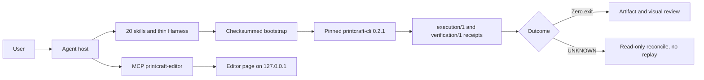

# PdfCraft Use

## Plugin marketplaces

This plugin belongs to **AIGC content creation**.

| Category | Marketplace | Purpose |
| --- | --- | --- |
| Full-stack development | [Full Stack Plugins](https://github.com/partme-ai/full-stack-plugins) | Architecture and UI design, code understanding, quality checks, code review, workflow governance, and server operations |
| AIGC content creation | [Full AIGC Plugins](https://github.com/partme-ai/full-aigc-plugins) | Image, video, audio, music, 3D, and multimodal content creation |


> Inspect, edit, OCR, and deliver PDFs from a coding agent, with a pinned native CLI, session-bound plans, and review gates that keep uncertain results uncertain.

[](#positioning)
[](#skills)
[](#mcp-tools)
[](LICENSE)

[English](README.md) | [简体中文](README.zh-CN.md) · [Install](#installation) · [Quick start](#quick-start) · [Skills](#skills) · [MCP tools](#mcp-tools) · [Limits](#troubleshooting)

## Positioning

`printcraft` gives an agent a controlled way to work on PDF files: inspect before editing, operate on pages, fill forms, redact, build bookmarks and internal links, OCR scans, check print readiness, and finish in an embedded editor. It does not reimplement a PDF engine. It pins and verifies `printcraft-cli` 0.2.1, wraps it in 20 skills plus one thin local Harness, and treats process exit zero as `REVIEW_REQUIRED`, never as delivery.

The plugin is a controlled development prerelease. Host loading, model selection, native execution, and creative review are recorded as separate gates; passing one does not prove the others.

| Property | Value |
| --- | --- |
| Plugin ID | `printcraft` |
| Display name | PdfCraft Use |
| Version | `0.1.0-dev.20261018.2` |
| Stage | Development prerelease, production promotion blocked |
| Native runtime | `printcraft-cli` 0.2.1, digest-pinned |
| License | Apache-2.0 |

## Installation

### Prerequisites

- Codex is the only host with recorded installation and model evidence. Claude Code, Gemini, OpenCode, and Kimi are `NOT_RUN`.
- Python 3.11 or newer for the skills, the local Harness, and receipts.
- Node.js 24 or newer for the embedded editor; no Rust build and no `npm install` are required at runtime.
- The verified installer lock is **macOS arm64 only**. Upstream native runs exist for Linux x64/arm64, Windows x64, macOS Intel, and macOS arm64, but those results exercise the CLI directly, not this plugin's installer.
- Chinese OCR needs an explicit Tesseract backend. The recorded combination is Tesseract 5.5.3 with `tessdata_fast` 4.1.0 on macOS arm64; the pinned native engine itself is English-only.
- The first editor open tries to download a pinned enhanced build. Without network it falls back to the bundled assets; `CRAFT_EDITOR_UPDATE=off` skips the attempt.

### From the plugin marketplace

```bash
codex plugin marketplace add partme-ai/full-aigc-plugins
codex plugin add printcraft@full-aigc-plugins
```

The repository also ships its own marketplace metadata (`full-aigc-plugins-printcraft`) pinned to `v0.1.0-dev.20261018.2`. Restart the host, open a new task, and start with a read-only request such as “Inspect this PDF and tell me whether it needs OCR.”

## Quick start

1. Ask for inspection before any edit. The agent registers the input, runs read-only `info`/`text`, and reports page count, metadata, and whether empty text means “needs OCR” rather than “blank page”.
2. Ask for one bounded edit that writes a new file, for example: “Rotate page 2, reorder the pages to 3, 1, 2, save as a new PDF, reopen it, and verify the page order and geometry.”
3. Check the receipt before trusting the output. A zero exit reaches `REVIEW_REQUIRED`; the agent must inspect the explicit output list, sizes and digests, reopen in a new process, and complete a visual review bound to the current digest.
4. If a result is `UNKNOWN`, reconcile read-only. Do not replay the plan under a new directory or run ID.

```text
Read-only: Inspect report.pdf — pages, metadata, text, and scan or OCR status.
Edit: Rotate page 2, reorder to 3,1,2, and save as a new file.
Batch: Fill these form fields, export, then reopen and list the field values.
Delivery: Check page boxes, fonts, images, and print readiness before I send it out.
```

Direct local entry, using the plugin root the host actually loaded:

```bash
python3 -I -B "$PLUGIN_ROOT/skills/printcraft-harness/scripts/harness.py" route pages
python3 -I -B "$PLUGIN_ROOT/skills/printcraft-harness/scripts/harness.py" show "$TASK_DIR/receipt.json"
```

## What you can build

| Workflow | Built-in path | Verifiable output |
|:---|:---|:---|
| Inspect before editing | `printcraft-cli-inspect` with native `info`/`text` | Page count, metadata, scan-versus-blank classification |
| Page surgery | `printcraft-cli-pages`: extract, merge, split, reorder, rotate, crop | New file plus page order, boxes, and truncation checks |
| Multi-step automation | `printcraft-cli-automation`: one process, one session, explicit outputs | `STARTED` receipt, timeout log, `UNKNOWN` that forbids replay |
| Forms and redaction | `printcraft-fill-pdf-forms` and `printcraft-redact-pdf` with `redact_mark`/`redact_apply` | Field values, exported data, removed content plus redaction audit |
| OCR scanned pages | `printcraft-ocr-scans` with the explicit Tesseract backend | Rasterized searchable copy, TXT lines, backend identity |
| Structure and pagination | `printcraft-report-bookmarks`, `section-pagination`, `linked-agenda`, `invoice-split` | Outline, visible labels, bidirectional hotspots, no dropped pages |
| Revision and delivery review | `printcraft-revision-compare`, `review-watermark`, `pdf-preflight`, `compress-pdf` | Text diff report, targeted watermark, preflight findings, sized output |
| Visual editing | `printcraft-editor` with `open_editor` / `open_browser_editor` | Same-session UI plus a saved workspace artifact |

## Skills

### Routing and native contracts

| Skill | What it does |
|---|---|
| `printcraft-use` | Default entry: verify input, inspect read-only, route, register originals and outputs |
| `printcraft-cli` | Pinned CLI contract: list and describe real schemas before specialized operations |
| `printcraft-cli-setup` | First install, missing runtime, version or digest mismatch, offline archive, platform diagnosis |
| `printcraft-cli-inspect` | Metadata, page count, text, scan detection, previews, Chinese scan OCR routing |
| `printcraft-cli-pages` | Extract, merge, split, reorder, rotate, crop, and page-box adjustment |
| `printcraft-cli-automation` | Session document IDs, task receipts, timeouts, read-only reconciliation after interruption |

### Document delivery scenarios

| Skill | What it does |
|---|---|
| `printcraft-organize-pdf` | Merge, split, sort, and rotate pages while keeping the original |
| `printcraft-ocr-scans` | Recognize scanned PDFs and produce a searchable output |
| `printcraft-redact-pdf` | Permanently remove sensitive content rather than covering it |
| `printcraft-compress-pdf` | Reduce size while balancing image compression and reading quality |
| `printcraft-fill-pdf-forms` | Fill form fields and check boxes against the actual field inventory |
| `printcraft-pdf-preflight` | Check page boxes, fonts, images, and print readiness before delivery |

### Structured document tasks, orchestration, and editor

| Skill | What it does |
|---|---|
| `printcraft-report-bookmarks` | Build hierarchical bookmarks from confirmed chapter and appendix pages |
| `printcraft-review-watermark` | Watermark only the selected review pages and verify the rest are unchanged |
| `printcraft-invoice-split` | Split an invoice pack at confirmed start pages without dropping or mixing pages |
| `printcraft-section-pagination` | Give the preface its own labeling while the body starts at reading page 1 |
| `printcraft-linked-agenda` | Add bidirectional internal links between an agenda and its appendices |
| `printcraft-revision-compare` | Produce a text-difference report from two PDFs while keeping both originals |
| `printcraft-harness` | Thin plugin orchestration over the six pinned upstream skills and versioned protocols |
| `printcraft-editor` | Open the real editor in an MCP Apps host or a host browser and share one workspace session |

## MCP tools

`.codex-plugin/mcp.json` starts one stdio server, `printcraft-editor`, from `ui/bootstrap.mjs`. The adapter adds three stable tools and passes through the pinned editor's own tool catalog.

| Tool | Purpose |
|---|---|
| `open_editor` | Open the editor for an absolute `workspace`; the first call binds the workspace |
| `open_browser_editor` | Return an `editorUrl` for the same session when the host has a built-in browser |
| `editor_status` | Report whether the editor actually attached and whether it is ready |

The upstream catalog is recorded in `ui/catalog.lock.json` and covers document, page, bookmark, form, redaction, OCR, accessibility, print, and export operations. Query the live tool list instead of assuming a name from another build; a text-only tool result does not prove the panel rendered.

## Configuration

| Setting | Meaning |
|---|---|
| `${PLUGIN_ROOT}` | Expanded by the host; used by the portable `plugin.json` and `mcp.json` |
| `CRAFT_EDITOR_UPDATE=off` | Use the bundled editor only; skip the download-and-verify update |
| `CRAFT_EDITOR_CACHE_DIR` | Alternate absolute cache directory; default is `~/.cache/full-aigc/editors` |
| `--runtime-home` | Skill scripts keep the pinned runtime outside the plugin package; `--input` and `--expect` register files to protect and outputs to inspect |

## Architecture and security



- The plugin does not implement PDF execution. It delegates to pinned native entry points, keeps execution and verification protocols separate, and verifies the release tag, archive, and binary digests before runtime creation.
- stdio carries MCP only. The editor page uses a loopback HTTP server with a random token and Host/Origin checks; workspace escapes are rejected.
- Secret-looking fields (`password`, `token`, `api_key`, `credential`, and similar) are redacted from public receipts; private execution material is `0600` and cleaned up after normal or catchable failure.
- The wrapper does not upload PDFs. Local PDF operations can still reach the network or system capabilities through the native program, and host model logs may contain file content or paths.
- Task directories, produced PDFs, and `.printcraft-runs` identity records stay outside the package cache, so updates do not delete them.

## Troubleshooting

| Symptom | Cause | What to do |
|---|---|---|
| Installer rejects the platform | The installer lock is macOS arm64 only | Run the native CLI directly on other platforms, or wait for a lock; do not treat five-platform CLI evidence as installer support |
| Chinese scan returns no text | Pinned 0.2.1 OCR is English-only and rejects Chinese | Use the explicit Tesseract path, then expect `REVIEW_REQUIRED` |
| OCR text is correct but PDF search fails | Known PDF reading-order defect; long-phrase search is unreliable | Verify the page visually, use short search terms, and do not equate TXT output with PDF searchability |
| Form text looks wrong in Chinese | Chinese form font appearance has not passed acceptance | Use English content or an external workflow; this is a known gap |
| The embedded panel never appears | The host does not render MCP Apps | Use the `open_browser_editor` URL; a text result alone is not proof of a rendered panel |
| A write times out | The outcome is unknown | Run read-only reconciliation; never replay automatically |
| Git install fails on Windows | Long paths | Run `git config --global core.longpaths true`, or use the release ZIP |
| Mobile or tablet delivery | Not run; the Android device was not authorized | Treat mobile delivery as open |

## Upgrade

```bash
codex plugin marketplace upgrade full-aigc-plugins
codex plugin add printcraft@full-aigc-plugins
```

Updates remove the old package cache. Keep task data outside the cache; the update checker rejects task data inside it and does not migrate old or incompatible receipts.

## Contributing and support

Open issues at <https://github.com/full-aigc-plugins/printcraft-plugin/issues>. A change proposal must state which skill, protocol, or receipt field it affects, whether it alters execution or verification semantics, and which validation commands were actually run. Static validation does not replace host acceptance.

## License

Apache-2.0. The six upstream skill sources come from `full-aigc-skills/printcraft-skills`; the native `printcraft-cli` is fetched from its official release and keeps its own license. See [LICENSE](LICENSE), [THIRD_PARTY_NOTICES.md](THIRD_PARTY_NOTICES.md), and [assets/official-icon-source.json](assets/official-icon-source.json).
