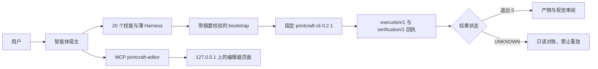

# PdfCraft Use

## 插件市场导航

本插件所属分类：**AIGC 内容创作**。

| 分类 | 插件市场入口 | 用途 |
| --- | --- | --- |
| 全栈开发 | [Full Stack Plugins](https://github.com/partme-ai/full-stack-plugins) | 架构与 UI 设计、代码理解、质量检查、代码审查、流程治理与服务器运维 |
| AIGC 内容创作 | [Full AIGC Plugins](https://github.com/partme-ai/full-aigc-plugins) | 图像、视频、音频、音乐、3D 与多模态内容创作 |


> 在编码智能体里完成 PDF 检查、编辑、OCR 与交付：原生 CLI 版本固定、计划与会话绑定、结果不明时保持不明，零退出也必须过验收。

[](#项目定位)
[](#技能)
[](#mcp-工具)
[](LICENSE)

[English](README.md) | [简体中文](README.zh-CN.md) · [安装](#安装) · [快速开始](#快速开始) · [技能](#技能) · [MCP 工具](#mcp-工具) · [限制](#故障排查)

## 项目定位

`printcraft` 让智能体以可控方式处理 PDF：先只读检查再动手，做页面操作、表单填写、内容遮盖、书签与内部链接、扫描件 OCR、印前检查，最后可以落到内嵌编辑器里。它不重写 PDF 引擎，而是把 `printcraft-cli` 0.2.1 固定并逐项校验，用 20 个技能加一个薄 Harness 包起来，并把进程退出 0 只当作 `REVIEW_REQUIRED`，绝不当成交付完成。本插件是受控开发预发布：宿主加载、模型选用、原生执行与创作审阅是四道分开的门禁，通过其中一道不能证明另外三道。

| 属性 | 值 |
| --- | --- |
| 插件 ID | `printcraft` |
| 展示名 | PdfCraft Use |
| 版本 | `0.1.0-dev.20261018.2` |
| 阶段 | 开发预发布，生产发布仍被阻断 |
| 原生运行时 | `printcraft-cli` 0.2.1，摘要固定 |
| 许可证 | Apache-2.0 |

## 安装

### 前置条件

- 只有 Codex 具备真实安装与模型证据。Claude Code、Gemini、OpenCode、Kimi 均为 `NOT_RUN`。
- 技能、本地 Harness 与回执需要 Python 3.11 或更新版本。
- 内嵌编辑器需要 Node.js 24 或更新版本；运行时不要求 Rust 构建，也不需要 `npm install`。
- 已验证的安装锁**仅支持 macOS arm64**。上游原生 CLI 也已在 Linux x64/arm64、Windows x64、macOS Intel 与 macOS arm64 上跑过，但那是直接执行 CLI，不是本插件安装器。
- 中文 OCR 需要显式挂接 Tesseract。已记录组合为 macOS arm64 + Tesseract 5.5.3 + `tessdata_fast` 4.1.0；固定原生引擎本身只支持英文。
- 首次打开编辑器会尝试下载固定的增强构建；没有网络时回退内置资源，`CRAFT_EDITOR_UPDATE=off` 可跳过这次尝试。

### 从插件市场安装

```bash
codex plugin marketplace add partme-ai/full-aigc-plugins
codex plugin add printcraft@full-aigc-plugins
```

仓库本身也带有市场元数据（`full-aigc-plugins-printcraft`），固定到 `v0.1.0-dev.20261018.2`。安装后重启宿主、新建任务，先用只读请求开场，例如“检查这份 PDF，并告诉我是否需要 OCR”。

## 快速开始

1. 先检查再编辑。智能体登记输入后运行只读 `info`/`text`，报告页数、元数据，并说明空文本表示“待 OCR”还是“页面为空”。
2. 只做一次边界明确的编辑，并写到新文件，例如：“旋转第 2 页，把页序调整为 3、1、2，另存为新 PDF，再重新打开核对页序和页框。”
3. 看回执再决定是否相信产物。零退出只到 `REVIEW_REQUIRED`：必须核对显式清单、大小与摘要、在新进程重开，并完成与当前摘要绑定的视觉审阅。
4. 遇到 `UNKNOWN` 时只做只读对账；不要换目录或 run ID 重放计划。

```text
只读：检查 report.pdf 的页数、元数据、文本，以及是否扫描件或需要 OCR。
编辑：旋转第 2 页，页序改成 3、1、2，另存为新文件。
批处理：填写这些表单字段，导出后重新打开并列出字段值。
交付：检查页框、字体、图像与打印就绪状态，再发出去。
```

使用宿主实际加载的插件根目录直接运行：

```bash
python3 -I -B "$PLUGIN_ROOT/skills/printcraft-harness/scripts/harness.py" route pages
python3 -I -B "$PLUGIN_ROOT/skills/printcraft-harness/scripts/harness.py" show "$TASK_DIR/receipt.json"
```

## 可完成的工作

| 工作流 | 内置路径 | 可验证输出 |
|:---|:---|:---|
| 编辑前检查 | `printcraft-cli-inspect` 配合原生 `info`/`text` | 页数、元数据、扫描件与空白页分类 |
| 页面操作 | `printcraft-cli-pages`：提取、合并、拆分、重排、旋转、裁剪 | 新文件，以及页序、页框、截断核对结果 |
| 多步自动化 | `printcraft-cli-automation`：单进程、单会话、显式产物 | `STARTED` 回执、超时日志、禁止重放的 `UNKNOWN` |
| 表单与遮盖 | `printcraft-fill-pdf-forms`，以及 `printcraft-redact-pdf` 配合 `redact_mark`/`redact_apply` | 字段值、导出数据、被移除的内容与遮盖审计结果 |
| 扫描件 OCR | `printcraft-ocr-scans` 配合显式 Tesseract 后端 | 栅格化可搜索副本、TXT 行、后端身份 |
| 结构与编号 | `printcraft-report-bookmarks`、`section-pagination`、`linked-agenda`、`invoice-split` | 大纲、可见编号、双向热点、无丢页 |
| 版本与交付审阅 | `printcraft-revision-compare`、`review-watermark`、`pdf-preflight`、`compress-pdf` | 文字差异报告、定向水印、印前问题、优化后的体积 |
| 可视化编辑 | `printcraft-editor` 配合 `open_editor` / `open_browser_editor` | 同会话界面，以及已保存到工作区的产物 |

## 技能

### 路由与原生契约

| 技能 | 作用 |
|---|---|
| `printcraft-use` | 默认入口：核实输入、只读检查、按目标路由、登记原件与产物 |
| `printcraft-cli` | 固定 CLI 契约：专项操作前先 list/describe 真实 Schema |
| `printcraft-cli-setup` | 首次安装、运行时缺失、版本或摘要不匹配、离线归档、平台诊断 |
| `printcraft-cli-inspect` | 元数据、页数、文本、扫描件判断、预览、中文扫描 OCR 路由 |
| `printcraft-cli-pages` | 提取、合并、拆分、重排、旋转、裁剪与页框调整 |
| `printcraft-cli-automation` | 单会话文档 ID、任务回执、超时与中断后的只读对账 |

### PDF 交付场景

| 技能 | 作用 |
|---|---|
| `printcraft-organize-pdf` | 合并、拆分、排序与旋转页面，保留原件 |
| `printcraft-ocr-scans` | 识别扫描 PDF，产出可搜索的输出版本 |
| `printcraft-redact-pdf` | 永久移除敏感内容，而不是盖一层色块 |
| `printcraft-compress-pdf` | 降低体积，同时平衡图片压缩与阅读质量 |
| `printcraft-fill-pdf-forms` | 按真实字段清单填写表单与勾选项 |
| `printcraft-pdf-preflight` | 交付前检查页框、字体、图像与打印就绪状态 |

### 结构化文档任务、编排与编辑器

| 技能 | 作用 |
|---|---|
| `printcraft-report-bookmarks` | 按确认的章节与附录页建立层级书签 |
| `printcraft-review-watermark` | 只给选定审阅页加水印，并确认其余页面未变 |
| `printcraft-invoice-split` | 按确认的起始页拆分单据包，不丢页、不串单 |
| `printcraft-section-pagination` | 前言单独标识，正文从阅读页码 1 开始 |
| `printcraft-linked-agenda` | 在议程与附录之间建立双向内部跳转 |
| `printcraft-revision-compare` | 对照新旧 PDF 生成文字差异报告，保留两个原件 |
| `printcraft-harness` | 薄插件编排层，复用六项固定上游技能与版本化协议 |
| `printcraft-editor` | 在 MCP Apps 宿主或宿主浏览器中打开真实编辑器并共享同一工作区会话 |

## MCP 工具

`.codex-plugin/mcp.json` 只启动一个 stdio 服务器 `printcraft-editor`，入口是 `ui/bootstrap.mjs`。适配层新增三个稳定工具，并透传固定编辑器自带的工具目录。

| 工具 | 用途 |
|---|---|
| `open_editor` | 按绝对 `workspace` 打开编辑器；首次调用完成工作区绑定 |
| `open_browser_editor` | 宿主带内置浏览器时，返回同一会话的 `editorUrl` |
| `editor_status` | 报告编辑器是否真的已附着、是否就绪 |

上游工具目录记录在 `ui/catalog.lock.json`，覆盖文档、页面、书签、表单、遮盖、OCR、无障碍、打印与导出操作。请查询实时工具列表，不要拿其他构建的工具名硬套；只有文字结果不代表面板已经渲染。

## 配置

| 配置项 | 含义 |
|---|---|
| `${PLUGIN_ROOT}` | 由宿主展开，portable `plugin.json` 与 `mcp.json` 使用 |
| `CRAFT_EDITOR_UPDATE=off` | 只用内置编辑器，跳过下载校验更新 |
| `CRAFT_EDITOR_CACHE_DIR` | 改用其他绝对缓存目录；默认为 `~/.cache/full-aigc/editors` |
| `--runtime-home` | 技能脚本把固定运行时放在插件包之外；`--input` 与 `--expect` 登记受保护文件与待检查产物 |

## 架构与安全



- 插件不实现 PDF 执行。它委托固定原生入口，把执行与验收协议分开，并在创建运行时前校验发行 tag、归档与二进制摘要。
- stdio 只承载 MCP。编辑器页面使用回环 HTTP、随机令牌与 Host/Origin 校验，工作区外路径会被拒绝。
- `password`、`token`、`api_key`、`credential` 等敏感字段在公开回执中脱敏；私有执行材料权限为 `0600`，正常结束或可捕获失败后清理。
- 包装层不主动上传 PDF；但原生程序本身可能联网或调用系统能力，宿主模型的工具日志也可能包含文件内容或路径。
- 任务目录、产出的 PDF 与 `.printcraft-runs` 身份记录保存在包缓存之外，更新不会删除。

## 故障排查

| 现象 | 原因 | 处理 |
|---|---|---|
| 安装器拒绝当前平台 | 安装锁仅 macOS arm64 | 其他平台直接运行原生 CLI，或等待锁更新；不要把五平台 CLI 证据当成安装器支持 |
| 中文扫描件识别不出文字 | 固定 0.2.1 只支持英文，会拒绝中文 | 走显式 Tesseract 路径，并接受 `REVIEW_REQUIRED` |
| OCR 文本正确但 PDF 搜索不到 | 已知 PDF 字序缺陷，长句搜索不可靠 | 逐页目视核对，改用短词搜索；不要把 TXT 正确等同于 PDF 可搜索 |
| 中文表单外观不正确 | 中文表单字体外观未通过验收 | 改用英文内容或外部流程；这是已知缺口 |
| 内嵌面板始终不出现 | 宿主不支持渲染 MCP Apps | 用 `open_browser_editor` 返回的地址；只有文字结果不算面板已打开 |
| 写操作超时 | 结果未知 | 先做只读对账，绝不自动重放 |
| Windows 通过 Git 安装失败 | 路径过长 | 执行 `git config --global core.longpaths true`，或改用发行 ZIP |
| 手机或平板交付 | 未实测，Android 设备未授权 | 移动交付按未完成处理 |

## 升级

```bash
codex plugin marketplace upgrade full-aigc-plugins
codex plugin add printcraft@full-aigc-plugins
```

更新会删除旧包缓存。任务数据必须放在缓存之外；更新检查器会拒绝缓存内的任务数据，也不会迁移旧版或不兼容回执。

## 贡献与支持

问题请提交到 <https://github.com/full-aigc-plugins/printcraft-plugin/issues>。变更提案需要说明影响哪个技能、协议或回执字段，是否改变执行与验收语义，以及实际运行了哪些校验命令。静态校验不能替代宿主验收。

## 许可证

Apache-2.0。六项上游技能源来自 `full-aigc-skills/printcraft-skills`；原生 `printcraft-cli` 取自其官方发行版并保留自身许可证。见 [LICENSE](LICENSE)、[THIRD_PARTY_NOTICES.md](THIRD_PARTY_NOTICES.md) 与 [assets/official-icon-source.json](assets/official-icon-source.json)。
