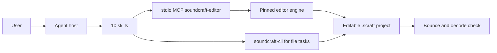

# SoundCraft Use

## Plugin marketplaces

This plugin belongs to **AIGC content creation**.

| Category | Marketplace | Purpose |
| --- | --- | --- |
| Full-stack development | [Full Stack Plugins](https://github.com/partme-ai/full-stack-plugins) | Architecture and UI design, code understanding, quality checks, code review, workflow governance, and server operations |
| AIGC content creation | [Full AIGC Plugins](https://github.com/partme-ai/full-aigc-plugins) | Image, video, audio, music, 3D, and multimodal content creation |


> Edit speech, music, and sound effects in one shared editor session, with explicit tracks, sample ranges, and checks that survive save and reopen.

[](#positioning)
[](#skills)
[](#mcp-tools)
[](LICENSE)

[English](README.md) | [简体中文](README.zh-CN.md) · [Install](#installation) · [Quick start](#quick-start) · [Skills](#skills) · [MCP tools](#mcp-tools) · [Limits](#troubleshooting)

## Positioning

`soundcraft` lets an agent work on audio the way an editor does: inspect the session, select real tracks and clips, cut, fade, level, mix, export, then reopen the project and check what actually changed. It wraps the native SoundCraft engine and CLI in ten skills and one embedded editor, and keeps native execution, host rendering, and listening acceptance as separate claims.

This is an installable development candidate. Production promotion is blocked, the package is recorded as local-unreleased, and the recorded technical regressions use synthetic signals rather than a full creative acceptance.

| Property | Value |
| --- | --- |
| Plugin ID | `soundcraft` |
| Display name | SoundCraft Use |
| Version | `0.1.0-dev.20261018.5` |
| Stage | Installable development candidate, production promotion blocked |
| Native engine | SoundCraft 0.7.0 via `soundcraft-cli` |
| Marketplace | `soundcraft-marketplace` |
| License | Apache-2.0 |

## Installation

### Prerequisites

- Codex is the host with recorded same-session evidence. Other hosts are not accepted.
- Node.js 24 or newer is required by the embedded editor. The distributed package already contains the editor build; no Rust toolchain and no `npm install` are needed at runtime.
- Native file workflows use `soundcraft-cli`, which is not installed by this plugin. Query the actual version and command schema before running a recipe.
- The first Git-based launch needs network access or an existing verified editor cache. Complete release ZIPs can start offline from bundled assets.
- Source builds additionally need the project JavaScript dependencies, the Rust `wasm32` target, and a `wasm-bindgen` CLI matching `Cargo.lock`.

### From the plugin marketplace

```bash
codex plugin marketplace add partme-ai/full-aigc-plugins
codex plugin add soundcraft@full-aigc-plugins
```

The repository also ships its own marketplace metadata (`soundcraft-marketplace`) pinned to `v0.1.0-dev.20261018.5`. Restart the host, open a new task, and ask for a read-only session inspection first.

## Quick start

1. Open the editor with an absolute workspace path: “Open SoundCraft for this folder and show me the current session.”
2. Wait for `editor_status` to report `attached: true` before editing. A successful tool response does not mean the page has rendered.
3. Work from real object IDs. Ask for one bounded operation, such as “on the Voice track, split at 2 seconds and add a 50 ms complementary linear crossfade”.
4. Save the project, reopen it in a new process, and re-inspect. Then bounce the mix and check the decoded audio rather than the dialog text.

```text
Inspect: List tracks, clips, sample rate, and any selection I should not reuse.
Edit: Cut the Voice clip at 2 s and crossfade 50 ms on both sides.
Level: Match two speakers to the same perceived level without clipping.
Deliver: Bounce a 48 kHz 24-bit WAV and confirm its length and format.
```

Direct CLI form for file tasks, using one argv argument per method:

```bash
soundcraft-cli info input.wav
soundcraft-cli run --in session.scraft --cmd 'session.inspect={"detail":"full"}' --save out.scraft
```

## What you can build

| Workflow | Built-in path | Verifiable output |
|:---|:---|:---|
| Clean up a podcast episode | `soundcraft-podcast-cleanup` | Edited speech, pauses, and loudness with a reopened project |
| Mix voice over music | `soundcraft-voice-over-mix` | Dialogue clarity and music bed checked as separate tracks |
| Level multiple speakers | `soundcraft-dialogue-leveling` | Per-speaker gain decisions and a clip-level recheck |
| Cut and join audio | `soundcraft-audio-edit` | Trim, join, and fades verified against source offsets |
| Shape a music demo | `soundcraft-music-demo` | Track balance, pan, and basic effects on editable clips |
| Deliver a format | `soundcraft-audio-delivery` | Sample rate, bit depth, naming, and decoded output |
| Preserve sync while gating silence | `soundcraft-voice-silence-gaps` | Visible gaps with later speech still on the original timeline |
| Repeat a short sound exactly | `soundcraft-finite-audio-loop` | Exact total count, sample length, and seam check |
| Work from a playbook | `soundcraft-scenario-playbooks` | Eight recipes with real methods, parameters, and checks |

## Skills

### Session and playbooks

| Skill | What it does |
|---|---|
| `soundcraft-editor` | Open the real editor in an MCP Apps host or host browser and share one workspace session |
| `soundcraft-scenario-playbooks` | Eight recipes for voice level, cut fades, interview quotes, stem delivery, reversed effects, DC offset, and polarity |

### Speech production

| Skill | What it does |
|---|---|
| `soundcraft-podcast-cleanup` | Edit spoken content, pauses, and loudness for a podcast episode |
| `soundcraft-voice-over-mix` | Balance narration against a music bed without losing intelligibility |
| `soundcraft-dialogue-leveling` | Unify level and tonal continuity across several speakers |

### Editing and delivery

| Skill | What it does |
|---|---|
| `soundcraft-audio-edit` | Trim, join, and fade clips while checking source offsets |
| `soundcraft-music-demo` | Balance multiple tracks, set pan, and apply basic effects |
| `soundcraft-audio-delivery` | Choose sample rate and bit depth, name files, and verify the export |

### Timeline utilities

| Skill | What it does |
|---|---|
| `soundcraft-voice-silence-gaps` | Turn long low-level regions into visible gaps without shifting later dialogue |
| `soundcraft-finite-audio-loop` | Repeat a short checked sound an exact number of times and expand it later |

## MCP tools

`.codex-plugin/mcp.json` starts one stdio server, `soundcraft-editor`, from `ui/bootstrap.mjs`. The adapter adds three stable tools and passes through the pinned engine's command catalog.

| Tool | Purpose |
|---|---|
| `open_editor` | Open the editor for an absolute `workspace`; the first call binds the workspace |
| `open_browser_editor` | Return an `editorUrl` for the same session when the host has a built-in browser |
| `editor_status` | Report whether the editor actually attached and is ready to accept edits |

Inside the session, the engine catalog in `ui/catalog.lock.json` provides `list_commands`, the `execute` wrapper, batch execution, session open/save, audio import, mix bounce, and UI automation tools. Query the live schema before calling; the skill recipes show the wrapper as `execute {"command":"…","params":{…}}`.

## Configuration

| Setting | Meaning |
|---|---|
| `${PLUGIN_ROOT}` | Expanded by the portable `plugin.json` and `mcp.json` |
| `${CLAUDE_PLUGIN_ROOT}` | Expanded by the Claude Code manifest and root `.mcp.json` |
| `CRAFT_EDITOR_UPDATE=off` | Use the bundled editor only and skip the update query |
| `CRAFT_EDITOR_CACHE_DIR` | Alternate absolute cache directory; default is `~/.cache/full-aigc/editors` |
| `CRAFT_WORKSPACE_ROOT` | Workspace root when the adapter is started directly |
| `CRAFT_PANEL_METADATA_FILE` | Host panel metadata used by the ZCode and Claude Code entries |

## Architecture and security



- The plugin does not implement an audio engine. It packages guidance and a verified editor build, then delegates execution to the pinned engine or the external CLI.
- MCP runs over stdio. The editor page uses a loopback HTTP server with a random token and Host/Origin checks; paths outside the workspace are rejected.
- Manual browser exports land in `craft-exports/` under the workspace with new file names. Closing the MCP process ends the session, so save before you exit.
- A CLI run against a file is not the same session as an open editor. Do not claim on-screen synchronization from a separate file process.
- The update path verifies metadata, downloads a pinned WASM/JS archive, and falls back to bundled assets on failure, missing digest, bad ZIP, or schema change.

## Troubleshooting

| Symptom | Cause | What to do |
|---|---|---|
| You need separate mic tracks from one stereo file | 0.7.0 export does not isolate left and right content | This batch ships no track-splitting skill; do not treat track metadata as proof of separated audio |
| A mix sounds fine in the tool but wrong on playback | No real-material listening or loudness acceptance is recorded | Listen end to end and measure loudness yourself; `session.audio_health` only checks references |
| The embedded panel never appears | The host does not render MCP Apps | Use the `open_browser_editor` URL; a text result is not a rendered panel |
| Edits vanished after closing the tool | The session ended with the MCP process | Save the project before closing and reopen it to verify |
| The CLI and the open editor disagree | They are different states | Pick one path, save, and explicitly reopen in the other |
| First launch fails offline | A Git install needs the verified archive | Start online once, or install a complete release ZIP with bundled assets |
| Another host cannot load the plugin | Only Codex has recorded acceptance | Treat other hosts as unverified and report the exact host and version |

## Upgrade

```bash
codex plugin marketplace upgrade full-aigc-plugins
codex plugin add soundcraft@full-aigc-plugins
```

The editor update is independent of the plugin version. `editor_status` reports the runtime `source` (`download`, `cache`, or `bundled`) and the version actually in use.

## Contributing and support

Open issues at <https://github.com/full-aigc-plugins/soundcraft-plugin/issues>. Include the engine and plugin version, the session mode (embedded editor or CLI), the method ID, the actual parameters, and the reopened-result evidence. Synthetic-signal regressions do not replace real-material listening.

## License

Apache-2.0. The plugin bundles guidance and an editor build; the native engine and CLI remain external. Icon provenance and the MIT notice are recorded in `assets/official-icon-source.json` and the adjacent license file. See [LICENSE](LICENSE).
