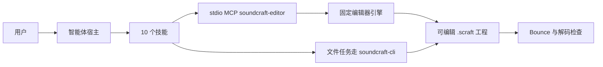

# SoundCraft Use

## 插件市场导航

本插件所属分类：**AIGC 内容创作**。

| 分类 | 插件市场入口 | 用途 |
| --- | --- | --- |
| 全栈开发 | [Full Stack Plugins](https://github.com/partme-ai/full-stack-plugins) | 架构与 UI 设计、代码理解、质量检查、代码审查、流程治理与服务器运维 |
| AIGC 内容创作 | [Full AIGC Plugins](https://github.com/partme-ai/full-aigc-plugins) | 图像、视频、音频、音乐、3D 与多模态内容创作 |


> 在同一个编辑会话里处理人声、音乐与音效：轨道和采样范围写清楚，保存重开之后仍然能核对改了什么。

[](#项目定位)
[](#技能)
[](#mcp-工具)
[](LICENSE)

[English](README.md) | [简体中文](README.zh-CN.md) · [安装](#安装) · [快速开始](#快速开始) · [技能](#技能) · [MCP 工具](#mcp-工具) · [限制](#故障排查)

## 项目定位

`soundcraft` 让智能体按剪辑师的路径处理音频：先看会话，选中真实轨道与片段，再剪切、淡化、调平、混音、导出，最后重开工程核对实际变化。它用十个技能和一个内嵌编辑器包住原生 SoundCraft 引擎与 CLI，并把原生执行、宿主画面、真实试听分成三种互不替代的结论。

这是可安装的开发候选：生产发布仍被阻断，包状态登记为本地未发布，已有技术回归使用合成信号，不等于完整的创作验收。

| 属性 | 值 |
| --- | --- |
| 插件 ID | `soundcraft` |
| 展示名 | SoundCraft Use |
| 版本 | `0.1.0-dev.20261018.5` |
| 阶段 | 可安装的开发候选版本，生产发布仍被阻断 |
| 原生引擎 | SoundCraft 0.7.0，通过 `soundcraft-cli` 调用 |
| 市场名 | `soundcraft-marketplace` |
| 许可证 | Apache-2.0 |

## 安装

### 前置条件

- 只有 Codex 具备已记录的同会话证据，其他宿主尚未验收。
- 内嵌编辑器需要 Node.js 24 或更新版本。分发包已包含编辑器构建，运行时不要求 Rust 工具链，也不需要 `npm install`。
- 原生文件任务使用 `soundcraft-cli`，本插件不负责安装它。执行配方前先查询实际版本与命令 Schema。
- 首次通过 Git 启动需要网络，或已有校验通过的编辑器缓存；完整发行 ZIP 可用内置资源离线启动。
- 源码构建额外需要项目 JavaScript 依赖、Rust `wasm32` target，以及与 `Cargo.lock` 匹配的 `wasm-bindgen` CLI。

### 从插件市场安装

```bash
codex plugin marketplace add partme-ai/full-aigc-plugins
codex plugin add soundcraft@full-aigc-plugins
```

仓库本身也带市场元数据（`soundcraft-marketplace`），固定到 `v0.1.0-dev.20261018.5`。安装后重启宿主、新建任务，先做只读会话检查。

## 快速开始

1. 用绝对工作区路径打开编辑器：“为这个目录打开 SoundCraft，并把当前会话展示出来。”
2. 等 `editor_status` 返回 `attached: true` 再动手。工具调用成功不代表页面已经渲染。
3. 基于真实对象 ID 操作，一次只做一件边界清楚的事，例如“在 Voice 轨道 2 秒处切开，两侧各做 50 ms 互补线性交叉淡化”。
4. 保存工程，在新进程里重开并重新检查；随后 bounce 混音，解码检查音频本身，而不是只看对话文字。

```text
检查：列出轨道、片段、采样率，以及哪些选区不能复用。
编辑：在 2 秒处切开 Voice 片段，两侧各做 50 ms 交叉淡化。
调平：让两位说话人听感一致，同时不削波。
交付：导出 48 kHz、24-bit WAV，并确认时长与格式。
```

文件型任务的直接 CLI 写法，一个方法对应一个 argv 参数：

```bash
soundcraft-cli info input.wav
soundcraft-cli run --in session.scraft --cmd 'session.inspect={"detail":"full"}' --save out.scraft
```

## 可完成的工作

| 工作流 | 内置路径 | 可验证输出 |
|:---|:---|:---|
| 整理播客一期 | `soundcraft-podcast-cleanup` | 口播、停顿与响度处理，以及重开后的工程 |
| 配音配乐混音 | `soundcraft-voice-over-mix` | 对白清晰度与音乐床分轨核对 |
| 多说话人调平 | `soundcraft-dialogue-leveling` | 逐说话人增益决策与片段级复检 |
| 音频剪切与拼接 | `soundcraft-audio-edit` | 裁切、拼接与淡化对照源偏移核对 |
| 音乐小样整理 | `soundcraft-music-demo` | 可编辑片段上的轨道平衡、声像与基础效果 |
| 格式交付 | `soundcraft-audio-delivery` | 采样率、位深、命名与解码后的输出 |
| 保留时轴的静音处理 | `soundcraft-voice-silence-gaps` | 可见间隙，且后续语音仍在原时间线 |
| 精确有限次重复 | `soundcraft-finite-audio-loop` | 精确总次数、采样长度与接缝核对 |
| 按手册执行 | `soundcraft-scenario-playbooks` | 八条含真实方法、参数与检查的配方 |

## 技能

### 会话与手册

| 技能 | 作用 |
|---|---|
| `soundcraft-editor` | 在 MCP Apps 宿主或宿主浏览器中打开真实编辑器，共享同一工作区会话 |
| `soundcraft-scenario-playbooks` | 八条配音电平、切口淡变、采访引用、分轨交付、倒放音效、去直流与极性诊断配方 |

### 语言类制作

| 技能 | 作用 |
|---|---|
| `soundcraft-podcast-cleanup` | 处理播客的口播剪辑、停顿与响度 |
| `soundcraft-voice-over-mix` | 在不让对白糊掉的前提下平衡配音与背景音乐 |
| `soundcraft-dialogue-leveling` | 统一多位说话人的音量与音色衔接 |

### 剪辑与交付

| 技能 | 作用 |
|---|---|
| `soundcraft-audio-edit` | 裁切、拼接与淡化，并核对源偏移 |
| `soundcraft-music-demo` | 多轨平衡、声像设置与基础效果 |
| `soundcraft-audio-delivery` | 选择采样率与位深、命名文件并验收导出 |

### 时间线工具

| 技能 | 作用 |
|---|---|
| `soundcraft-voice-silence-gaps` | 把长低电平区变成可见间隙，同时不移动后续对白 |
| `soundcraft-finite-audio-loop` | 按精确总次数重复已核查接缝的短音效，之后还能展开编辑 |

## MCP 工具

`.codex-plugin/mcp.json` 只启动一个 stdio 服务器 `soundcraft-editor`，入口是 `ui/bootstrap.mjs`。适配层新增三个稳定工具，并透传固定引擎的命令目录。

| 工具 | 用途 |
|---|---|
| `open_editor` | 按绝对 `workspace` 打开编辑器；首次调用完成工作区绑定 |
| `open_browser_editor` | 宿主带内置浏览器时，返回同一会话的 `editorUrl` |
| `editor_status` | 报告编辑器是否真的已附着、是否已就绪 |

会话内由 `ui/catalog.lock.json` 记录的命令目录提供 `list_commands`、`execute` 包装、批量执行、会话打开与保存、音频导入、混音 bounce 与界面自动化工具。调用前先查实时 Schema；技能配方中的包装写法是 `execute {"command":"…","params":{…}}`。

## 配置

| 配置项 | 含义 |
|---|---|
| `${PLUGIN_ROOT}` | 由 portable `plugin.json` 与 `mcp.json` 展开 |
| `${CLAUDE_PLUGIN_ROOT}` | 由 Claude Code 清单与根 `.mcp.json` 展开 |
| `CRAFT_EDITOR_UPDATE=off` | 只用内置编辑器，跳过更新查询 |
| `CRAFT_EDITOR_CACHE_DIR` | 改用其他绝对缓存目录；默认为 `~/.cache/full-aigc/editors` |
| `CRAFT_WORKSPACE_ROOT` | 直接启动适配层时的工作区根目录 |
| `CRAFT_PANEL_METADATA_FILE` | ZCode 与 Claude Code 入口使用的面板元数据 |

## 架构与安全



- 插件不实现音频引擎。它提供指导与校验过的编辑器构建，执行委托给固定引擎或外部 CLI。
- MCP 走 stdio。编辑器页面使用回环 HTTP、随机令牌与 Host/Origin 校验，工作区外路径会被拒绝。
- 浏览器手动导出落到工作区的 `craft-exports/`，使用新文件名。关闭 MCP 进程即结束会话，退出前先保存。
- 对文件跑 CLI 与已打开的编辑器不是同一个会话，不能把独立文件进程说成画面同步。
- 更新路径会校验元数据、下载固定 WASM/JS 归档；HTTP 失败、缺少摘要、ZIP 异常或 Schema 变化时回退内置资源。

## 故障排查

| 现象 | 原因 | 处理 |
|---|---|---|
| 想从单个立体声文件拆出两支麦克风 | 0.7.0 导出不会隔离左右内容 | 本批不提供拆轨技能；轨道元数据不能当成声道已分离的证据 |
| 工具里听着正常，播放时不对 | 没有真实素材试听与响度验收记录 | 自己整段试听并测量响度；`session.audio_health` 只检查引用 |
| 内嵌面板始终不出现 | 宿主不支持渲染 MCP Apps | 用 `open_browser_editor` 返回的地址；文字结果不等于面板已渲染 |
| 关闭工具后编辑丢失 | 会话随 MCP 进程结束 | 关闭前保存工程，重开后核对 |
| CLI 与已打开编辑器状态不一致 | 它们是两个状态 | 选定一条路径，保存后在另一侧显式重开 |
| 首次启动离线失败 | Git 安装需要校验过的归档 | 先联网启动一次，或安装带内置资源的完整发行 ZIP |
| 其他宿主加载不了 | 只有 Codex 有验收记录 | 按未验证处理，并记录具体宿主与版本 |

## 升级

```bash
codex plugin marketplace upgrade full-aigc-plugins
codex plugin add soundcraft@full-aigc-plugins
```

编辑器更新与插件版本相互独立。`editor_status` 会返回运行时 `source`（`download`、`cache` 或 `bundled`）以及实际使用的版本。

## 贡献与支持

问题请提交到 <https://github.com/full-aigc-plugins/soundcraft-plugin/issues>。请附上引擎与插件版本、会话模式（内嵌编辑器或 CLI）、方法 ID、实际参数，以及重开后的核对证据。合成信号回归不能替代真实素材试听。

## 许可证

Apache-2.0。插件打包指导与编辑器构建，原生引擎与 CLI 仍属外部组件。图标来源与 MIT 声明记录在 `assets/official-icon-source.json` 及相邻许可证文件中。见 [LICENSE](LICENSE)。
