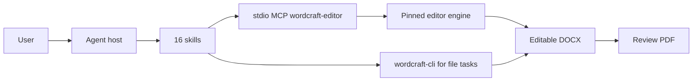

# WordCraft Use

## Plugin marketplaces

This plugin belongs to **AIGC content creation**.

| Category | Marketplace | Purpose |
| --- | --- | --- |
| Full-stack development | [Full Stack Plugins](https://github.com/partme-ai/full-stack-plugins) | Architecture and UI design, code understanding, quality checks, code review, workflow governance, and server operations |
| AIGC content creation | [Full AIGC Plugins](https://github.com/partme-ai/full-aigc-plugins) | Image, video, audio, music, 3D, and multimodal content creation |


> Draft, lay out, and deliver editable Word documents from an agent session, with real section structures, native tables, and a reopened-file check before handoff.

[](#positioning)
[](#skills)
[](#mcp-tools)
[](LICENSE)

[English](README.md) | [简体中文](README.zh-CN.md) · [Install](#installation) · [Quick start](#quick-start) · [Skills](#skills) · [MCP tools](#mcp-tools) · [Limits](#troubleshooting)

## Positioning

`wordcraft` turns source material into an editable document rather than a text dump: it collects the real facts, fills a section and field structure, lays the result out with native headings, tables, page numbers, and headers, then reopens the file and checks what the reader will actually see. It wraps the native WordCraft engine in sixteen skills and one embedded editor.

This is an installable development candidate. Production promotion is blocked, embedded host synchronization is not accepted, and short one-page samples do not prove that arbitrary long documents paginate correctly.

| Property | Value |
| --- | --- |
| Plugin ID | `wordcraft` |
| Display name | WordCraft Use |
| Version | `0.1.0-dev.20261018.5` |
| Stage | Installable development candidate, production promotion blocked |
| Native engine | WordCraft 0.7.0 via `wordcraft-cli` |
| Marketplace | `wordcraft-marketplace` |
| License | Apache-2.0 |

## Installation

### Prerequisites

- Codex is the host with recorded evidence. Other hosts are not accepted.
- Node.js 24 or newer is required by the embedded editor. The distributed package already contains the editor build; no Rust toolchain and no `npm install` are needed at runtime.
- Native file workflows use `wordcraft-cli`, which this plugin does not install. Query the installed version and command schema before running a recipe.
- The first Git-based launch needs network access or an existing verified editor cache. Complete release ZIPs can start offline from bundled assets.
- Windows Git installs need long-path support: `git config --global core.longpaths true`.

### From the plugin marketplace

```bash
codex plugin marketplace add partme-ai/full-aigc-plugins
codex plugin add wordcraft@full-aigc-plugins
```

The repository also ships its own marketplace metadata (`wordcraft-marketplace`) pinned to `v0.1.0-dev.20261018.5`. Restart the host, open a new task, and state the document type and the real source material.

## Quick start

1. Say what to produce and from what: “Write this week's report from these work notes; mark anything missing as pending confirmation.”
2. Let the agent choose the document skill and fill real fields. Templates describe sections, required fields, and native layout operations; they are not empty outlines with a new title.
3. Ask for a new editable DOCX plus a review PDF. Templates are designed for new documents, not for overwriting an existing file.
4. Reopen the DOCX, check heading levels, cell-by-cell table content, and column counts, then compare against the PDF page.

```text
Meeting minutes: turn these notes into minutes with decisions and action items.
Weekly report: summarize progress, blockers, and next week's plan.
Proposal: produce a project proposal with phases, deliverables, and owners.
Quotation: build a line-item table with quantities and decimal prices; do not infer tax.
```

Direct CLI form for file tasks, one method per argv argument; verify text afterwards with `wordcraft-cli text out.docx`:

```bash
wordcraft-cli run --cmd 'text.insert={"text":"Body text"}' --save out.docx
```

## What you can build

| Workflow | Built-in path | Verifiable output |
|:---|:---|:---|
| Meeting minutes | `wordcraft-meeting-minutes` | Decisions, owners, and action items in an editable table |
| Weekly report | `wordcraft-weekly-report` | Completed, in-progress, blocked, and next-step sections kept separate |
| Project proposal | `wordcraft-business-proposal` | Goals, phases, deliverables, and planned dates |
| Requirements document | `wordcraft-requirements-document` | Numbered requirements with observable acceptance conditions |
| Acceptance report | `wordcraft-acceptance-report` | Expected versus actual results, with failed items preserved |
| Business letter | `wordcraft-business-letter` | Recipient, subject, confirmed facts, and requested reply |
| Commercial quotation | `wordcraft-quotation` | Native line-item table, per-line amounts, and a checked total |
| Research and resume layout | `wordcraft-research-report`, `wordcraft-resume-layout` | Structured sections, figures, references, and a compact layout |
| Long-form structure | `wordcraft-toc-handbook`, `wordcraft-illustrated-guide`, `wordcraft-landscape-appendix` | Updatable table of contents, captioned figures, and portrait body with landscape appendix |
| Revision and playbooks | `wordcraft-document-comparison`, `wordcraft-document-style`, `wordcraft-scenario-playbooks` | Text and structure diff, unified styles, eight checked recipes |

## Skills

### Document templates

| Skill | What it does |
|---|---|
| `wordcraft-meeting-minutes` | Build minutes from discussion, decisions, and action items |
| `wordcraft-weekly-report` | Build a weekly report from work records, progress, and next-week plans |
| `wordcraft-business-proposal` | Build a proposal with goals, approach, plan, and delivery |
| `wordcraft-requirements-document` | Turn interviews or drafts into numbered, testable requirements |
| `wordcraft-acceptance-report` | Record acceptance criteria, measured results, and open issues |
| `wordcraft-business-letter` | Draft a business letter from recipient, subject, and confirmed facts |

### Commercial and layout

| Skill | What it does |
|---|---|
| `wordcraft-quotation` | Compile explicit line items into a native table and verify decimal totals |
| `wordcraft-research-report` | Lay out abstract, sections, figures, tables, and references |
| `wordcraft-resume-layout` | Lay out experience and outcomes in a compact resume |
| `wordcraft-document-style` | Unify headings, paragraphs, lists, and tables across a document |

### Long-form and comparison

| Skill | What it does |
|---|---|
| `wordcraft-toc-handbook` | Produce a handbook with an updatable table of contents |
| `wordcraft-illustrated-guide` | Produce a guide with images and captions |
| `wordcraft-landscape-appendix` | Combine a portrait body with a landscape matrix appendix |
| `wordcraft-document-comparison` | Compare two versions for textual and structural differences |

### Session and playbooks

| Skill | What it does |
|---|---|
| `wordcraft-editor` | Open the real editor in an MCP Apps host or host browser and share one workspace session |
| `wordcraft-scenario-playbooks` | Eight recipes for project briefs, SOPs, release notes, decision tables, letters, training decks, and two-column briefs |

## MCP tools

`.codex-plugin/mcp.json` starts one stdio server, `wordcraft-editor`, from `ui/bootstrap.mjs`. The adapter adds three stable tools and passes through the pinned engine's document tool catalog.

| Tool | Purpose |
|---|---|
| `open_editor` | Open the editor for an absolute `workspace`; the first call binds the workspace |
| `open_browser_editor` | Return an `editorUrl` for the same session when the host has a built-in browser |
| `editor_status` | Report whether the editor actually attached and is ready to accept edits |

Inside the session, the catalog in `ui/catalog.lock.json` provides `list_commands`, an execution wrapper, batch mode, document open/save, text entry and selection, inspection, and page rendering. The wrapper is exposed as `execute` in the shipped catalog and referenced as `run_command` in some recipes; read the live tool schema before calling rather than assuming either name.

## Configuration

| Setting | Meaning |
|---|---|
| `${PLUGIN_ROOT}` | Expanded by the portable `plugin.json` and `mcp.json` |
| `${CLAUDE_PLUGIN_ROOT}` | Expanded by the Claude Code manifest and root `.mcp.json` |
| `CRAFT_EDITOR_UPDATE=off` | Use the bundled editor only and skip the update query |
| `CRAFT_EDITOR_CACHE_DIR` | Alternate absolute cache directory; default is `~/.cache/full-aigc/editors` |
| `CRAFT_WORKSPACE_ROOT` | Workspace root when the adapter is started directly |
| `CRAFT_PANEL_METADATA_FILE` | Host panel metadata used by the ZCode and Claude Code entries |

## Architecture and security



- The plugin does not implement a document engine. It ships template guidance and a verified editor build, and delegates execution to the pinned engine or external CLI.
- MCP runs over stdio. The editor page uses a loopback HTTP server with a random token and Host/Origin checks; paths outside the workspace are rejected.
- Manual browser exports land in `craft-exports/` under the workspace with new file names. Closing the MCP process ends the session, so save before you exit.
- A CLI run against a file is not the same session as an open editor; do not claim on-screen synchronization from a separate file process.
- Template examples are fictional. Agent output must mark unknown facts as pending rather than inventing them, and failed acceptance items must stay visible.

## Troubleshooting

| Symptom | Cause | What to do |
|---|---|---|
| A long document breaks across pages badly | Pagination was validated on one-page A4 samples only | Inspect every page in the PDF; long-document pagination is not proven |
| The host does not show the editor panel | The host does not render MCP Apps | Use the `open_browser_editor` URL; a text result is not a rendered panel |
| Edits vanished after closing the tool | The session ended with the MCP process | Save the document before closing and reopen it |
| A template overwrote my existing file | Templates are intended for new documents | Work on a new file and target an existing document explicitly |
| A quotation total is wrong for my tax rules | The skill does not infer tax | Provide explicit tax lines or compute tax outside the skill |
| Chinese or table layout looks wrong | Only the recorded six-sample set was reviewed | Check the actual page; do not assume the sample result generalizes |

## Upgrade

```bash
codex plugin marketplace upgrade full-aigc-plugins
codex plugin add wordcraft@full-aigc-plugins
```

The editor update is independent of the plugin version. `editor_status` reports the runtime `source` (`download`, `cache`, or `bundled`) and the version actually in use.

## Contributing and support

Open issues at <https://github.com/full-aigc-plugins/wordcraft-plugin/issues>. Include the plugin and engine version, the template or skill, the real input shape, the generated DOCX and PDF, and the reopened-check evidence. A rendered sample does not prove every document length or host.

## License

Apache-2.0. Template metadata, fictional examples, and the editor build ship with the plugin; the native engine and CLI remain external. Icon provenance and the MIT notice are recorded in `assets/official-icon-source.json` and the adjacent license file. See [LICENSE](LICENSE).
