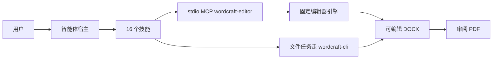

# WordCraft Use

## 插件市场导航

本插件所属分类：**AIGC 内容创作**。

| 分类 | 插件市场入口 | 用途 |
| --- | --- | --- |
| 全栈开发 | [Full Stack Plugins](https://github.com/partme-ai/full-stack-plugins) | 架构与 UI 设计、代码理解、质量检查、代码审查、流程治理与服务器运维 |
| AIGC 内容创作 | [Full AIGC Plugins](https://github.com/partme-ai/full-aigc-plugins) | 图像、视频、音频、音乐、3D 与多模态内容创作 |


> 在智能体会话里起草、排版并交付可编辑的 Word 文档：章节和字段是真实结构，表格是原生表格，交付前还要重开文件核对。

[](#项目定位)
[](#技能)
[](#mcp-工具)
[](LICENSE)

[English](README.md) | [简体中文](README.zh-CN.md) · [安装](#安装) · [快速开始](#快速开始) · [技能](#技能) · [MCP 工具](#mcp-工具) · [限制](#故障排查)

## 项目定位

`wordcraft` 把素材变成可编辑文档，而不是一段文字堆砌：先收集真实事实，再按章节与字段结构填写，用原生标题、表格、页码和页眉页脚完成排版，最后重开文件核对读者真正会看到的内容。它用十六个技能和一个内嵌编辑器包住原生 WordCraft 引擎。

这是可安装的开发候选：生产发布仍被阻断，宿主内嵌同步未验收，一页短样例也不能证明任意长文档分页正确。

| 属性 | 值 |
| --- | --- |
| 插件 ID | `wordcraft` |
| 展示名 | WordCraft Use |
| 版本 | `0.1.0-dev.20261018.5` |
| 阶段 | 可安装的开发候选版本，生产发布仍被阻断 |
| 原生引擎 | WordCraft 0.7.0，通过 `wordcraft-cli` 调用 |
| 市场名 | `wordcraft-marketplace` |
| 许可证 | Apache-2.0 |

## 安装

### 前置条件

- 只有 Codex 具备已记录的验收证据，其他宿主尚未验收。
- 内嵌编辑器需要 Node.js 24 或更新版本。分发包已包含编辑器构建，运行时不要求 Rust 工具链，也不需要 `npm install`。
- 原生文件任务使用 `wordcraft-cli`，本插件不负责安装它。执行配方前先查询已安装版本与命令 Schema。
- 首次通过 Git 启动需要网络，或已有校验通过的编辑器缓存；完整发行 ZIP 可用内置资源离线启动。
- Windows 通过 Git 安装需要开启长路径支持：`git config --global core.longpaths true`。

### 从插件市场安装

```bash
codex plugin marketplace add partme-ai/full-aigc-plugins
codex plugin add wordcraft@full-aigc-plugins
```

仓库本身也带市场元数据（`wordcraft-marketplace`），固定到 `v0.1.0-dev.20261018.5`。安装后重启宿主、新建任务，先说清要产出什么文档、素材在哪里。

## 快速开始

1. 说明产出与素材，例如：“根据这些工作记录写本周周报，缺失的信息标为待确认。”
2. 由智能体选择对应文档技能并填写真实字段。模板给出章节、必填字段与原生排版操作，不是只换标题的空提纲。
3. 要求生成新的可编辑 DOCX 与供审阅的 PDF。模板面向新建文档，不用来整篇覆盖已有文件。
4. 重开 DOCX，核对标题层级、逐单元格内容与列数，再和 PDF 页面比对。

```text
会议纪要：把这份记录整理成含决策与行动项的纪要。
工作周报：汇总本周进展、阻塞项与下周计划。
项目方案：给出阶段、交付物与负责人的项目方案。
报价单：按项目、数量和十进制单价生成明细表，不要自动推断税费。
```

文件型任务的直接 CLI 写法，一个方法对应一个 argv 参数；之后用 `wordcraft-cli text out.docx` 核对文本：

```bash
wordcraft-cli run --cmd 'text.insert={"text":"正文"}' --save out.docx
```

## 可完成的工作

| 工作流 | 内置路径 | 可验证输出 |
|:---|:---|:---|
| 会议纪要 | `wordcraft-meeting-minutes` | 决策、负责人与行动项，落在可编辑表格中 |
| 工作周报 | `wordcraft-weekly-report` | 完成、进行中、受阻与下周计划分开呈现 |
| 项目方案 | `wordcraft-business-proposal` | 目标、阶段、交付物与计划日期 |
| 需求说明 | `wordcraft-requirements-document` | 带编号与可观察验收条件的需求条目 |
| 验收报告 | `wordcraft-acceptance-report` | 预期与实际结果，失败项如实保留 |
| 业务函 | `wordcraft-business-letter` | 收件方、事由、已确认事实与所需回复 |
| 商业报价单 | `wordcraft-quotation` | 原生明细表、逐项金额与核对后的合计 |
| 研究与简历排版 | `wordcraft-research-report`、`wordcraft-resume-layout` | 结构化章节、图表、参考来源与紧凑版面 |
| 长文档结构 | `wordcraft-toc-handbook`、`wordcraft-illustrated-guide`、`wordcraft-landscape-appendix` | 可更新目录、带题注图片、纵向正文加横向附录 |
| 版本与手册 | `wordcraft-document-comparison`、`wordcraft-document-style`、`wordcraft-scenario-playbooks` | 文字与结构差异、统一样式、八条已核查配方 |

## 技能

### 文档模板

| 技能 | 作用 |
|---|---|
| `wordcraft-meeting-minutes` | 依据讨论、决策与行动项生成会议纪要 |
| `wordcraft-weekly-report` | 依据工作记录、进度与下周计划生成周报 |
| `wordcraft-business-proposal` | 生成含目标、方案、计划与交付的项目方案 |
| `wordcraft-requirements-document` | 把访谈或草稿整理成带编号、可验收的需求 |
| `wordcraft-acceptance-report` | 记录验收标准、实测结果与遗留问题 |
| `wordcraft-business-letter` | 依据收件方、事由与已确认事实撰写业务函 |

### 商务与排版

| 技能 | 作用 |
|---|---|
| `wordcraft-quotation` | 把显式明细编译为原生表格并核对十进制合计 |
| `wordcraft-research-report` | 排版摘要、章节、图表与参考来源 |
| `wordcraft-resume-layout` | 用紧凑版面呈现经历与成果 |
| `wordcraft-document-style` | 统一全文标题、段落、列表与表格样式 |

### 长文档与版本核对

| 技能 | 作用 |
|---|---|
| `wordcraft-toc-handbook` | 生成带可更新目录的操作手册 |
| `wordcraft-illustrated-guide` | 生成带图片与题注的操作指南 |
| `wordcraft-landscape-appendix` | 纵向正文配合横向矩阵附录 |
| `wordcraft-document-comparison` | 对比两版文档的文字与结构差异 |

### 会话与手册

| 技能 | 作用 |
|---|---|
| `wordcraft-editor` | 在 MCP Apps 宿主或宿主浏览器中打开真实编辑器，共享同一工作区会话 |
| `wordcraft-scenario-playbooks` | 项目说明、SOP、版本说明、决策表、业务函、培训讲义与双栏简报八条配方 |

## MCP 工具

`.codex-plugin/mcp.json` 只启动一个 stdio 服务器 `wordcraft-editor`，入口是 `ui/bootstrap.mjs`。适配层新增三个稳定工具，并透传固定引擎的文档工具目录。

| 工具 | 用途 |
|---|---|
| `open_editor` | 按绝对 `workspace` 打开编辑器；首次调用完成工作区绑定 |
| `open_browser_editor` | 宿主带内置浏览器时，返回同一会话的 `editorUrl` |
| `editor_status` | 报告编辑器是否真的已附着、是否已就绪 |

会话内由 `ui/catalog.lock.json` 记录的命令目录提供 `list_commands`、执行包装、批量模式、文档打开与保存、文本输入与选取、文档检查与页面渲染。执行包装在随包目录里叫 `execute`，部分配方写作 `run_command`；调用前先读实时 Schema，不要假定其中一个名字。

## 配置

| 配置项 | 含义 |
|---|---|
| `${PLUGIN_ROOT}` | 由 portable `plugin.json` 与 `mcp.json` 展开 |
| `${CLAUDE_PLUGIN_ROOT}` | 由 Claude Code 清单与根 `.mcp.json` 展开 |
| `CRAFT_EDITOR_UPDATE=off` | 只用内置编辑器，跳过更新查询 |
| `CRAFT_EDITOR_CACHE_DIR` | 改用其他绝对缓存目录；默认为 `~/.cache/full-aigc/editors` |
| `CRAFT_WORKSPACE_ROOT` | 直接启动适配层时的工作区根目录 |
| `CRAFT_PANEL_METADATA_FILE` | ZCode 与 Claude Code 入口使用的面板元数据 |

## 架构与安全



- 插件不实现文档引擎。它提供模板指导与校验过的编辑器构建，执行委托给固定引擎或外部 CLI。
- MCP 走 stdio。编辑器页面使用回环 HTTP、随机令牌与 Host/Origin 校验，工作区外路径会被拒绝。
- 浏览器手动导出落到工作区的 `craft-exports/`，使用新文件名。关闭 MCP 进程即结束会话，退出前先保存。
- 对文件跑 CLI 与已打开的编辑器不是同一个会话，不能把独立文件进程说成画面同步。
- 模板示例均为虚构数据。智能体必须把未知事实标为待确认，不能补造；验收失败项必须保留在报告里。

## 故障排查

| 现象 | 原因 | 处理 |
|---|---|---|
| 长文档跨页明显错乱 | 分页只在一页 A4 样例上验证过 | 逐页检查 PDF；长文档分页尚未证明 |
| 宿主不显示编辑器面板 | 宿主不支持渲染 MCP Apps | 用 `open_browser_editor` 返回的地址；文字结果不等于面板已渲染 |
| 关闭工具后编辑丢失 | 会话随 MCP 进程结束 | 关闭前保存文档，重开后核对 |
| 模板覆盖了已有文件 | 模板面向新建文档 | 在新文件上工作，修改既有文档要显式指定目标范围 |
| 报价单合计不符合我的税务规则 | 技能不推断税费 | 显式给出税行，或在技能之外计算税费 |
| 中文或表格排版不对 | 只审阅了记录的六份样例 | 检查实际页面，不要把样例结论外推到所有文档 |

## 升级

```bash
codex plugin marketplace upgrade full-aigc-plugins
codex plugin add wordcraft@full-aigc-plugins
```

编辑器更新与插件版本相互独立。`editor_status` 会返回运行时 `source`（`download`、`cache` 或 `bundled`）以及实际使用的版本。

## 贡献与支持

问题请提交到 <https://github.com/full-aigc-plugins/wordcraft-plugin/issues>。请附上插件与引擎版本、使用的模板或技能、真实输入形态、生成的 DOCX 与 PDF，以及重开后的核对证据。样例渲染不能证明所有文档长度与宿主。

## 许可证

Apache-2.0。模板元数据、虚构示例与编辑器构建随插件分发；原生引擎与 CLI 仍属外部组件。图标来源与 MIT 声明记录在 `assets/official-icon-source.json` 及相邻许可证文件中。见 [LICENSE](LICENSE)。
